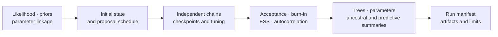

# Bayesian Inference

Bijux owns native Metropolis–Hastings inference for supported DNA, partitioned
DNA, discrete-trait, continuous-trait, topology, and clock-model contracts. It
also prepares and reviews MrBayes and BEAST analyses while preserving those
engines as external computational owners.

## Native Model Families

| Family | Representative native surface | Identity that must be retained |
| --- | --- | --- |
| fixed-topology DNA | `run_fixed_topology_dna_metropolis_hastings` | substitution model, branch lengths, priors, proposal schedule |
| partitioned DNA | `run_fixed_topology_partitioned_dna_metropolis_hastings` | partition definitions, linked and unlinked parameters, per-partition likelihoods |
| joint topology and DNA | `run_joint_topology_dna_metropolis_hastings` | topology prior, NNI/SPR/TBR proposals, branch-length policy |
| discrete trait Mk | `run_discrete_trait_mk_metropolis_hastings` | state order, ER/SYM/ARD rates, root prior, missing-state policy |
| continuous traits | Brownian and OU posterior surfaces | location, rate, attraction, optimum, and tree covariance conventions |
| clock and time tree | strict, local, relaxed, calibrated, and tree-prior surfaces | time units, calibrations, clock rates, topology prior, feasibility checks |

`run_bayesian_inference` is the high-level native entry point. A specialized
runner is preferable when its model contract, retained state, and result type
are needed directly.

## Choose The Native Surface By State Space

| Analysis design | Entry point | State whose mixing must be checked |
| --- | --- | --- |
| one DNA partition, fixed topology | `run_bayesian_inference` or `run_fixed_topology_dna_metropolis_hastings` | branches and supported substitution parameters |
| linked or unlinked DNA partitions | `run_fixed_topology_partitioned_dna_metropolis_hastings` | shared and partition-specific parameters |
| DNA with topology uncertainty | `run_bayesian_inference` or `run_joint_topology_dna_metropolis_hastings` | topology, branches, and substitution parameters |
| discrete trait under Mk | `run_discrete_trait_mk_metropolis_hastings` | rates, root state, and any reconstructed states |
| continuous Brownian or OU trait | specialized continuous-trait runner | ancestral values and family-specific evolutionary parameters |
| calibrated or clock analysis | specialized strict, local, relaxed, or time-tree runner | rates, times, calibrations, tree prior, and topology where sampled |

Do not choose a broader runner by name alone. Confirm that its result type
retains every latent state and diagnostic needed by the scientific claim.

## Posterior Identity Begins Before Sampling

A posterior is defined by more than the observed data. Its run identity
includes the likelihood implementation, partitioning, prior components,
initial state, proposal kernels and weights, random seed, chain count, tuning
policy, iteration budget, burn-in rule, thinning, checkpoint lineage, and
software version.

`build_bayesian_run_manifest` records this identity.
`write_bayesian_run_manifest` persists it. Prior-only sampling and prior
component evaluation are first-class surfaces, allowing reviewers to detect a
prior or parameterization defect before treating posterior output as data-led.

## Sampling And Recovery

| Public locator | Contract |
| --- | --- |
| `bijux_phylogenetics.bayesian:run_metropolis_hastings_sampler` | one governed native chain |
| `bijux_phylogenetics.bayesian:run_independent_metropolis_hastings_chains` | independent initializations with between-chain comparison |
| `bijux_phylogenetics.bayesian:run_adaptive_tuned_metropolis_hastings_sampler` | bounded tuning with retained tuning windows |
| `bijux_phylogenetics.bayesian:run_checkpointed_metropolis_hastings_sampler` | checkpoint creation under run identity |
| `bijux_phylogenetics.bayesian:resume_metropolis_hastings_sampler` | continuation from serialized state and random-state lineage |
| `bijux_phylogenetics.bayesian:replay_fixed_topology_dna_run_manifest` | replay of a declared supported run contract |

Resume is continuation, not an independent replicate. It must preserve model,
data, proposal, random-state, sample numbering, and checkpoint identity. A
resumed segment cannot be counted as a second chain when assessing
between-chain convergence.

## Diagnose The Chain Before The Posterior

Acceptance rate alone is insufficient. Review proposal-specific acceptance,
tuning windows, burn-in sensitivity, autocorrelation, effective sample size,
trace intervals, independent-chain behavior, topology diversity, and any
parameter fixed at or near a boundary.

The runtime exposes `diagnose_metropolis_hastings_burnin`,
`compute_trace_autocorrelation`, `compute_trace_effective_sample_size`,
`summarize_metropolis_hastings_trace_posterior_intervals`, and independent-chain
variants. Diagnostics qualify individual monitored quantities; a healthy
scalar does not establish mixing for topology or another slow parameter.

## Posterior Review Surfaces

Posterior samples support more than a point estimate:

- tree archives, thinning, maximum-clade-credibility summaries, and topology
  diversity;
- equal-tail and highest-posterior-density intervals;
- model-averaged parameter summaries;
- ancestral sequences, continuous traits, and discrete states;
- missing-state and missing-value summaries;
- posterior predictive simulation and predictive p-values;
- comparison with maximum-likelihood trees and independent Bayesian runs.

`evaluate_bayesian_posterior` evaluates the likelihood, prior components, and
combined log posterior for one declared model state; it is an evaluation
primitive, not a convergence verdict. `summarize_bayesian_posterior_decomposition`
turns those components into a reviewable decomposition, while
`write_bayesian_posterior_evaluation_artifacts` persists its machine- and
human-readable projections. `build_bayesian_evidence_package` inventories
identified inputs, configuration, trees, logs, diagnostics, and reports under
one evidence root. It does not create missing diagnostics or convert them into
a pass.

Keep four records separate:

| Record | Question answered |
| --- | --- |
| posterior evaluation | how likelihood and prior components combine for a model state |
| chain diagnostics | whether retained samples adequately explore claimed quantities |
| posterior summary | what the retained sample distribution says under the model |
| evidence package | whether the files needed to reconstruct review are identified together |

A rendered report never upgrades a failed diagnostic, and an evidence-package
inventory never substitutes for a chain assessment.

## Convergence Is Quantity-Specific

A run-wide label is insufficient when one parameter mixes well and another
does not. Build a conclusion table that maps each reported quantity to its
trace, burn-in decision, effective sample size, autocorrelation, interval,
between-chain comparison, and sensitivity result. For topology claims, add
topology visitation and split-frequency behavior; a scalar ESS cannot certify
tree-space exploration.

Refuse interpretation when a claimed quantity has no diagnostic path. Qualify
the conclusion when it changes materially under defensible burn-in, prior, or
starting-state choices. Preserve failed chains in the denominator rather than
reporting convergence only for survivors.

## Native And External Boundaries

`prepare_mrbayes_analysis` and `prepare_beast_time_tree_analysis` create
external-engine inputs. `run_mrbayes_posterior_inference` and
`run_beast_posterior_inference` execute those engines when configured.
MrBayes or BEAST owns the posterior computation, while Bijux owns preparation,
dispatch, capture, parsing, diagnostics, and artifact contracts.

Native and external runs may be compared only after model, prior, taxon,
partition, clock, burn-in, retention, and summary conventions align. Similar
field names do not prove equivalent parameterization.

## Acceptance And Refusal

A posterior is ready for scientific interpretation only when:

1. the run manifest resolves to the executed data and model;
2. every chain has an explicit terminal or interrupted state;
3. retained samples and burn-in policy are reproducible;
4. ESS, autocorrelation, acceptance, and between-chain evidence are adequate
   for each claimed quantity;
5. topology and model uncertainty are represented when the claim depends on
   them;
6. exclusions, invalid proposals, failed chains, and partial artifacts remain
   visible;
7. native or external computational ownership is explicit.

The runtime should refuse undefined likelihoods, impossible calibrations,
invalid probability vectors, incompatible taxon sets, unsupported model
linkage, and unsafe checkpoint resumes. A refused run is evidence that the
input contract was protected; it is not a posterior result.
