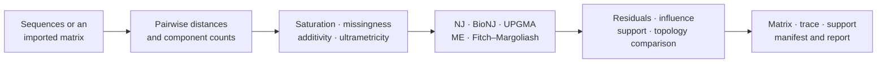
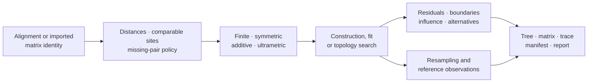

# Distance-Based Inference

Distance methods compress character observations into pairwise dissimilarities,
then infer or fit a tree under assumptions about those distances. Bijux exposes
the complete path: distance estimation, matrix diagnostics, tree construction,
fit residuals, topology comparison, resampling, and reproducibility artifacts.

## Distance Inference Is A Two-Stage Contract

A distance tree is downstream of two distinct scientific decisions. First, an
observation model compresses characters into a matrix. Second, a construction
or fitting method interprets that matrix as tree-like geometry. Keeping the
stages separate prevents a well-fitting tree from being treated as proof that
the original character information was preserved.

| Stage | Governed object | Evidence to retain | What success does not establish |
| --- | --- | --- | --- |
| encode | sequence or character observations into pairwise distances | model, deletion policy, comparable-site counts, saturation diagnostics | that all phylogenetic signal survived compression |
| construct | distance matrix into a topology | algorithm, tie policy, taxon order, construction trace | that the matrix is additive or generated by a tree |
| fit | topology and branch lengths against the matrix | objective, weights, constraints, residuals | that alternative topologies fit equally poorly |
| assess | topology under perturbation or comparison | replicate policy, correspondence rule, failed draws | that support measures recover character-level uncertainty |

Topological agreement between two distance workflows is therefore weaker than
workflow equivalence. The matrices may differ while inducing the same joins,
and the same matrix may yield different branches or ties under different
construction policies.

## Choose The Scientific Contract

| Question | Suitable family | Assumption that controls interpretation |
| --- | --- | --- |
| Which agglomerative topology follows from an approximately additive matrix? | neighbor joining or BioNJ | distances estimate path length and the taxon set is complete |
| Which rooted hierarchy is implied by clock-like distances? | UPGMA or WPGMA | ultrametricity is scientifically defensible, not merely numerically close |
| Which tree minimizes total branch length? | minimum evolution or balanced minimum evolution | candidate topology search and branch-length policy are declared |
| Which branch lengths best fit a fixed topology? | ordinary, nonnegative, or weighted least squares | residual weights and nonnegativity constraints match the claim |
| How stable is the inferred topology? | taxon influence, jackknife, or bootstrap | perturbation unit, replicate denominator, and failed draws remain visible |

Single- and complete-linkage trees are also available as explicit clustering
contracts. They are not silently presented as evolutionary tree estimators.

## Establish Matrix Identity

A distance value is inseparable from its model and observation policy. Retain:

- taxon labels and matrix order;
- alphabet, ambiguity, gap, deletion, and missing-pair policy;
- the distance model and every estimated or fixed parameter;
- comparable-site and component counts behind each pair;
- finite-value, symmetry, diagonal, saturation, and completeness diagnostics;
- the source alignment or imported-matrix identity.

`compute_pairwise_genetic_distance_matrix` and
`compute_pairwise_genetic_distance_matrix_from_records` create native matrix
records. `validate_imported_distance_matrix` and
`inspect_imported_distance_matrix_quality` protect the boundary when distances
come from another system.

## Diagnose Before Building

`diagnose_distance_saturation` identifies pairs for which observed divergence
and corrected distance no longer support an uncomplicated reading.
`diagnose_distance_additivity` evaluates four-point violations.
`diagnose_distance_ultrametricity` evaluates clock-like path equality.
`assess_distance_method_assumptions` joins those conditions to the selected
method policy.

These diagnostics answer different questions. An additive matrix need not be
ultrametric; an ultrametric matrix can still be dominated by missing pairs; a
finite corrected distance can still be saturation-sensitive. Do not collapse
them into one generic matrix-quality flag.

## Account For Compression Loss

Converting characters to pairwise distances is a lossy transformation. The
matrix can preserve estimated path dissimilarity while discarding which sites
support a split, whether incompatible patterns concentrate in one partition,
and whether the same observed distance arose from different substitution
histories. Tree construction cannot recover information omitted by that
transformation.

Classify problematic pairs before construction:

| Pair state | Meaning | Required handling |
| --- | --- | --- |
| zero | no estimated divergence under the declared observation policy | retain comparable-site counts; do not infer sequence identity automatically |
| missing | no admissible comparison under the missingness or deletion policy | refuse methods requiring a complete matrix or declare an imputation policy |
| non-finite | the estimator is undefined for the observed components | retain the estimator failure; never coerce to a large finite value |
| saturation-sensitive | multiple substitutions make corrected path length weakly identified | qualify or reject the pair under a registered threshold |
| finite but non-tree-like | the matrix violates additivity beyond the declared tolerance | retain four-point residuals and avoid treating the selected tree as an exact representation |

When the scientific claim depends on character-level support, partition
conflict, or substitution histories, retain the alignment and use a
character-based likelihood or parsimony contract alongside the distance
analysis. A good tree fit to a compressed matrix is not evidence that the
matrix retained every signal relevant to the question.

## Native Construction And Fitting

| Public locator | Owned result |
| --- | --- |
| `bijux_phylogenetics.distance:build_distance_tree` | policy-selected native distance tree |
| `bijux_phylogenetics.distance:build_bionj_tree` | BioNJ tree with variance-aware joining |
| `bijux_phylogenetics.distance:build_upgma_tree` | rooted ultrametric clustering tree |
| `bijux_phylogenetics.distance:build_tree_from_imported_distance_matrix` | tree from a validated external matrix |
| `bijux_phylogenetics.distance:fit_minimum_evolution_tree` | minimum-evolution fit record |
| `bijux_phylogenetics.distance:fit_fitch_margoliash_tree` | weighted least-squares fit record |
| `bijux_phylogenetics.distance:fit_nonnegative_least_squares_tree` | fit with nonnegative branch-length constraints |
| `bijux_phylogenetics.distance:search_balanced_minimum_evolution_nni` | NNI search trace and selected balanced-ME tree |

Method names do not make outputs interchangeable. UPGMA owns a rooted,
clock-like interpretation; neighbor joining does not. Weighted and ordinary
least squares optimize different objectives. A constrained fit that lands on
zero-length branches needs its boundary state retained.

## Trace The Distance Result Lineage

Each arrow changes the scientific object. An alignment-derived matrix must
retain pairwise observation counts; an imported matrix must retain its source
and validation; a fitted tree must retain the objective and constraints; a
supported tree must retain the replicate population. Reusing only the final
tree severs the information needed to decide whether a disagreement came from
distance estimation, assumptions, construction, search, or resampling.

## Refusal Boundaries

Do not produce an unqualified distance tree when required pairs are non-finite,
taxa are duplicated, symmetry or diagonal rules fail, the selected method's
clock/additivity precondition is violated without an explicit policy, or a fit
cannot account for its residual denominator. When policy permits a partial or
qualified result, preserve every missing pair, rejected taxon, zero-boundary
branch, failed replicate, and warning in structured output.

A fallback from one distance model or construction method to another is a new
analysis route. Record the reason and both identities; never present the
fallback as though it were the requested computation.

## Review The Fit And Search

`compute_patristic_residual_diagnostics` compares observed distances with tree
path lengths. `analyze_distance_taxon_influence_from_imported_distance_matrix`
and `analyze_distance_taxon_jackknife_from_imported_distance_matrix` expose
taxa whose inclusion controls the result. `compare_distance_tree_methods_from_imported_distance_matrix`
keeps competing methods in one aligned record, while
`compare_distance_tree_topologies` separates topology disagreement from matrix
fit.

For any selected tree, retain the objective, starting state, accepted search
moves, termination reason, branch-length constraints, residual distribution,
excluded pairs, and alternative or equal solutions. A final Newick file alone
cannot establish that the search or fit was adequate.

## Resampling And Reference Correspondence

`bootstrap_distance_trees` records replicate-level outcomes and
`summarize_distance_bootstrap_support` derives support from the governed
denominator. Failed or unusable replicates remain part of that denominator.
`compare_distance_tree_to_reference_tree` compares a bounded tree result;
`validate_distance_reference_examples` validates named reference fixtures.

APE live correspondence covers registered `dist.dna`, `nj`, tree-distance,
and related cases. That evidence applies to the selected cases and conventions,
not to every distance method or every biological dataset.

## Acceptance Record

Before using a distance tree downstream, record:

1. matrix identity and observation policy;
2. diagnostic outcomes and every exclusion;
3. construction or fitting objective and search coverage;
4. residual, influence, and support evidence appropriate to the claim;
5. structured outputs and reproducibility-bundle identity;
6. the precise limitation when assumptions are violated or untested.

`build_distance_method_report` and `write_distance_reproducibility_bundle`
assemble reviewer-facing projections. Their contents remain subordinate to the
structured matrix, diagnostics, search, and support records.
