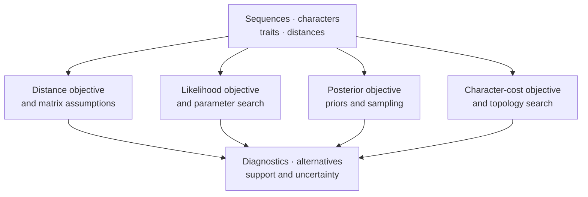
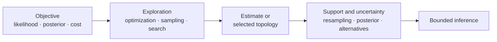

# Inference

Inference connects observed characters to parameters, ancestral assignments,
and topology. The runtime distinguishes probabilistic objectives from
parsimony cost models and preserves the search or sampling record needed to
interpret either one.

| Family | Objective | Essential review evidence |
| --- | --- | --- |
| maximum likelihood | maximize data likelihood under a named model | starts, moves, convergence, fitted parameters, support method |
| Bayesian inference | characterize a posterior under likelihood and priors | proposals, acceptance, burn-in, ESS, chains, topology distribution |
| parsimony | minimize declared character-change cost | state/cost model, search trace, equal-best trees, consensus, support |

Continue by method family:

- [Likelihood And Inference](likelihood-and-inference.md) defines finite-state
  likelihood, optimization, model comparison, and the shared probabilistic
  layers.
- [Distance-Based Inference](distance-based-inference.md) covers distance
  estimation, assumption diagnostics, tree construction, residuals,
  influence, and resampling.
- [Bayesian Inference](bayesian-inference.md) covers native models, priors,
  proposals, checkpoints, chain diagnostics, posterior summaries, and the
  external-engine boundary.
- [Parsimony](parsimony.md) covers Fitch, Wagner, Sankoff, Dollo, Camin–Sokal,
  topology search, reconstruction, and support.
- [Search, Model Selection, And Support](search-model-selection-and-support.md)
  connects eligible candidates, exploration records, comparison
  admissibility, ties, and method-specific support across inference families.

## Method Ownership Map

The families may share trees, states, and reports, but they do not share an
objective or uncertainty interpretation. Preserve the method family in every
result and artifact identity.

## Separate Objective, Exploration, And Support

These layers fail independently. A correct likelihood can be paired with an
inadequate topology search. A completed chain can target the wrong posterior.
A best parsimony score can coexist with many equal-best trees. Support is not a
generic confidence number added after selection; its producing procedure and
denominator are part of the estimand.

## Native And External Inference Paths

| Path | Computation owner | Retained method state | Assurance boundary |
| --- | --- | --- | --- |
| native nucleotide maximum likelihood | Bijux finite-state likelihood and native search surfaces | model, objective, topology/search candidates, estimates, convergence and artifacts | supported contracts and benchmark corpora only |
| native Bayesian DNA inference | Bijux Bayesian model, prior, proposal and sampler surfaces | initial state, priors, proposals, samples, acceptance, burn-in and diagnostics | supported DNA entry-point/model boundary |
| native parsimony | Bijux scoring, reconstruction and topology-search surfaces | coding, cost matrix, moves, scores, equal-best trees and support | declared character and search contract |
| IQ-TREE2 or FastTree | named external executable through Bijux adapters | executable/version, command, model, native files, parsed topology/support | adapter correspondence; external algorithm ownership retained |
| MrBayes or BEAST | named external executable through Bayesian adapters | prepared analysis, execution identity, traces, trees, burn-in and diagnostics | parsed or live-run state must be distinguished |

“Native” identifies implementation ownership, not universal superiority.
“Adapter” identifies an execution and parsing contract, not weaker science.
Select by the scientific model and assurance available for the intended claim.

## Select The Inferential Contract

| If the question is… | Required declaration | Do not omit |
| --- | --- | --- |
| Which parameterized model has the strongest support? | likelihood model, candidate set, fitting policy | comparable likelihood convention and parameter counts |
| Which topology maximizes likelihood? | substitution model, partitions, starting trees, moves | search coverage, convergence, branch-length constraints |
| What posterior uncertainty remains? | likelihood, priors, proposals, chains, retention policy | burn-in, acceptance, ESS, topology diversity |
| Which tree minimizes character-change cost? | coding, cost model, ancestral constraints | equal-best trees, topology moves, search limits |
| How stable is the selected tree? | resampling or posterior support method | replicate count, support meaning, failed replicates |

The same tree can be an input, a search state, a point estimate, or a sample
from uncertainty. Preserve that role in result and artifact labels.

## Preserve The Candidate Population

Selection changes interpretation. A chosen model, topology, parameter start,
consensus, or posterior summary must remain connected to the population and
rule from which it was selected.

| Selected result | Candidate population to retain | Selection-aware review |
| --- | --- | --- |
| best likelihood model | every eligible model, score, parameter count, failed fit, and criterion | ties, near-ties, candidate-set limits, and criterion sensitivity |
| best topology | starting trees, proposed/evaluated candidates, objective values, and termination | repeated-start agreement, near-optima, and unexplored search space |
| consensus tree | admitted trees, weights, burn-in or replicate policy, and excluded trees | split denominator, unresolved clades, and threshold sensitivity |
| reported posterior interval | chains, retained draws, transform, parameter key, and missing/non-finite draws | ESS, chain agreement, tail stability, and selection of the reported quantity |
| parsimonious reconstruction | all equal-best states or trees under the declared cost model | ambiguity, optimization rule, and alternative-history coverage |

Reporting only the selected row makes selection failures and uncertainty
unrecoverable. It also prevents a reviewer from distinguishing a dominant
result from one that won by a negligible difference or because alternatives
failed to execute.

Use [Search, Model Selection, And Support](search-model-selection-and-support.md)
for the common review packet and method-specific denominator rules.

## Review The Search, Not Only The Winner

A final topology or score is insufficient when different starts, moves, or
chains explored materially different regions. Retain accepted and rejected
moves where supported, convergence and termination reasons, equal or near-equal
solutions, support replicates, and warnings. These records distinguish a
well-supported optimum from the best result found under a narrow search.

### Search Evidence By Family

| Family | Exploration record | Stability evidence | Warning that blocks a clean conclusion |
| --- | --- | --- | --- |
| maximum likelihood | starting topologies/parameters, evaluated moves, objective trace, termination | repeated starts, nearby solutions, parameter/profile sensitivity | non-finite objective, boundary estimate without treatment, inconsistent starts |
| Bayesian | chain seed/state, proposal schedule, accepted/rejected moves, retained draws | ESS, drift, independent-chain agreement, posterior topology diversity | inadequate effective size, non-stationary trace, inconsistent chains |
| parsimony | initial trees, move set, accepted scores, plateau/termination, equal-best set | repeated searches, consensus, resampling and move-set sensitivity | unexplored search space presented as exhaustive, discarded equal-best trees |
| distance | input distances, correction, matrix diagnostics, construction order | resampling, residuals, influence and alternative correction | invalid/saturated distances or a matrix that violates method assumptions |

## Interpret The Run State

| State | Minimum retained information | Permitted interpretation |
| --- | --- | --- |
| complete | objective, configuration, termination, diagnostics, result, and artifacts | bounded result under the declared model and search or sampling policy |
| partial | completed starts, moves, samples, replicates, outputs, and exact interruption | diagnostic evidence; no silent promotion to a complete estimate |
| refused | validated input identity and the violated precondition | the runtime protected the contract before computation |
| failed | execution context, exception or engine status, partial outputs, and denominator | failure of this execution; not automatic evidence against every method use |
| unavailable | named external dependency and discovery/version evidence | no external computation occurred |

Completion is not a scientific verdict. It says that the declared execution
contract reached its terminal state; accuracy, reference correspondence, and
study evidence require their own records.

## Compare Inferential Results Safely

Before comparing two fits or trees, align the data revision, taxon order,
topology constraints, branch-length scale, state model, likelihood convention,
parameter bounds, and search or sampling budget. Then compare structured
quantities that share meaning. A better objective from a broader model, a
different retained posterior, or a support value from another method is not an
unqualified improvement on the original result.

## Shared Limits

A reported optimum is conditional on the model and explored search space. A
posterior is conditional on priors, proposals, and retained samples. A most
parsimonious tree is conditional on coding, costs, and search coverage. None of
these labels alone proves a historically certain topology.

Inference should refuse interpretation when the model is undefined for the
input, optimization terminates without a usable solution, chains lack adequate
mixing, or support generation is incomplete. A partial artifact may remain
valuable for diagnosis, but its status must remain partial.
