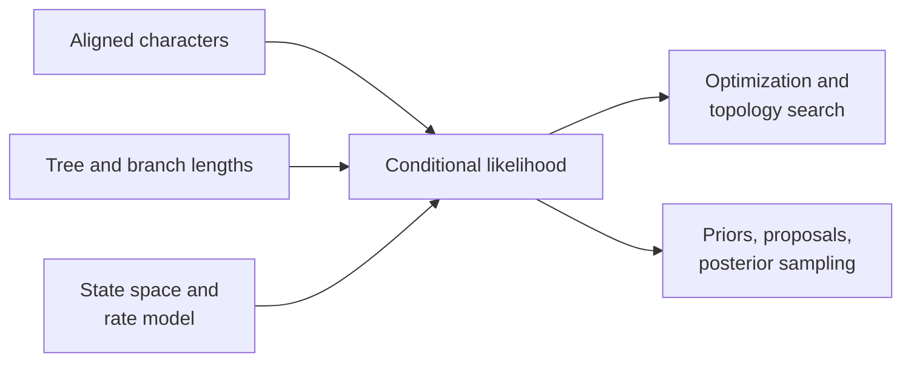

# Likelihood And Inference

Likelihood evaluates data under a tree, model, and parameters. Inference adds
search or sampling to learn parameters, topology, or both. Keeping those layers
separate makes numerical results and ownership claims precise.

## Finite-State Likelihood

The native foundation covers nucleotide, protein, codon, and discrete Mk state
spaces. A likelihood value is comparable only when data, tree, branch-length
units, state encoding, model parameterization, site treatment, and numerical
conventions agree.

Partial-likelihood pruning, transition probabilities, equilibrium frequencies,
rate parameters, and scaling behavior belong to the computation contract.
Underflow protection must preserve the reported log-likelihood meaning.

## Maximum-Likelihood Inference

The documented native tree-inference result is strongest for nucleotide
models. It retains model selection, fitted parameters, final tree, topology
fingerprint, multi-start summaries, accepted search moves, optional bootstrap
and SH-like support, and warnings.

NNI and other topology moves explore a non-convex search space. Multiple starts
and repeated convergence provide search evidence; they do not prove a global
optimum. Branch support quantifies resampling or local evidence under its named
method, not model adequacy or historical certainty.

## Bayesian Inference

Supported native DNA paths include fixed-topology and joint-topology models
through an explicit dispatcher. Priors, proposal weights, tuning scales,
iteration count, sampling interval, burn-in, and seed define the run. Posterior
interpretation requires acceptance, autocorrelation, effective sample size,
trace stability, and independent-chain review.

BEAST and MrBayes remain external-engine workflows. Their adapters preserve
configuration, execution, parsing, and artifacts without relabeling the
external computation.

## Model Selection And Comparison

AIC-like criteria, likelihood-ratio tests, posterior summaries, and benchmark
correspondence answer different questions. Always retain the compared models,
parameter counts, nesting assumptions, objective convention, and decision
rule.

## Numerical Failure Modes

- invalid transition matrices or state encoding;
- underflow, overflow, or unstable scaling;
- flat, multimodal, or boundary likelihood surfaces;
- optimizer stagnation or start-dependent solutions;
- poor proposal acceptance or posterior mixing;
- topology labels or partitions inconsistent with the alignment;
- comparison against a reference using different assumptions.

## Related Operations

- [Native maximum-likelihood inference](../../01-bijux-phylogenetics/operations/native-maximum-likelihood-workflows.md)
- [Native Bayesian inference](../../01-bijux-phylogenetics/operations/native-bayesian-workflows.md)
- [Native benchmark evidence](../../01-bijux-phylogenetics/quality/native-benchmark-evidence.md)
