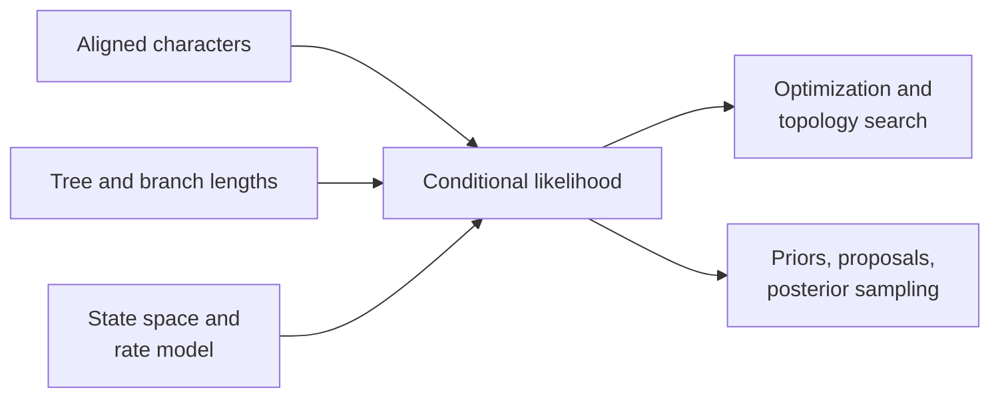
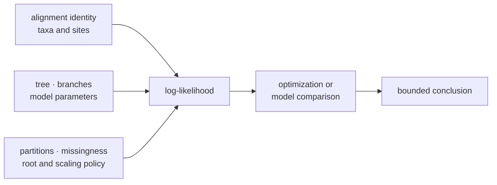

# Likelihood And Inference

Likelihood evaluates data under a tree, model, and parameters. Inference adds
search or sampling to learn parameters, topology, or both. Keeping those layers
separate makes numerical results and ownership claims precise.

## A Likelihood Value Has A Scientific Identity

A log-likelihood is not a portable property of a tree. It identifies one
calculation under a complete data-and-model contract.

| Identity component | Questions that must have one answer |
| --- | --- |
| observation population | Which taxa, sites, partitions, and ascertainment rule are included? |
| character process | Which state space, ambiguity policy, substitution model, rate mixture, and equilibrium frequencies apply? |
| tree state | Which topology, rooting convention, branch-length units, clock constraint, and fitted values apply? |
| numerical contract | Which transition calculation, scaling policy, tolerances, and invalid-state behavior apply? |
| objective | Is the value a fixed-state likelihood, an optimized maximum, a marginal likelihood, or part of a posterior calculation? |
| computation owner | Was the value produced natively, by an adapter, or by an external engine, and which version and invocation own it? |

Compare scalar values only after these identities match. Otherwise, the
difference may reflect a changed population, model, parameterization, or
normalization rather than stronger support for a tree. A posterior probability
is still further removed: it depends on priors and the sampled state space in
addition to the likelihood contract.

## Finite-State Likelihood

The native foundation covers nucleotide, protein, codon, and discrete Mk state
spaces. A likelihood value is comparable only when data, tree, branch-length
units, state encoding, model parameterization, site treatment, and numerical
conventions agree.

Partial-likelihood pruning, transition probabilities, equilibrium frequencies,
rate parameters, and scaling behavior belong to the computation contract.
Underflow protection must preserve the reported log-likelihood meaning.

## Layered Runtime Surfaces

| Layer | Representative locator | Scientific question |
| --- | --- | --- |
| compile | `compile_finite_state_likelihood_analysis` and model-specific compilers | Which state space, transition process, observations, partitions, and caches define the calculation? |
| evaluate | `evaluate_compiled_finite_state_likelihood_analysis` and named model evaluators | What likelihood is assigned to this fixed tree and parameter state? |
| optimize | branch-length, frequency, substitution, and joint-optimization reports | Which parameters moved, under what bounds and restart policy, and where did optimization stop? |
| search | NNI, SPR, TBR, annealing, ratchet, multi-start, and starting-tree reports | Which topologies were considered, accepted, refused, or left unexplored? |
| support | bootstrap, SH-like, site-likelihood, and topology-test reports | How stable is a split or topology under the named resampling/comparison rule? |
| result | `NucleotideMaximumLikelihoodResult` | Which model, final topology, fitted state, search evidence, support, warnings, and artifacts belong together? |

The broad finite-state foundation does not imply equal inference depth for
every state space. The documented end-to-end native tree-search result remains
strongest for nucleotide models; protein, codon, and Mk likelihood surfaces
must be described at the layer they actually implement.

## Enter At The Layer Your Question Requires

| Intended work | Begin with | Do not infer |
| --- | --- | --- |
| score one declared tree and parameter state | model-specific evaluator or compiled finite-state analysis | that the tree or parameters are optimal |
| fit parameters on a fixed topology | optimizer surface with bounds and starts | that topology uncertainty was explored |
| infer a nucleotide tree | `NucleotideMaximumLikelihoodResult` workflow | that other state spaces have the same search depth |
| quantify split stability | named bootstrap or SH-like report | that support is model adequacy or posterior probability |
| sample a supported posterior | native Bayesian model and matching proposal schedule | that chain completion establishes convergence |
| invoke IQ-TREE2, FastTree, MrBayes, or BEAST | external-engine adapter | that Bijux owns the external numerical algorithm |

Selecting a lower layer gives more control and more responsibility. Callers
that assemble compile, evaluation, optimization, and search primitives must
retain the same identity and diagnostic information that the unified result
would otherwise preserve.

## Maximum-Likelihood Inference

The documented native tree-inference result is strongest for nucleotide
models. It retains model selection, fitted parameters, final tree, topology
fingerprint, multi-start summaries, accepted search moves, optional bootstrap
and SH-like support, and warnings.

NNI and other topology moves explore a non-convex search space. Multiple starts
and repeated convergence provide search evidence; they do not prove a global
optimum. Branch support quantifies resampling or local evidence under its named
method, not model adequacy or historical certainty.

## Bayesian Inference

Supported native DNA paths include fixed-topology and joint-topology models
through an explicit dispatcher. Priors, proposal weights, tuning scales,
iteration count, sampling interval, burn-in, and seed define the run. Posterior
interpretation requires acceptance, autocorrelation, effective sample size,
trace stability, and independent-chain review.

BEAST and MrBayes remain external-engine workflows. Their adapters preserve
configuration, execution, parsing, and artifacts without relabeling the
external computation.

## Model Selection And Comparison

AIC-like criteria, likelihood-ratio tests, posterior summaries, and benchmark
correspondence answer different questions. Always retain the compared models,
parameter counts, nesting assumptions, objective convention, and decision
rule.

[Search, Model Selection, And Support](search-model-selection-and-support.md)
defines the shared eligible/attempted/evaluated/selected populations and the
record required for ties, failed candidates, and support denominators.

### Comparison Admissibility

Two likelihoods are directly comparable only when they use the same observed
sites and taxon set, tree interpretation, conditioning convention, partition
accounting, state/missingness policy, root treatment, and log-likelihood scale.
A likelihood-ratio test additionally requires a declared nested pair and valid
degrees-of-freedom rule. Information criteria require consistent parameter
counting. Posterior summaries require the same estimand and compatible prior,
likelihood, and sampling definitions.

If those conditions are absent, retain both results as separate observations;
do not manufacture a delta, ranking, or parity verdict.

## Trace A Reported Likelihood

Every published likelihood should be recoverable through this chain:

If the tree, parameter state, or numerical convention cannot be recovered,
the likelihood is an orphaned scalar. It may be displayed, but it cannot
support reproducible model comparison.

For an optimized result, preserve both the final objective and the route that
produced it: starting-state identity, bounds, termination condition, warnings,
and search trace. For a posterior sample, preserve the corresponding prior and
proposal identity as well.

## Numerical Failure Modes

- invalid transition matrices or state encoding;
- underflow, overflow, or unstable scaling;
- flat, multimodal, or boundary likelihood surfaces;
- optimizer stagnation or start-dependent solutions;
- poor proposal acceptance or posterior mixing;
- topology labels or partitions inconsistent with the alignment;
- comparison against a reference using different assumptions.

## Related Operations

- [Native maximum-likelihood inference](../../01-bijux-phylogenetics/operations/native-maximum-likelihood-workflows.md)
- [Native Bayesian inference](../../01-bijux-phylogenetics/operations/native-bayesian-workflows.md)
- [Native benchmark evidence](../../01-bijux-phylogenetics/quality/native-benchmark-evidence.md)
