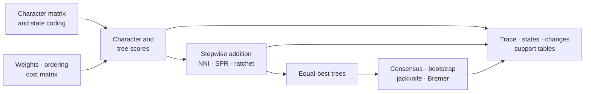
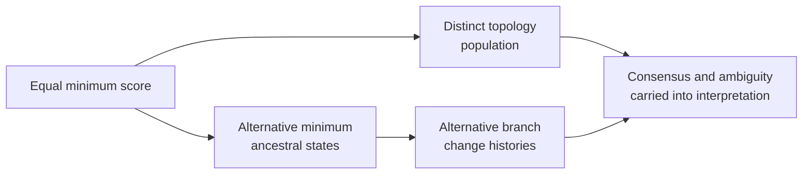

# Parsimony

Parsimony evaluates a tree by the minimum cost of explaining observed
characters. It is a family of explicit cost models, reconstruction rules, and
topology searches—not a single score. Bijux Phylogenetics exposes those parts
separately so a result can be traced from character matrix to supported tree.

## Keep Cost, Optimum, Topology, And History Separate

Parsimony answers several nested questions. Each answer has a different
identity and a different evidentiary limit.

| Result layer | Meaning | Does not by itself establish |
| --- | --- | --- |
| cost model | the penalty assigned to every allowed state change | that the penalties describe the generating evolutionary process |
| tree score | the minimum cost attainable on one topology | that the topology is globally optimal |
| optimal score | the best score found under the declared search | that all tree space was exhausted |
| optimal topology set | all distinct equal-best trees retained by the search | one uniquely supported history |
| ancestral reconstruction | one or more minimum-cost state assignments | that reconstructed states or branch changes were observed |
| support summary | stability or extra-cost evidence under a named rule | a posterior probability or likelihood ratio |

The result packet must preserve all six layers. Reporting only the best score
erases topological multiplicity; reporting one resolved tree erases both
search limits and ambiguity among minimum-cost histories.

## Scoring Models

| Model | Cost assumption | Appropriate interpretation |
| --- | --- | --- |
| Fitch | unordered states with equal change cost | minimum number of state changes |
| Wagner | ordered states with distance-sensitive changes | minimum cost under the declared order |
| Sankoff | arbitrary state-to-state cost matrix | minimum cost under a fully explicit transition policy |
| Dollo | a derived state originates once but may be lost repeatedly | score under an asymmetric gain/loss history |
| Camin–Sokal | change is constrained in the declared irreversible direction | score under directional irreversibility |

Ambiguous and polymorphic tip states must remain distinct from missing data.
Character weights and cost matrices are part of the scientific model and must
travel with the score. A lower tree length is comparable only when matrices,
state encodings, weights, and cost rules are identical.

## Reconstruction And Homoplasy

Minimum-score ancestral states are often non-unique. ACCTRAN resolves
ambiguity toward earlier changes; DELTRAN delays changes toward descendant
branches. The choice changes the placement of homoplasy without changing the
minimum tree score, so branch-change tables must name the reconstruction rule.

Consistency, retention, and rescaled-consistency indices summarize different
aspects of homoplasy. They depend on the character's attainable minimum and
maximum as well as its observed steps. Report character-level values before
aggregates; a single index can conceal a small set of strongly conflicting
characters.

## Searching Tree Space

Stepwise addition supplies starting trees. NNI explores local rearrangements;
SPR reaches a broader neighborhood; the parsimony ratchet perturbs character
weights to escape local optima. These searches are heuristic unless the
declared problem is exhaustively enumerated.

A trustworthy search record retains:

- the starting-tree strategy and random seed;
- character weights and perturbation policy;
- move type, accepted moves, and score trajectory;
- stopping conditions and number of independent starts;
- every equal-best topology, not only the first encountered tree;
- a stable topology fingerprint for comparison across runs.

Repeated discovery of the same best score strengthens search evidence but
does not prove global optimality.

The cross-method [Search, Model Selection, And Support](search-model-selection-and-support.md)
guide defines the candidate populations and tie discipline that a parsimony
search shares with likelihood and Bayesian workflows without conflating their
objectives.

## Separate Score, Topology, And History Equivalence

Equal total scores establish only equality under the declared cost model.
They do not establish that trees contain the same splits, that characters
place changes on the same branches, or that the implied ancestral states are
unique.

Define the candidate population before summarizing it: all exhaustively
enumerated trees, all equal-best trees discovered by a named search policy, or
a bounded retained sample. A strict consensus over discovered optima is a
property of that discovered set, not proof that every global optimum was
found. Likewise, ACCTRAN and DELTRAN select resolutions within a score class;
neither converts a non-unique minimum history into an observed event sequence.

Preserve a topology fingerprint, per-character score vector, reconstructed
state ambiguity, and branch-change identity separately. Two results may agree
on one of those projections and disagree on the others.

## Support And Consensus

Strict or majority consensus describes agreement among a declared tree set.
Bootstrap and jackknife support describe recovery under character resampling
or deletion. Bremer support describes how much additional tree length is
needed before a clade disappears. These quantities answer different
questions and should never share an unlabeled “support” column.

Support does not establish model adequacy, absence of bias, or historical
certainty. Report the resampling scheme, replicate count, search policy within
each replicate, clade identity rule, and unresolved consensus structure.

## Public Surface Map

| Decision | Public surface | Structured evidence |
| --- | --- | --- |
| load characters and weights | `load_parsimony_character_matrix`, `load_parsimony_character_weights` | taxa, character/state coding, ambiguity, weights, exclusions |
| score unordered or custom-cost changes | `score_fitch`, `score_sankoff` | per-character scores, node state sets or costs, total score |
| score ordered or irreversible changes | `score_wagner`, `score_dollo`, `score_camin_sokal` | declared transition policy, branch changes, character totals |
| reconstruct one minimum history | `reconstruct_acctran`, `reconstruct_deltran` | node states, branch changes, ambiguity-resolution policy |
| find lower-scoring topologies | `build_parsimony_stepwise_addition_tree`, `search_parsimony_nni`, `search_parsimony_spr`, `run_parsimony_ratchet` | starts, moves, score trajectory, termination, equal optima |
| assess homoplasy | `consistency_index`, `retention_index`, `rescaled_consistency_index` | character-level numerator, denominator, undefined cases, aggregate |
| assess clade stability | `bootstrap_parsimony`, `jackknife_parsimony`, `compute_parsimony_bremer_support` | replicate or score-decay population, failures, clade support |
| summarize equal optima | `summarize_equal_best_parsimony_trees` | topology identities, score equality, consensus and unresolved clades |

These functions expose separate scientific contracts. A search report is not a
score report, a reconstruction is not proof of a unique history, and a support
table cannot recover characters or replicates that were omitted upstream.

## Minimum Parsimony Result Packet

Publish the source matrix and taxon order, state vocabulary and ambiguity
policy, weights or cost matrix, scoring model, per-character decomposition,
search configuration and trace, all equal-best topology identities,
reconstruction policy where used, support denominator, warnings and failed
replicates, plus structured run and artifact inventories. Link every consensus,
tree, branch-change table, and figure back to that packet.

Refuse a global-optimum claim from heuristic search unless exhaustive coverage
is established. Refuse an unqualified ancestral history when multiple
minimum-cost states remain. Qualify aggregate support whenever incomplete
replicates or unresolved equal-best trees affect its denominator.

## Review Checklist

Before interpreting a parsimony result, confirm that:

1. taxa and characters were parsed without silent coercion;
2. state ordering, ambiguity, weights, and transition costs are explicit;
3. per-character scores sum to the reported tree length;
4. reconstruction policy is named wherever branch changes are shown;
5. search traces support the claimed degree of optimization;
6. equal-best trees and consensus ambiguity are preserved;
7. each support value names its method and replication contract;
8. structured run, score, state, trace, and support artifacts remain available.
