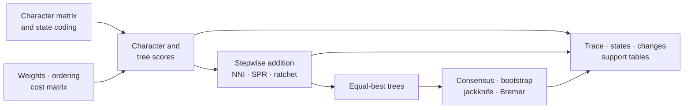

# Parsimony

Parsimony evaluates a tree by the minimum cost of explaining observed
characters. It is a family of explicit cost models, reconstruction rules, and
topology searches—not a single score. Bijux Phylogenetics exposes those parts
separately so a result can be traced from character matrix to supported tree.

## Scoring Models

| Model | Cost assumption | Appropriate interpretation |
| --- | --- | --- |
| Fitch | unordered states with equal change cost | minimum number of state changes |
| Wagner | ordered states with distance-sensitive changes | minimum cost under the declared order |
| Sankoff | arbitrary state-to-state cost matrix | minimum cost under a fully explicit transition policy |
| Dollo | a derived state originates once but may be lost repeatedly | score under an asymmetric gain/loss history |
| Camin–Sokal | change is constrained in the declared irreversible direction | score under directional irreversibility |

Ambiguous and polymorphic tip states must remain distinct from missing data.
Character weights and cost matrices are part of the scientific model and must
travel with the score. A lower tree length is comparable only when matrices,
state encodings, weights, and cost rules are identical.

## Reconstruction And Homoplasy

Minimum-score ancestral states are often non-unique. ACCTRAN resolves
ambiguity toward earlier changes; DELTRAN delays changes toward descendant
branches. The choice changes the placement of homoplasy without changing the
minimum tree score, so branch-change tables must name the reconstruction rule.

Consistency, retention, and rescaled-consistency indices summarize different
aspects of homoplasy. They depend on the character's attainable minimum and
maximum as well as its observed steps. Report character-level values before
aggregates; a single index can conceal a small set of strongly conflicting
characters.

## Searching Tree Space

Stepwise addition supplies starting trees. NNI explores local rearrangements;
SPR reaches a broader neighborhood; the parsimony ratchet perturbs character
weights to escape local optima. These searches are heuristic unless the
declared problem is exhaustively enumerated.

A trustworthy search record retains:

- the starting-tree strategy and random seed;
- character weights and perturbation policy;
- move type, accepted moves, and score trajectory;
- stopping conditions and number of independent starts;
- every equal-best topology, not only the first encountered tree;
- a stable topology fingerprint for comparison across runs.

Repeated discovery of the same best score strengthens search evidence but
does not prove global optimality.

## Support And Consensus

Strict or majority consensus describes agreement among a declared tree set.
Bootstrap and jackknife support describe recovery under character resampling
or deletion. Bremer support describes how much additional tree length is
needed before a clade disappears. These quantities answer different
questions and should never share an unlabeled “support” column.

Support does not establish model adequacy, absence of bias, or historical
certainty. Report the resampling scheme, replicate count, search policy within
each replicate, clade identity rule, and unresolved consensus structure.

## Review Checklist

Before interpreting a parsimony result, confirm that:

1. taxa and characters were parsed without silent coercion;
2. state ordering, ambiguity, weights, and transition costs are explicit;
3. per-character scores sum to the reported tree length;
4. reconstruction policy is named wherever branch changes are shown;
5. search traces support the claimed degree of optimization;
6. equal-best trees and consensus ambiguity are preserved;
7. each support value names its method and replication contract;
8. structured run, score, state, trace, and support artifacts remain available.
