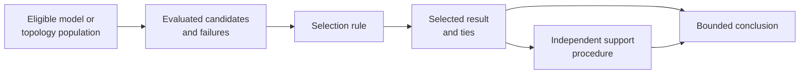
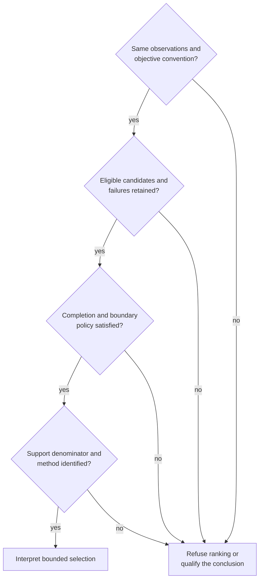

# Search, Model Selection, And Support

Search, selection, and support answer three different questions. Search asks
which candidate states were explored. Selection applies a declared rule to
those candidates. Support measures stability or relative evidence under a
named procedure. A selected topology or model is not self-validating merely
because the same run also produced a support number.

## Preserve Four Populations

| Population | Meaning | Common loss |
| --- | --- | --- |
| eligible | every model, tree, start, or configuration admitted by the declared design | alternatives disappear before execution |
| attempted | candidates for which evaluation began | failures are omitted from the denominator |
| evaluated | candidates with an admissible objective or score | partial or non-finite results are treated as complete |
| selected | winner, ties, retained near-optima, or accepted posterior/tree population | only one convenient result survives |

Report all four. A candidate that fails to fit is not evidence that the
remaining winner is scientifically superior. It is a failed member of the
selection experiment until its cause and eligibility are resolved.

## Match The Record To The Search Family

| Search family | Minimum exploration record | Unsupported shortcut |
| --- | --- | --- |
| likelihood parameter optimization | starts, bounds, objective trace, convergence, boundary state | quoting the best scalar without optimizer state |
| likelihood topology search | starting trees, move set, accepted/evaluated candidates, repeated starts, termination | presenting the best encountered topology as a proven global optimum |
| Bayesian sampling | initial state, proposals, accepted/rejected moves, retained draws, chain identity | treating requested iterations as effective samples |
| parsimony search | starting construction, NNI/SPR/ratchet policy, score trace, equal-best set | discarding equal-best trees after the first discovery |
| distance tree construction | distance model, admitted pairs, correction, construction order and residuals | treating the derived tree as independent of the matrix |

Stochastic and heuristic searches need seeds and budgets, but a seed is not an
assurance argument. Repeat runs and diagnostics show whether the observed
solution depends materially on starts, proposals, or random choices.

## Select Only Comparable Candidates

Model ranking requires a common observation population and comparable
objectives. Before applying AIC, AICc, BIC, a likelihood-ratio test, posterior
model probability, parsimony score, or another rule, align:

- admitted taxa, sites, characters, and missing-data policy;
- tree, branch, root, state, partition, and transformation conventions;
- likelihood or cost definition and all constant terms relevant to the rule;
- parameter-count, constraint, and boundary treatment;
- convergence or completion policy;
- the complete eligible candidate set.

If those identities differ, preserve separate fits and explain the boundary.
A ranking over non-comparable objectives is more misleading than no ranking.

## Treat Ties And Near-Ties As Results

Exact ties can represent equal-best parsimony trees, identical criteria, or
equivalent parameterizations. Near-ties arise under a declared tolerance or
decision threshold. Retain every tied candidate, the tie rule, stable
candidate identity, and the selection consequence.

| Outcome | Correct record |
| --- | --- |
| one candidate clearly selected | winner plus every eligible candidate and rule |
| exact ties | complete tie set and any consensus or ambiguity projection |
| criterion differences below a declared materiality threshold | near-tie set and bounded interpretation |
| different starts reach different optima | start-linked results and unstable selection |
| some candidates fail | failed rows, causes and whether ranking remains admissible |

Arbitrary file order, first-completion order, or display sorting is not a
scientific tie-breaker.

## Keep Support Method-Specific

| Support output | Producing experiment | Does not mean |
| --- | --- | --- |
| bootstrap clade proportion | resampled-data inference and clade recovery | posterior probability of the clade |
| SH-like or topology-test quantity | declared site-likelihood comparison | model adequacy or universal topology confidence |
| posterior clade frequency | retained posterior tree population | independent resampling support |
| jackknife proportion | character-deletion replicates | bootstrap support under another name |
| Bremer support | score increase required to lose a clade | probability that the clade is correct |
| consensus frequency | occurrence in an admitted tree set | evidence independent of how that set was generated |

Every value retains its clade/split key, method, scale, requested and completed
denominator, failures, and selection policy. Never move a value into a generic
support column after dropping its producing method.

## Review Selection Before Interpretation

The minimum review packet contains eligible and attempted populations,
candidate identities, objectives or scores, failures, search state, selection
rule, ties, support rows, warnings, and structured artifacts. A rendered best
tree can be included, but cannot replace that packet.
