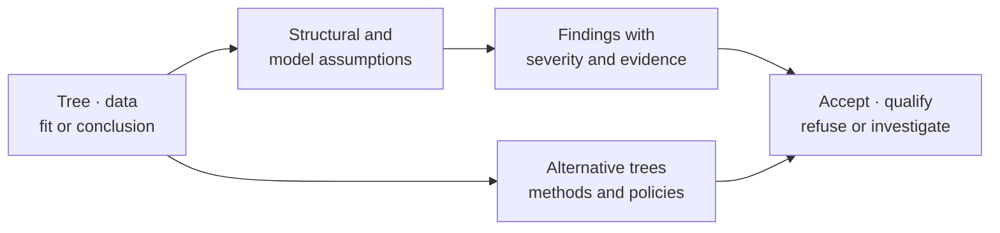

# Diagnostics And Sensitivity

Diagnostics determine whether an input, execution, or conclusion satisfies a
named assumption. Sensitivity analysis asks whether the conclusion survives a
plausible change in tree, method, support surface, ancestral reconstruction, or
comparative model. Neither is a generic “confidence score.”

## Tree Inspection, Validation, And Forensics

The tree diagnostic surface separates increasingly strong questions:

| Public locator | Question answered |
| --- | --- |
| `bijux_phylogenetics.diagnostics.validation:inspect_tree_path` | What structure, labels, lengths, and immediate warnings are present? |
| `bijux_phylogenetics.diagnostics.validation:validate_tree_path` | Does the tree satisfy declared rootedness, length, topology, and integrity requirements? |
| `bijux_phylogenetics.diagnostics.validation:diagnose_tree_path` | Which quality findings and repair suggestions require review? |
| `bijux_phylogenetics.diagnostics.validation:forensic_tree_path` | Which stable node identities, outliers, label interpretations, and structural details explain a disputed tree? |

Inspection does not imply validity. Validation does not prove that the tree is
appropriate for a biological question. Forensics explains structure and
anomalies; it does not silently repair the input.

## Assumptions Are Named Records

`assess_tree_assumptions` joins support-label normalization, branch-length
units, rootedness, and tree context into a structured report.
`inspect_branch_length_units` distinguishes substitutions, time-like values,
unknown scale, and unsupported interpretations where the available evidence
permits it. `standardize_support_labels` records conversions rather than
changing the meaning of support in place.

Every diagnostic should retain the inspected object identity, rule,
observation, threshold or tolerance, severity, and consequence. A warning that
is omitted from the rendered report still exists and still qualifies the
result.

## Root-To-Tip And Temporal Signal

`compute_root_to_tip_distances` produces per-tip path lengths.
`diagnose_root_to_tip_regression` joins those lengths to sampling times and
records fitted values, residuals, leverage, studentized residuals, and
outliers. `diagnose_tip_date_randomization` compares the observed fit with a
seeded permutation distribution.

| Record | Safe conclusion | Unsafe conclusion |
| --- | --- | --- |
| positive root-to-tip slope | divergence and sampling time covary in this rooted tree | the tree is automatically suitable for molecular dating |
| high fitted `r_squared` | the linear trend explains much observed path-length variation | rate constancy or correct rooting is proven |
| tip-date randomization separation | observed temporal association exceeds the declared permutation baseline | every clock model or calibration is valid |
| identified outlier | one tip has unusual residual or leverage under this regression | the tip is erroneous and may be deleted without review |

Root choice, taxon sampling, date range, branch-length units, recombination,
and rate variation can change the result. Retain the regression and
randomization denominators with any dating-readiness claim.

## Conclusion Stability

`build_conclusion_stability_report` evaluates four separate surfaces:

- key clade presence across bootstrap and method variants;
- support-value consistency;
- discrete ancestral-state consistency;
- comparative-coefficient direction and significance consistency.

The report emits row-level evidence plus stable, weak, and unstable counts.
Those classes summarize declared inputs and thresholds. They are not evidence
verdicts and do not replace the underlying bootstrap, tree-set, ancestral, or
regression records.

## Construct A Sensitivity Matrix

| Axis | Hold fixed | Vary | Compare |
| --- | --- | --- | --- |
| topology | taxa, observations, scientific question | plausible trees or bootstrap members | clades, states, coefficients, exclusions |
| branch lengths | topology and observations | scaling, clock transform, fitted lengths | likelihoods, covariance, ancestral values |
| model | inputs and candidate identity | substitution, covariance, transition, or error structure | fit, estimates, uncertainty, residuals |
| data policy | source revision and question | missingness, ambiguity, pruning, aggregation | denominator and conclusion change |
| execution | model and inputs | starts, chains, seeds, budgets | convergence, optimum, posterior, failures |

Change one interpretable axis or declare the interaction. Otherwise a changed
conclusion cannot be attributed to a specific assumption.

## Failure And Exclusion Discipline

Sensitivity denominators include failed alternatives, absent clades,
non-converged models, undefined statistics, and excluded taxa. A stability
score computed only from successful variants answers a different and usually
weaker question. Retain the cause and eligibility of every omitted member.

Do not turn a threshold into a universal truth. A score above a configured
stability boundary means the declared evidence met that policy. It does not
establish causal correctness or transfer to a different dataset, model family,
or release.

## Decision Record

A diagnostic or sensitivity decision records:

1. the exact inspected object and revision;
2. assumption, rule, threshold, and comparison population;
3. row-level observations, warnings, failures, and exclusions;
4. the resulting accept, qualify, refuse, or investigate action;
5. downstream claims and artifacts affected by that action.

Preserve the structured TSV and JSON outputs used by the decision. HTML and
figures make patterns visible, but they do not own the status.
