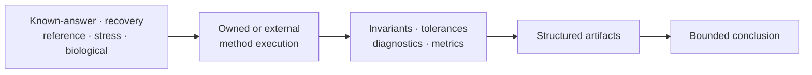
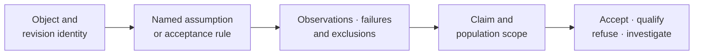
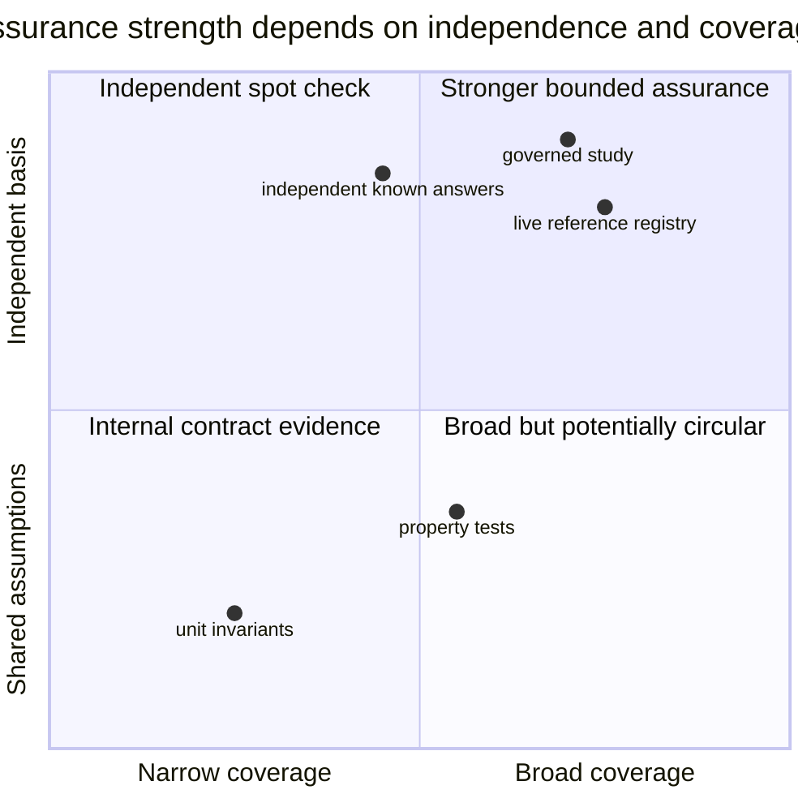

# Scientific Assurance

Scientific assurance connects controlled inputs to bounded claims. Simulation
and curated datasets define what is known or held fixed; validation and
benchmarks test named contracts; reporting preserves the provenance,
diagnostics, and limitations needed for review.

- [Simulation And Datasets](simulation-and-datasets.md) explains generators,
  known truth, catalog roles, bundle provenance, and circularity controls.
- [Validation, Benchmarks, And Reporting](validation-benchmarks-and-reporting.md)
  explains proof layers, experiment design, implementation comparison,
  artifacts, and promotion into evidence.
- [Diagnostics And Sensitivity](diagnostics-and-sensitivity.md) explains tree
  validation, assumption findings, temporal-signal diagnostics, conclusion
  stability, and failure-aware sensitivity matrices.
- [Tree Uncertainty And Sensitivity](tree-uncertainty-and-sensitivity.md)
  explains topology modes, unstable taxa and clades, run comparison,
  tree-population denominators, and propagation into downstream claims.
- [Reporting And Rendering](reporting-and-rendering.md) explains how structured
  results become methods text, supplementary tables, tree figures, annotated
  trait trees, and reproducibility manifests.
- [Publication Artifact Review](publication-artifact-review.md) explains how to
  admit a report package, trace displayed claims, compare packages, and retain
  revalidation outcomes.

## Choose The Assurance Output

| Decision | Primary record | Human projection |
| --- | --- | --- |
| did an input or method contract hold? | validation observation and diagnostics | validation report |
| how did a method behave over a declared population? | benchmark or sensitivity ledger | summary table or figure |
| which tree conclusions survive the admitted tree population? | tree-set inventory plus mode, conflict, instability and sensitivity rows | topology distribution or stability figure |
| what values and uncertainty belong to one result? | typed result plus machine-readable tables | methods text, tree figure, annotated report |
| is a publication package complete and internally aligned? | manifest, inventory, checks, comparison and revalidation rows | reviewer checklist and publication report |
| does a bounded scientific claim have governed support? | Evidence Book claim, checks, observations, verdict and freshness | study guide and citation text |

The projection never replaces the primary record named in the same row.

## Assurance Is A Decision Chain

The decision is reproducible only when the object, rule, denominator, and
action remain linked. A passing scalar detached from that chain is not an
assurance record.

## Assurance Requires Independence And Coverage

Coverage counts the declared population, including failures and exclusions.
Independence asks whether the expected result comes from a genuinely separate
derivation, implementation, dataset, or observation. Many self-consistent
cases can still share one defect; one independent case can still be too narrow
for a broad claim.

## Denominator Contract

Every assurance summary records:

| Count | Meaning |
| --- | --- |
| declared | cases, datasets, runs, parameters, nodes, or claims in scope |
| selected | records chosen by an explicit filter |
| executed | selected records for which computation actually ran |
| comparable | executed records with aligned identities and estimands |
| passed or matched | comparable records satisfying the registered rule |
| failed or mismatched | comparable records violating the rule |
| skipped, unavailable, or not comparable | selected records outside numerical adjudication, with cause |

The denominator used in a percentage must be named. Reporting only successful
rows converts execution gaps and scientific boundaries into invisible
selection.

## Choose Evidence That Matches The Claim

| Claim | Appropriate starting corpus | Required comparison |
| --- | --- | --- |
| parser preserves a format contract | adversarial and round-trip fixtures | structured identity and invariant checks |
| numerical routine returns known values | independent known-answer fixtures | explicit absolute, relative, or structural tolerance |
| estimator recovers generating parameters | independently generated simulation | bias, error, coverage, failure and boundary rates |
| implementation corresponds with another tool | shared input plus live or checked reference | aligned conventions and observation-level verdicts |
| workflow scales to a target regime | named benchmark corpus and environment | runtime, memory, completeness, and failure classification |
| study claim is reviewable | governed scientific inputs and source provenance | claim-scoped checks, freshness, artifacts, and verdict |

Self-generated fixtures are useful for invariants but weak evidence for an
algorithm that shares the same assumptions or defect. Independence must be
described, not inferred from a different file name or language.

## Declare Selection And Stopping Before Observation

The assurance contract records how cases enter the denominator and when
execution stops before outcomes are inspected. Otherwise a flexible filter,
tolerance, replicate count, or diagnostic threshold can make the result appear
stronger after the fact.

| Decision fixed in advance | Bias prevented |
| --- | --- |
| corpus revision and eligibility rule | retaining only easy, available, or favorable cases |
| case, parameter, node, and model identifiers | changing the comparison population after failures |
| exact, structural, numerical, or distributional rule | choosing the rule that best fits observed differences |
| tolerance and its scientific rationale | widening acceptance after seeing the error |
| replicate, chain, start, and bootstrap counts | stopping when a favorable summary first appears |
| missing, failed, skipped, and non-comparable treatment | calculating success only over completed outputs |
| sensitivity axes and conclusion classification | testing alternatives only after an unwanted result |

An exploratory run may discover an appropriate rule. Preserve it as
exploration, define a new governed evaluation, and apply the rule to a fresh or
independently identified population. Do not retroactively describe the
exploratory denominator as confirmatory evidence.

## Preserve Negative Evidence

Mismatches, skips, non-convergence, incomplete engine output, unsupported
parameterizations, and not-comparable cases belong in the result set. Report
their denominators and causes. Removing them turns a bounded experiment into a
selection-biased summary.

## Read Sensitivity As A Result

Sensitivity is not a ceremonial list of alternative settings. Predeclare the
axes, execute their cross-product or an explicit design, retain failures, and
classify the conclusion:

- **stable:** the claim and material interpretation survive the declared
  alternatives;
- **qualified:** the direction survives but magnitude, uncertainty, topology,
  or selected model changes materially;
- **unstable:** plausible alternatives reverse or erase the conclusion;
- **not assessable:** required executions or comparable outputs are missing.

The preferred configuration does not erase the other cells. A stability label
is meaningful only with the tested axes and completed denominator.

## Assurance Rule

Every conclusion names its corpus, method, acceptance rule, result, and
revision. Passing one lane never silently grants structural, numerical,
benchmark, evidence, or release confidence in another lane.

Figures support inspection but do not own verdicts. Store the structured
observations, tolerances, status, environment, and provenance from which each
figure or narrative summary is derived.
