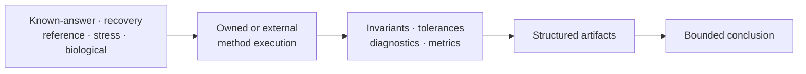

# Scientific Assurance

Scientific assurance connects controlled inputs to bounded claims. Simulation
and curated datasets define what is known or held fixed; validation and
benchmarks test named contracts; reporting preserves the provenance,
diagnostics, and limitations needed for review.

- [Simulation And Datasets](simulation-and-datasets.md) explains generators,
  known truth, catalog roles, bundle provenance, and circularity controls.
- [Validation, Benchmarks, And Reporting](validation-benchmarks-and-reporting.md)
  explains proof layers, experiment design, implementation comparison,
  artifacts, and promotion into evidence.

## Choose Evidence That Matches The Claim

| Claim | Appropriate starting corpus | Required comparison |
| --- | --- | --- |
| parser preserves a format contract | adversarial and round-trip fixtures | structured identity and invariant checks |
| numerical routine returns known values | independent known-answer fixtures | explicit absolute, relative, or structural tolerance |
| estimator recovers generating parameters | independently generated simulation | bias, error, coverage, failure and boundary rates |
| implementation corresponds with another tool | shared input plus live or checked reference | aligned conventions and observation-level verdicts |
| workflow scales to a target regime | named benchmark corpus and environment | runtime, memory, completeness, and failure classification |
| study claim is reviewable | governed scientific inputs and source provenance | claim-scoped checks, freshness, artifacts, and verdict |

Self-generated fixtures are useful for invariants but weak evidence for an
algorithm that shares the same assumptions or defect. Independence must be
described, not inferred from a different file name or language.

## Preserve Negative Evidence

Mismatches, skips, non-convergence, incomplete engine output, unsupported
parameterizations, and not-comparable cases belong in the result set. Report
their denominators and causes. Removing them turns a bounded experiment into a
selection-biased summary.

## Assurance Rule

Every conclusion names its corpus, method, acceptance rule, result, and
revision. Passing one lane never silently grants structural, numerical,
benchmark, evidence, or release confidence in another lane.

Figures support inspection but do not own verdicts. Store the structured
observations, tolerances, status, environment, and provenance from which each
figure or narrative summary is derived.
