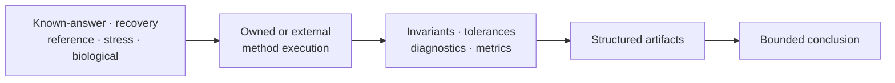

# Scientific Assurance

Scientific assurance connects controlled inputs to bounded claims. Simulation
and curated datasets define what is known or held fixed; validation and
benchmarks test named contracts; reporting preserves the provenance,
diagnostics, and limitations needed for review.

- [Simulation And Datasets](simulation-and-datasets.md) explains generators,
  known truth, catalog roles, bundle provenance, and circularity controls.
- [Validation, Benchmarks, And Reporting](validation-benchmarks-and-reporting.md)
  explains proof layers, experiment design, implementation comparison,
  artifacts, and promotion into evidence.

## Assurance Rule

Every conclusion names its corpus, method, acceptance rule, result, and
revision. Passing one lane never silently grants structural, numerical,
benchmark, evidence, or release confidence in another lane.
