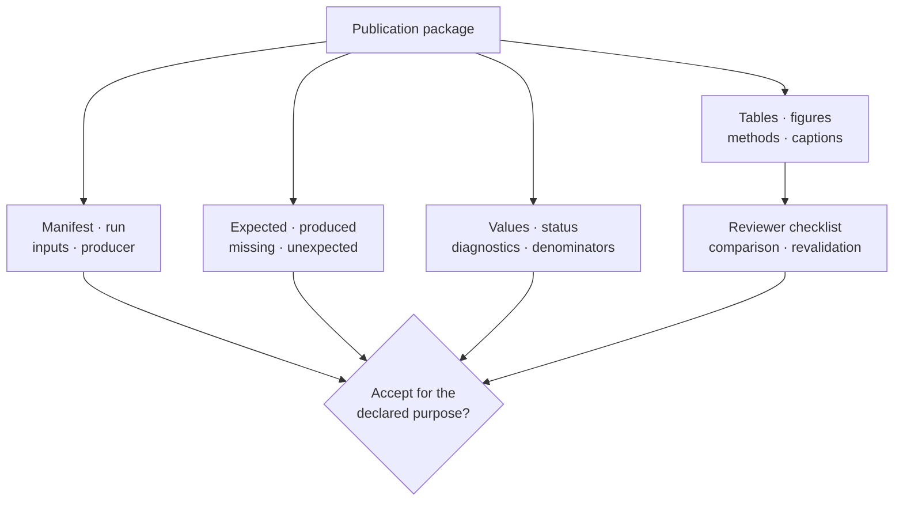

# Publication Artifact Review

A publication package is accepted as one identified record: manifest,
structured values, tables, figures, methods, warnings, exclusions, and review
checks. A polished HTML page or complete-looking directory is insufficient
when those components do not resolve to the same run and scientific object.

## Begin With Package Identity

Record the package kind, manifest/schema version, run identifier, tree or
alignment identity, input digests, runtime and external producer versions,
configuration, expected inventory, and package digest where governed. Stop if
any component belongs to another run or cannot be joined by exact identity.

`build_tree_report_package` and `build_alignment_figure_package` produce
integrated publication records. Their successful return means the builder
completed its contract; inspect the contained audit, warnings, and source
status before accepting the scientific result.

## Review In Dependency Order

1. **Identity:** confirm one run, source object, configuration and producer.
2. **Inventory:** reconcile expected, produced, failed, missing, optional and
   unexpected artifacts.
3. **Status:** inspect validation, search, optimizer, chain, support and
   exclusion states before values.
4. **Structured values:** verify row grain, units, stable keys, denominators and
   transformations.
5. **Projections:** trace every table, figure, caption and methods statement to
   those values.
6. **Claims:** use only the benchmark, parity or Evidence Book records actually
   linked to the package.

Do not skip directly from file presence to claim review.

## Use The Reviewer Checklist As An Index

`build_reviewer_audit_checklist`, `write_reviewer_audit_checklist`, and
`write_reviewer_audit_checklist_from_manifest` organize the checks a reviewer
must resolve. The checklist is a projection of package state, not an
independent approval. Each item must retain the owning observation and its
terminal result.

A checked box cannot override a contradictory manifest, missing artifact,
failed diagnostic, or stale input. Preserve unresolved checklist items in the
decision packet.

## Compare Publication Packages

`write_publication_package_comparison_report` should compare packages only
after their kinds, schemas, source objects, and intended purposes align. Report
added, removed, changed, and incomparable artifacts separately.

| Difference | Review question |
| --- | --- |
| checksum changed | did source data, configuration, renderer, or serialization change? |
| row count changed | did the scientific population, exclusion policy, or table grain change? |
| figure changed but ledger did not | was the change purely presentational and reproducible? |
| ledger changed but headline did not | does the unchanged narrative conceal a scientific difference? |
| artifact absent | was it optional, failed, intentionally removed, or lost? |
| schema changed | can both packages be interpreted under one semantic contract? |

Similarity of filenames or visual appearance is not package equivalence.

## Revalidate Without Rewriting History

`write_publication_package_revalidation_report` records whether a retained
package still satisfies current integrity and interpretation rules. Revalidation
does not mutate the original manifest or make an old run current. Retain the
reviewer, time, tool version, checks performed, findings, and resulting accepted
scope as a child record.

When a source artifact or schema has changed, build and review a new package.
Do not replace bytes inside the old inventory while retaining its identity or
earlier approval.

## Acceptance Decision

Accept the package only for a named purpose and scope. The decision records
accepted artifacts and meanings, exclusions, unresolved findings, linked
scientific evidence, reviewer, revision, and date. Possible conclusions are:

- accepted for the declared use;
- accepted with a narrower scope or explicit limitation;
- rejected because identity, integrity, status, semantics, or evidence is
  insufficient.

Preserve rejected and superseded packages. They explain denominator changes,
scientific corrections, and why a later projection differs.

Continue with [Reporting And Rendering](reporting-and-rendering.md) for the
projection contract and the [Artifact Consumption Guide](../../01-bijux-phylogenetics/interfaces/artifact-consumption-guide.md)
for general bundle traversal.
