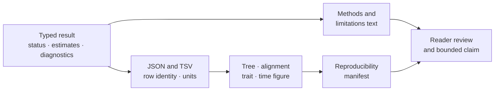

# Reporting And Rendering

Reporting turns typed scientific results into methods text, stable ledgers,
figures, and integrated review packages. Rendering turns admitted tree and
annotation records into SVG or HTML projections. Neither surface owns a new
scientific result: every displayed value and visual mark must resolve to its
structured source.

## Treat Every Report As A Declared Query

A table or figure selects, transforms, orders, and encodes part of a result.
That operation is a query over a governed population, even when no SQL or data
frame is visible. Make the query recoverable:

| Reporting decision | Record to retain |
| --- | --- |
| selection | eligible source rows, included rows, omitted rows, and reasons |
| transformation | source field, formula or classification rule, units, and precision |
| aggregation | input grain, grouping key, denominator, weights, and missing/failed treatment |
| ordering | stable sort keys and display-only order |
| visual encoding | row-to-mark mapping, scales, legends, uncertainty, and style-only attributes |
| caption claim | structured observations and diagnostics that authorize each statement |

The report is therefore reproducible when another consumer can start from the
typed result and recover the same displayed population and marks. A polished
figure with an unknown selection denominator is less reviewable than a plain
ledger with stable row identity.

## Public Reporting Families

| Need | Public surface | Required source identity |
| --- | --- | --- |
| methods text for alignment filtering, tree inference, or validation | `write_alignment_filtering_methods_summary_text`, `write_tree_inference_methods_summary_text`, `write_tree_validation_methods_summary_text` | exact method configuration, software owner, status and limitations |
| supplementary scientific tables | `write_supplementary_*_table` surfaces under `bijux_phylogenetics.reports` | row grain, stable identifiers, units, denominators and exclusions |
| tree support and branch statistics | `summarize_tree_support`, `summarize_tree_branch_statistics` | tree identity, support method/scale and branch-length meaning |
| complete tree or alignment report package | `build_tree_report_package`, `build_alignment_figure_package` | admitted result, manifest, expected inventory and audit context |
| rectangular or circular tree SVG | `bijux_phylogenetics.render:render_tree_svg` | topology, rooting, branch policy, labels, support and annotation strips |
| time-tree SVG | `bijux_phylogenetics.render:render_time_tree_svg` | time direction, units, node intervals and calibration meaning |
| annotated trait tree | `bijux_phylogenetics.render:build_annotated_trait_tree_package` | taxon/trait join, state or value scale, exclusions and legend |
| reproducible figure inventory | `build_figure_reproducibility_manifest` and `write_figure_reproducibility_manifest` | source artifacts, filters, output files and digests |

Function availability establishes a reporting capability. Scientific
acceptance still depends on the input result and its diagnostics.

## Preserve Row Grain

Supplementary tables represent different observational units: taxon, branch,
clade, node, model, alignment column, batch member, or ancestral state. Name the
grain and stable key in every table. Do not join by display order or shorten a
compound model/tree identity until distinct rows collide.

For transformed values, retain source field, transformation, units, rounding,
missing-value rule, and source record. A formatted p-value, support percentage,
or rounded branch length is a presentation field, not a replacement numerical
observation.

## Encode Visual Meaning Explicitly

| Visual feature | Scientific meaning that must be declared |
| --- | --- |
| branch length | substitutions, time, arbitrary layout, or intentionally ignored |
| node or branch color | state, trait interval, support class, warning, or presentation-only grouping |
| node marker | sampled tip, reconstructed node, calibration, event, or uncertainty |
| annotation strip | taxon-linked category/value, missing-state treatment and legend scale |
| collapsed or omitted clade | selection rule, retained membership and effect on context |
| confidence bar or region | interval type, level, estimator and conditioning model |

Color, area, line width, and position can imply magnitude or certainty even
when intended only for style. Legends and captions must state the encoding and
surface missing, excluded, unstable, and unsupported states.

## Audit A Figure Backward

1. Identify the output and its figure manifest entry.
2. Resolve every panel, marker, branch, strip, and label to a structured row.
3. Confirm tree, taxon, node, branch, model, and run identities.
4. Recompute transformations and display classifications from source values.
5. Reconcile omitted or filtered records with the declared population.
6. Verify the caption carries method, scale, uncertainty, and limitation.

If the only retained value exists in pixels, path geometry, or prose, the
figure is not reviewable evidence.

## Methods Text Is A Projection

Generated methods text can preserve exact software, parameters, selection, and
validation decisions, but it cannot decide scientific appropriateness. Review
the text against the run manifest and configuration. A default omitted from
the text is still part of the method identity when it affects results.

Do not copy methods text from a different run because the command name matches.
Tree search, model, seed, partition, trimming, missingness, engine version, and
termination policy can differ beneath the same high-level label.

## Minimum Rendering Record

Retain the structured source, accepted status, renderer and version, layout and
filter configuration, stable row-to-mark mapping, legend/caption inputs,
expected and produced outputs, warnings, omitted records, digests, and figure
manifest. Refuse publication when a visual element cannot be traced or when
rendering hides a failure state material to interpretation.
