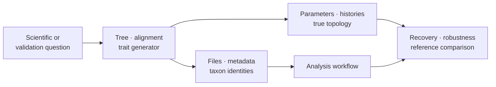
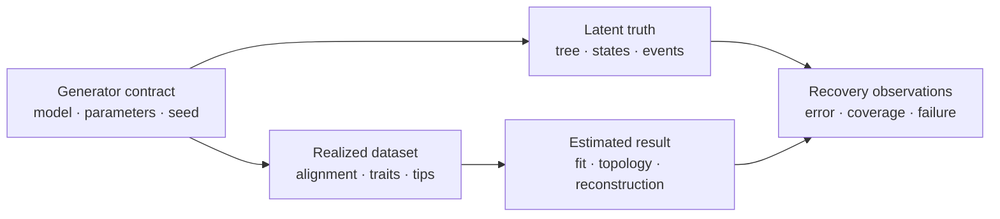

# Simulation And Datasets

Simulation supplies known generative conditions. Dataset bundles supply stable,
inspectable inputs with biological or methodological context. Together they
support examples, regression tests, recovery experiments, sensitivity studies,
and benchmarks without pretending that one corpus can answer every question.

For estimator evaluation, continue with
[Simulation Recovery And Calibration](simulation-recovery-and-calibration.md),
which defines replicate states, regime denominators, calibration metrics, and
independence claims.

## Native Simulation Families

| Family | Controlled conditions | Outputs to retain |
| --- | --- | --- |
| trees | birth–death-like tree generation and multispecies-coalescent scenarios | topology, times or lengths, lineage/species mapping, parameters, seed |
| alignments | characters evolved on a supplied tree under a declared state model | alignment, tree identity, model parameters, site count, seed |
| continuous traits | Brownian, correlated, and related continuous processes | tip values, covariance or rate parameters, starting state, seed |
| discrete traits | finite-state trajectories and stochastic histories | tip states, branch histories, rate matrix, root state, seed |

A seed is necessary for replay but is not a full simulation contract. Generator
version, random-number algorithm, tree and model conventions, parameter values,
and output schema must also be recorded. The realized dataset should be retained
when exact byte-for-byte replay matters.

## Public Simulation And Truth Surfaces

| Generative question | Public surface | Truth that remains attached |
| --- | --- | --- |
| what tree population follows from a declared process? | `simulate_random_trees`, `simulate_birth_death_trees`, `simulate_coalescent_trees` | generator, parameters, seed stream, tree index, topology and time/length convention |
| how does a gene tree relate to a species tree? | `simulate_multispecies_coalescent_gene_tree` | species branches, samples, lineage events, gene-tree identity |
| what continuous traits follow from BM, OU, early burst, or speciational change? | `simulate_brownian_traits`, `simulate_ou_traits`, `simulate_early_burst_traits`, `simulate_speciational_traits` | tree, root state, rate/mode parameters, node and tip truth |
| what covariance should correlated traits express? | `simulate_correlated_brownian_trait_collection` | requested covariance, replicate identity, realized trait pairs |
| what states and transitions generated discrete tips? | `simulate_discrete_traits`, `simulate_discrete_histories` | rate matrix, state order, root state, branch segments and events |
| what characters follow from a sequence model? | `simulate_dna_alignment`, `simulate_protein_alignment` | tree, alphabet/model, site count, parameters, seed and realized alignment |

Collection surfaces are not merely convenience loops. They own the replicate
population, seed allocation, failures, and summary denominator needed for
recovery or distribution claims.

## Keep Generative Truth Separate From Estimated Results

The realized dataset is an observation from the generator, not the complete
truth. The estimated result is an output of a separate method, not a corrected
truth record. Join them only through stable simulation and replicate identity
so failed estimation, invalid realizations, and excluded replicates remain in
the recovery denominator.

## Dataset Roles

Choose a dataset by the question it can adjudicate:

| Role | What it is good for | What it cannot establish alone |
| --- | --- | --- |
| known-answer fixture | exact parsing, scoring, reconstruction, and small numerical contracts | realistic performance or broad biological behavior |
| recovery suite | whether an estimator recovers declared generative modes or parameters | behavior outside the simulated model family |
| reference corpus | comparison with a named implementation or published result | universal equivalence across versions and settings |
| stress corpus | missingness, identifier errors, scale, degeneracy, and failure behavior | ordinary-case scientific accuracy |
| biological study bundle | an interpretable workflow on a named organism and question | known truth or general performance |

The package catalog spans known-answer references, continuous and discrete mode
recovery, macroevolution recovery, data-quality stress, primate comparative
traits, avian reproductive traits, seashore flora, pathogen and rabies studies,
Influenza A HA, Pleistocene bear cytochrome-b fragments, and a gnathostome
ortholog protein benchmark. These are distinct assets with distinct licenses,
provenance, schemas, and permitted claims—not a generic pool of example files.

## A Dataset Bundle Is More Than Data Files

A durable bundle identifies:

- stable dataset and revision identifiers;
- upstream source, citation, license, and retrieval or derivation history;
- checksums for governed input files;
- taxon naming and reconciliation policy;
- columns, units, state coding, missing-value semantics, and transformations;
- tree rootedness, branch-length meaning, partitions, and alignments;
- known truth or expected properties, when those genuinely exist;
- exclusions, quality warnings, and intended analytical roles.

Exports, panels, and demonstration workflows are projections of this contract.
They should not become alternative sources of truth for the same dataset.

## Designing Recovery Experiments

Recovery means comparing an estimate with a condition known because it was
generated or independently fixed. Define the estimand and acceptance rule
before running the analysis. Use replicated seeds, cover interior and boundary
parameters, and separate estimator bias from optimizer or search failure.

For topology, compare clades or distances as well as an exact-match indicator.
For continuous parameters, retain signed error, absolute or relative error, and
interval coverage where applicable. For discrete histories, distinguish tip
state recovery, internal-state uncertainty, and branch-transition recovery.

The [recovery and calibration guide](simulation-recovery-and-calibration.md)
turns those comparisons into a complete review packet and keeps generation,
analysis failure, and non-comparability in the requested denominator.

## Preventing Simulation Circularity

Agreement is weakest when generator and estimator share the same defect or
hidden assumption. Stronger review combines several sources:

1. hand-checkable fixtures for exact contracts;
2. simulation recovery under multiple parameter regimes;
3. independent reference implementations where assumptions align;
4. biological datasets for realism and failure discovery;
5. stress corpora for explicit limits.

No simulated success licenses a broader claim about empirical adequacy.
