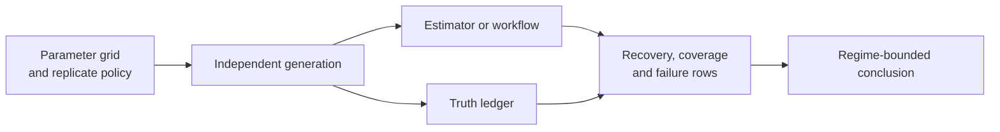
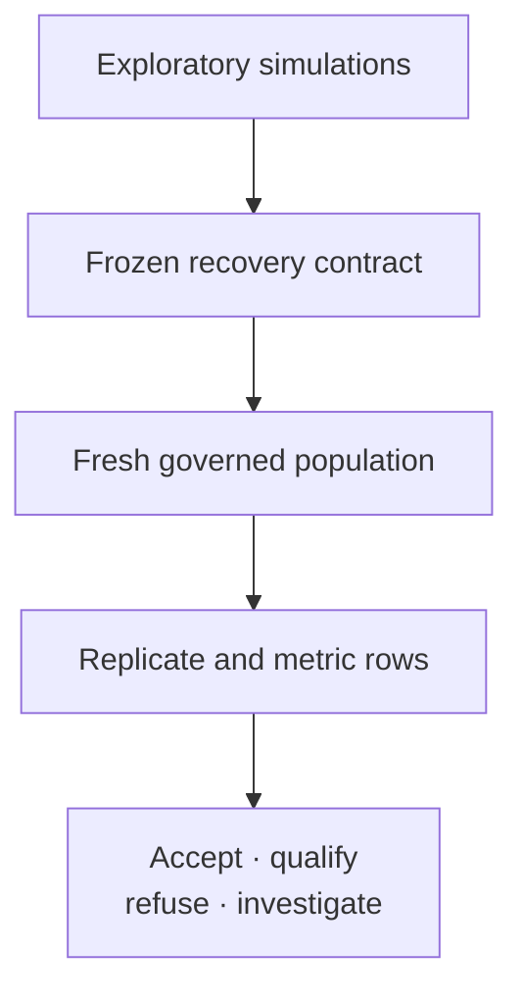

# Simulation Recovery And Calibration

A recovery experiment tests an estimator or workflow against conditions known
from generation. It is credible only when the generator contract, replicate
population, estimator contract, failures, metrics, and acceptance rule are
declared before outcomes are inspected.

## Design From The Failure Mode

Begin with the scientific failure that would invalidate use of the method,
then derive the experiment. A large undirected simulation grid can produce
many summaries while never exercising the boundary that controls the claim.

| Design field | Question fixed before generation | Example failure exposed |
| --- | --- | --- |
| estimand | What exact quantity or structure must be recovered? | a correct topology masks biased branch lengths |
| regime | Which signal, boundary, missingness, and sample-size conditions matter? | average performance masks short-alignment failure |
| population | How are seeds allocated, and what counts as a requested replicate? | failed draws disappear from the denominator |
| metric | Which loss, coverage, topology, or completion measure addresses the claim? | mean error hides catastrophic tail behavior |
| threshold | What result is acceptable, qualified, or refusing? | tolerance is relaxed after outcomes are known |
| stopping rule | What determines the final replicate count? | sampling stops when a favorable estimate appears |
| exclusion rule | Which outcomes are ineligible, and how are they retained? | non-converged fits are silently removed |

The frozen design should make an unfavorable outcome interpretable. If a
failure cannot be assigned to a regime, replicate state, metric, and rule, the
experiment is not yet an acceptance test.

## Define The Estimand And Recovery Unit

| Generated object | Possible recovery unit | Required identity |
| --- | --- | --- |
| topology | whole-tree equality, clade, split, quartet, distance | taxon population, rooting rule and structural key |
| branch length or node age | structurally keyed branch/node value | tree identity, units and conditioning convention |
| continuous parameter | signed error, relative error, interval coverage | parameter key, transform, boundary and generating value |
| ancestral state | node/state probability or preferred state | stable node key, state order and loss function |
| discrete history | tip state, branch dwell time, event count or transition | branch key, state labels, opportunity and event identity |
| alignment or trait distribution | site/replicate summary and predictive discrepancy | realized data identity, generator model and summary definition |

Choose the recovery unit before selecting a metric. Exact topology recovery and
clade recovery answer different questions; parameter bias and interval coverage
can disagree; correct tip states do not imply recovered transition histories.

## Retain Every Replicate State

Each requested replicate ends in exactly one auditable state:

| State | Meaning | Treatment |
| --- | --- | --- |
| generated and evaluated | both truth and admissible estimate exist | include in the declared comparison |
| generation refused or failed | no eligible realized dataset exists | retain cause in the requested denominator |
| analysis refused | generated data violated a documented estimator precondition | retain truth, refusal and regime identity |
| analysis failed or partial | execution began without an admissible terminal estimate | retain partial artifacts and failure cause |
| generated but not comparable | truth and estimate do not share the declared estimand | retain explicit non-comparability reason |

Do not regenerate a failed seed until a usable dataset appears. Do not compute
bias only over converged fits without also reporting convergence and exclusion
rates by parameter regime.

## Evaluate Recovery By Regime

Average performance can hide boundary failures. Predeclare a grid covering
interior and boundary parameter values, small and large trees, short and long
alignments, balanced and imbalanced sampling, weak and strong signal, and
missing or ambiguous observations where supported.

For each regime report requested, generated, executed, comparable, passed,
failed, and excluded counts. Then retain metric distributions rather than only
means. Tail error, catastrophic failures, and non-coverage can matter even when
average bias is small.

## Match Metrics To Claims

| Claim | Minimum metrics | Important companion evidence |
| --- | --- | --- |
| parameter estimates are calibrated | signed bias, absolute error, interval coverage | boundary rate, interval width, convergence and regime |
| topology is recovered | exact recovery plus clade/split or distance observations | taxon/root policy, unresolved trees and failed searches |
| uncertainty is calibrated | empirical coverage at declared nominal levels | interval construction, effective sample size and selection |
| ancestral summaries are useful | state loss or probability score by structural node | node availability, ambiguity and tree/model sensitivity |
| stochastic histories are recovered | event/count/dwell discrepancies under declared aggregation | opportunity denominator and non-identifiability limits |
| workflow is robust | completion, refusal, failure and artifact-integrity rates | resource regime, warnings and reproducibility checks |

A nominal 95% interval is calibrated only if its empirical coverage is assessed
over the declared replicate population. One interval containing its generating
value is an example, not a calibration result.

## Protect Against Circular Evidence

Using the same transition code, likelihood kernel, or tree convention in the
generator and estimator can make shared defects invisible. Record the
independence basis for each experiment:

- separate implementation or external reference;
- analytically derived known answer;
- independently generated fixed fixture;
- shared implementation with only invariant-level claims;
- biological data with no known truth and therefore no recovery claim.

Shared-code simulation remains valuable for schema, invariants, failure
handling, and end-to-end reproducibility. Describe it at that strength rather
than presenting it as independent numerical validation.

## Separate Exploration From Acceptance

Pilot runs may reveal useful regimes, metrics, or tolerances. Preserve them as
exploration. Freeze the generator revision, parameter grid, seed allocation,
estimator configuration, metric definitions, thresholds, and stopping rule
before the governed evaluation begins.

Increasing replication after an unfavorable result is valid diagnostic work,
but it creates a separately identified evaluation. Retain the original result
and explain the changed precision or stopping rule.

## Publish A Recovery Packet

The minimum packet contains generator and estimator versions, parameter grid,
seed allocation, realized-data and truth identities, replicate states,
row-level estimates and metrics, regime summaries, failures, acceptance rules,
and structured artifact checksums. Figures may display bias, coverage, topology
distance, or failure rates, but the ledger owns the denominator and decision.

Limit the conclusion to the simulated regimes and the independence actually
established. Successful recovery under the generating model does not establish
that the model is adequate for an empirical biological system.
