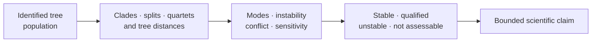
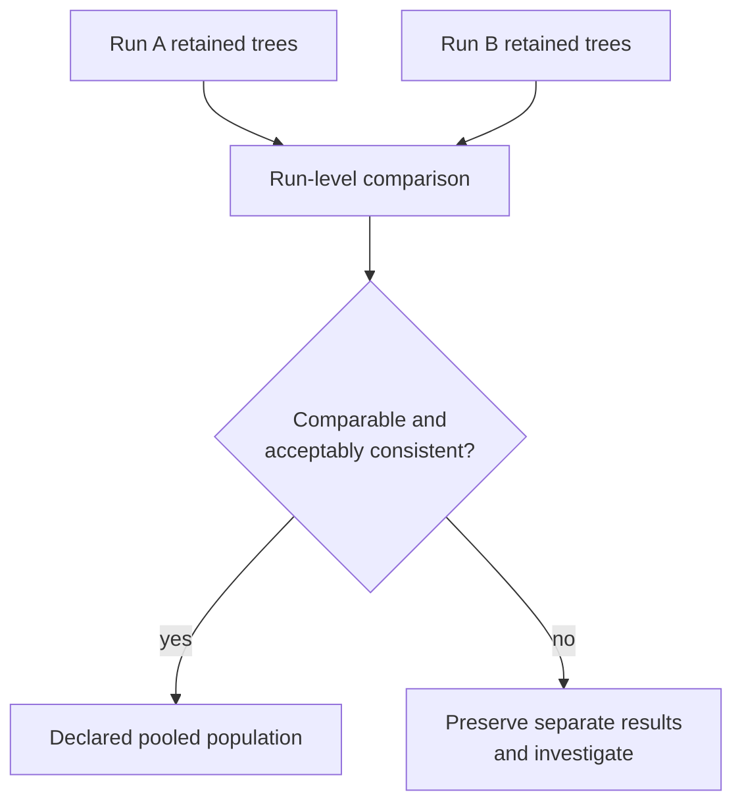

# Tree Uncertainty And Sensitivity

Tree uncertainty is not one number. It can appear as competing topology modes,
unstable clades or taxa, disagreement between bootstrap and posterior support,
gene-tree conflict, sensitivity to consensus thresholds, or dependence on
burn-in and thinning. Each pattern has a different denominator and consequence
for downstream claims.

## Diagnose The Uncertainty Source

| Pattern | Relevant public surface | Interpretation boundary |
| --- | --- | --- |
| several common topology modes | `summarize_posterior_topology_diversity`, `cluster_trees_by_topology`, `detect_posterior_topology_multimodality` | one consensus may conceal separated regions of tree space |
| clades or taxa change across trees | `detect_unstable_clades`, `detect_unstable_taxa`, `detect_rogue_taxa` | instability identifies dependence, not the biological cause |
| bootstrap and posterior support disagree | `compare_bootstrap_and_posterior_uncertainty` | methods have different sampling meanings and need aligned clade keys |
| two posterior samples differ | `compare_posterior_tree_sets`, `compare_posterior_topological_diversity` | chain/run populations must be independently identified and comparably selected |
| gene trees conflict | `summarize_gene_tree_conflicts`, `compute_gene_tree_quartet_concordance_factors` | discordance is an observation; incomplete lineage sorting or another cause requires separate evidence |
| conclusion changes with threshold or thinning | `compare_consensus_thresholds`, `assess_tree_set_thinning_sensitivity` | stability applies only to the declared alternatives and selection policy |

The corresponding reports preserve row-level observations. A narrative such
as “topology was uncertain” is not a substitute for mode frequencies, unstable
clade keys, affected taxa, run comparisons, or failed members.

## Retain The Analysis Population

For posterior trees, record chain and run identity, requested samples, burn-in,
thinning, retained sample indices, parse failures, duplicate handling, and
weights. For bootstrap trees, record requested, completed, failed, and admitted
replicates. For gene trees, retain locus identity and taxon reconciliation.

Changing any of these creates a new uncertainty result. In particular, a
thinned sample can be useful for resource control while supporting a weaker
statement about rare modes or tail behavior than the full retained sample.

## Distinguish Frequency, Conflict, And Instability

- **frequency** counts how often an identified clade, split, topology, or
  quartet appears in the admitted population;
- **conflict** records incompatible observations or mutually exclusive clades;
- **instability** records how a conclusion or identity changes across members,
  methods, runs, or policies.

A low-frequency clade is not automatically a conflict. A high-frequency clade
can coexist with instability elsewhere in the tree. A rogue-taxon score does
not authorize deleting that taxon; it identifies a sensitivity question that
must be rerun with a declared population change.

## Propagate Uncertainty To The Consumer

| Consumer | Minimum propagation |
| --- | --- |
| ancestral reconstruction | node/clade identity across trees, state summary by member, missing nodes and conclusion stability |
| comparative model | coefficient/model summary across trees, failed fits, admitted taxa and direction/significance stability |
| biogeography or host history | event or transition observation across trees, opportunity denominator and unresolved placements |
| representative-tree figure | selection method, clade frequencies, omitted modes and unstable taxa/clades |
| publication claim | uncertainty population, sensitivity axes, outcome class and exact non-claim |

If downstream analysis uses one selected tree, say so explicitly. The analysis
result is conditional on that tree until a declared set of plausible trees is
propagated through the method.

## Compare Runs Without Pooling Them First

Keep run or chain identities separate long enough to compare topology
frequencies, distance distributions, modes, branch lengths, node ages, and
failed-member patterns. Pooling before comparison can make two disagreeing
runs look like one broad posterior.

Pooling is a new population identity. Retain the run-level comparison even
when pooling is accepted.

## Classify The Consequence

Use `stable` only when the material conclusion survives the declared tree
population and sensitivity policies. Use `qualified` when direction survives
but magnitude, support, selected topology, or affected clades change. Use
`unstable` when plausible alternatives reverse or remove the conclusion. Use
`not assessable` when failures, missing runs, or non-comparable identities
prevent the planned evaluation.

The classification must link to its population, thresholds, row-level
observations, and failed members. Figures reveal modes and conflicts; the
structured reports own the denominator and consequence.
