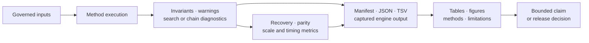
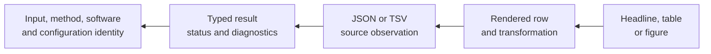

# Validation, Benchmarks, And Reporting

A scientific value becomes trustworthy through a chain of inspectable
decisions: input validation, numerical checks, workflow diagnostics, benchmark
comparisons, structured artifacts, and a report that preserves the limits of
the underlying result. Bijux Phylogenetics treats that chain as part of the
scientific surface.

## Validation Layers

| Layer | Typical checks | Failure means |
| --- | --- | --- |
| input structure | schemas, dimensions, identifiers, taxa, finite values | the method cannot safely interpret the input |
| mathematical invariants | probabilities, matrix properties, score decomposition, monotonic bounds | the computation violates its declared model contract |
| known answers and properties | exact fixtures, symmetry, limiting cases, round trips | a bounded numerical or behavioral contract is broken |
| workflow integration | adapters, composition, artifacts, error propagation | components do not preserve a coherent run record |
| recovery and reference comparison | parameter/topology recovery, tolerance-based parity | the named fixture or reference acceptance rule is not met |
| production scale | time, memory, convergence, practical-limit policy | the declared operating envelope is unsupported |
| publication and release | schemas, freshness, docs, packages, evidence linkage | the result is not ready for its claimed distribution surface |

These layers are cumulative only where a claim depends on them. Structural
validity does not imply numerical correctness; reference agreement does not
imply biological adequacy; a passing release gate does not expand the tested
scope.

## Route A Claim To The Required Proof

| Intended statement | Minimum proof record | Missing proof that blocks the statement |
| --- | --- | --- |
| input is accepted | schema and semantic validation with input identity | unresolved identifiers, dimensions, states, or units |
| native calculation is numerically correct on a bounded case | known-answer/property observation plus model and tolerance | no independent expected value or invariant |
| search or sampler is adequate for this run | trace/chain diagnostics and complete attempt denominator | winner-only output, failed starts, or absent chain evidence |
| behavior corresponds with a named implementation | aligned live or checked reference observations | version, parameterization, normalization, tolerance, or denominator absent |
| method is robust over a declared range | recovery, stress, and sensitivity population | only successful or central cases retained |
| scientific study claim is supported | current Evidence Book claim with governed inputs, observations, checks, and verdict | stale, neighboring, contract-only, or non-comparable evidence |
| package is publishable | package, docs, schema, evidence, artifact, and readiness gates | any contradictory or missing governed release record |

Use the narrowest row that actually contains the claim. Proof does not flow
upward merely because a stronger-sounding lane exists elsewhere in the
repository.

## Benchmark Design

A benchmark is an experiment, not a stopwatch. Its record should identify the
question, corpus, comparison target, environment, warm-up and repetition
policy, measured quantities, acceptance thresholds, exclusions, and raw
observations. Accuracy, robustness, scalability, and throughput are separate
dimensions.

Native likelihood and topology inference benchmarks cover hand-checkable and
simulated accuracy fixtures, wrapper/reference correspondence, and artifact
production. Model-fitting and macroevolution benchmarks include GEIGER-aligned
references and real-dataset review. Scalability suites expose growth behavior,
stress conditions, and practical limits. A benchmark supports only its named
method, corpus, configuration, platform envelope, and metric.

## Comparing Implementations Honestly

Before declaring parity, align state coding, topology, branch-length units,
model parameterization, optimization target, random seed policy, missing-data
treatment, and output convention. Then choose a tolerance with a scientific and
numerical rationale.

A difference may be:

- a defect in either implementation;
- an allowed numerical difference within the declared tolerance;
- a convention mismatch that makes values not comparable;
- an optimization or sampling failure;
- a model or feature that one side does not own.

Do not force these conditions into one status vocabulary. The record type
determines the allowed states.

## Status Namespaces

| Record | Governed states | Interpretation |
| --- | --- | --- |
| live parity case | `passed`, `failed`, `skipped` | whether the selected harness case executed and satisfied its registered comparisons |
| validation or benchmark observation | named metric plus pass/fail rule, warning, or exclusion | whether one declared acceptance rule held for one observation |
| Evidence Book verdict | `matched`, `matched_with_tolerance`, `mismatch_explained`, `mismatch_unexplained`, `not_comparable` | claim-scoped comparison conclusion in a governed bundle |
| resolution workflow | open follow-through, named blocker, or accepted bounded state | what action remains after the recorded evidence verdict |

A skipped live reference case is not `not_comparable` evidence: no evidence
verdict exists until a governed bundle establishes one. Likewise,
`mismatch_unexplained` is not a generic process failure, and an open
follow-through item must not replace the bundle's current verdict. Preserve
every failed, skipped, excluded, mismatched, and non-comparable record in its
own denominator and namespace.

## Reporting Contract

Structured results are canonical. Manifests link input identities,
configuration, versions, outputs, diagnostics, and integrity metadata. JSON
preserves typed run and result records; TSV supports tabular review; captured
external-engine files preserve the original boundary. Markdown, HTML, figures,
methods text, and supplementary tables are generated or assembled for human
interpretation.

A report should answer, without reconstructing the run:

1. What question and method does this result address?
2. Which exact data, tree, model, software, and configuration produced it?
3. Which diagnostics qualify the headline result?
4. Which values are estimates, comparisons, support measures, or verdicts?
5. Which warnings, exclusions, and uncertainty remain material?
6. Which machine-readable artifact supports every displayed value?

Figures must not be the only location of a result, and prose must not silently
upgrade a diagnostic into a scientific conclusion.

## Audit A Report From The Headline Backward

Every displayed estimate, count, support value, exclusion, and verdict must
complete this trace. Aggregation must retain its eligible population and
transformation; captions must retain method and scale; missing or failed rows
must remain visible in structured status. If the trace stops at prose, a
figure, or an unversioned intermediate file, the report is not an authoritative
scientific record.

## From Benchmark To Evidence

Benchmark artifacts become evidence only when a governed claim maps them to
identified sources, inputs, checks, acceptance rules, and a current verdict.
The [Evidence Book](../../03-bijux-phylogenetics-evidence-book/index.md) provides
that stronger layer. The [validation lanes](../../01-bijux-phylogenetics/quality/validation-lanes.md),
[native benchmark evidence](../../01-bijux-phylogenetics/quality/native-benchmark-evidence.md),
and [artifact contracts](../../01-bijux-phylogenetics/interfaces/artifact-contracts.md)
describe the operational review paths behind it.
