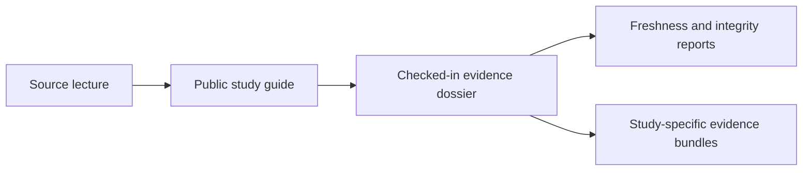

# Evidence Book

This section explains the comparative study record behind the public
phylogenetics runtime.

The five study families come from course material that the repository has
turned into checked-in, reviewable evidence. All five now have governed
parity bundle IDs. Some studies already carry stronger numerical
parity records, while others keep parity verdicts open because the
scientific workflow still depends on an external engine or an unclosed
lecture-specific boundary.

## Start Here

- checked-in study dossiers:
  [`evidence-book/README.md`](https://github.com/bijux/bijux-phylogenetics/blob/main/evidence-book/README.md)
- repository-wide review reports:
  [`evidence-book/index/`](https://github.com/bijux/bijux-phylogenetics/tree/main/evidence-book/index)

Treat those checked-in reports as the current source of truth when you need
live repository status rather than the stable narrative on this page.

## At A Glance

- studies: `5`
- evidence bundles: `43`
- teaching studies: `2`
- migration studies: `2`
- freshness statuses: `current=43`
- coverage gaps still tracked: `28`
- foundational numerical trust: `bounded`
- reviewer readiness: `bounded`
- maturity tier: `reviewable_but_incomplete`

## Core Reading Order

1. `overview`
2. `PCM1`
3. `PCM2`
4. `PCM3`
5. `PCM4`
6. `PCM5`

That sequence mirrors the course progression. It starts with data and tree
preparation, moves through comparative regression, and ends with the
cichlid mixed-model studies where external posterior tooling remains the
largest open boundary.

## Study Atlas

| Study | Main question | Evidence IDs | Current repository state |
| --- | --- | --- | --- |
| [Cichlid Bayesian Linear And Phylogenetic Mixed Models](./pcm4-cichlid-bayesian-linear-and-phylogenetic-mixed-models/index.md) | Where does the cichlid workflow move from standard regression into Bayesian mixed models with a phylogenetic effect? | `evidence-001` to `evidence-007` (7 bundles) | Governed parity bundles deployed; posterior workflow still external |
| [Cichlid Phylogenetic Generalized Linear Mixed Models](./pcm5-cichlid-phylogenetic-generalized-linear-mixed-models/index.md) | How do count models, binary-style models, repeated measures, and posterior signal estimates fit together in one study family? | `evidence-001` to `evidence-009` (9 bundles) | Governed parity bundles deployed; posterior workflow still external |
| [Primate Continuous And Categorical Regression](./pcm3-primate-continuous-and-categorical-regression/index.md) | How should continuous predictors, categorical predictors, and interactions be interpreted together in comparative regression? | `evidence-001` to `evidence-008` (8 bundles) | Governed parity bundles deployed; lecture-specific verdicts remain open |
| [Primate Longevity Signal](./pcm1-primate-longevity-signal/index.md) | How do primate traits and tree preparation become a usable signal and ancestral-state workflow? | `evidence-001` to `evidence-009` (9 bundles) | Governed parity bundles deployed; plotting boundary remains explicit |
| [Primate PGLS And Signal](./pcm2-primate-pgls-and-signal/index.md) | How do baseline GLS, PGLS, transformed trees, and signal tests behave on the same primate dataset? | `evidence-001` to `evidence-010` (10 bundles) | Governed parity bundles deployed; one coverage boundary remains explicit |

## When To Use These Pages

- Start with PCM1 if you want the full preparation path from raw primate traits and tree files to signal estimation and ancestral reconstruction.
- Continue to PCM2 when you want to compare baseline GLS, PGLS, transformed trees, and signal testing on the same primate study.
- Read PCM3 when the main question is how continuous predictors, categorical predictors, and interactions should be interpreted together.
- Read PCM4 and PCM5 together when the main question is the cichlid mixed-model sequence, because they share the same dataset family and the same external posterior boundary.

- Use the public study guides when you want the scientific story in plain language.
- Use the checked-in evidence-book when you need provenance, registries, or bundle-level proof.
- Use the index reports when you need freshness, integrity, or repository-wide gap tracking.

## Reading Boundaries

- These pages do not claim that every lecture has already been reproduced end to end inside the repository.
- They do not hide external-tool dependencies just because nearby Python surfaces exist.
- They do keep those limits visible, especially for PCM4 and PCM5.

## Review Reports

- teaching and migration index: [`evidence-book/index/teaching-and-migration.md`](https://github.com/bijux/bijux-phylogenetics/blob/main/evidence-book/index/teaching-and-migration.md)
- parity dashboard: [`evidence-book/index/parity-dashboard.md`](https://github.com/bijux/bijux-phylogenetics/blob/main/evidence-book/index/parity-dashboard.md)
- freshness report: [`evidence-book/index/freshness-report.md`](https://github.com/bijux/bijux-phylogenetics/blob/main/evidence-book/index/freshness-report.md)
- integrity report: [`evidence-book/index/integrity-report.md`](https://github.com/bijux/bijux-phylogenetics/blob/main/evidence-book/index/integrity-report.md)
- coverage gaps: [`evidence-book/index/coverage-gaps.md`](https://github.com/bijux/bijux-phylogenetics/blob/main/evidence-book/index/coverage-gaps.md)
- claim re-audit: [`evidence-book/index/claim-reaudit.md`](https://github.com/bijux/bijux-phylogenetics/blob/main/evidence-book/index/claim-reaudit.md)
- closure criteria: [`evidence-book/index/closure-criteria.md`](https://github.com/bijux/bijux-phylogenetics/blob/main/evidence-book/index/closure-criteria.md)

The study record is useful because it keeps strong results visible without
pretending that every workflow is fully reproduced inside the repository.
