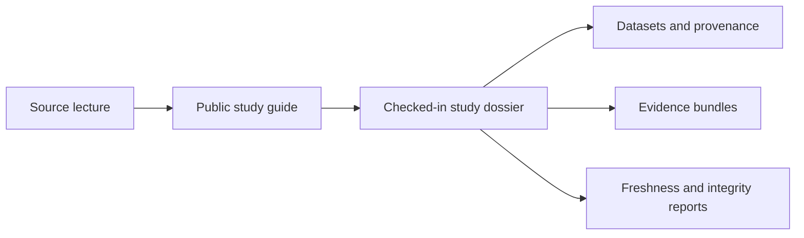

# Evidence Book

This section explains the governed comparative-study record behind the public
phylogenetics runtime.

The five study families come from course material that the repository has
turned into checked-in, reviewable evidence. All five now have governed
bundle IDs, local public study guides, dataset catalogs, and checked-in
dossiers. Some studies already carry stronger numerical closure than others,
but all five are now part of one decomposed public record instead of a vague
"teaching example" bucket.

## What This Guide Is For

- to explain what each PCM study is trying to show in reader-facing language
- to point directly to the checked-in dossier, datasets, and governed evidence
  bundles behind that study
- to keep open boundaries visible instead of flattening every study into the
  same level of trust
- to show that even this first evidence cluster already covers preparation,
  signal, comparative regression, and bounded mixed-model study families

## What The Checked-In Record Already Contains

| Evidence surface | What is already here |
| --- | --- |
| Study families | five public study guides with local dossier links |
| Bundle governance | `43` governed evidence bundles across PCM1 through PCM5 |
| Study materials | source copies, governed derivatives, dataset catalogs, provenance guides, freshness reports, and integrity reports |
| Trust language | explicit coverage gaps and bounded parity wording where lecture-equivalent closure is still open |

## Why This Evidence Group Matters

This evidence book is not trying to prove every scientific surface in the
repository at once. It does already prove that the repository can preserve one
serious comparative-study family with:

- durable source provenance
- named datasets and derivative inputs
- decomposed evidence IDs instead of one vague study label
- bounded trust language where the lecture workflow still exceeds repository
  closure

## Start Here

- checked-in study dossiers:
  [`evidence-book/README.md`](https://github.com/bijux/bijux-phylogenetics/blob/main/evidence-book/README.md)
- repository-wide review reports:
  [`evidence-book/index/`](https://github.com/bijux/bijux-phylogenetics/tree/main/evidence-book/index)

Treat those checked-in reports as the current source of truth when you need
live repository status rather than the stable narrative on this page.

## At A Glance

- studies: `5`
- evidence bundles: `43`
- foundational numerical trust: `bounded`
- reviewer readiness: `bounded`
- maturity tier: `reviewable_but_incomplete`

## Core Reading Order

1. `overview`
2. `PCM1: primate longevity signal`
3. `PCM2: primate PGLS and signal`
4. `PCM3: primate continuous and categorical regression`
5. `PCM4: cichlid Bayesian linear and phylogenetic mixed models`
6. `PCM5: cichlid phylogenetic generalized linear mixed models`

That sequence mirrors the teaching progression. It starts with primate data
preparation and signal work, moves through regression interpretation, and ends
with the cichlid mixed-model studies where posterior workflows remain the
largest open boundary.

## Study Atlas

| Study | Main question | Evidence IDs | Current repository state |
| --- | --- | --- | --- |
| [Primate Longevity Signal](./pcm1-primate-longevity-signal/index.md) | How do primate traits and tree preparation become a usable signal and ancestral-state workflow? | `evidence-001` to `evidence-009` (9 bundles) | Governed parity bundles deployed; plotting boundary remains explicit |
| [Primate PGLS And Signal](./pcm2-primate-pgls-and-signal/index.md) | How do baseline GLS, PGLS, transformed trees, and signal tests behave on the same primate dataset? | `evidence-001` to `evidence-010` (10 bundles) | Governed parity bundles deployed; one coverage boundary remains explicit |
| [Primate Continuous And Categorical Regression](./pcm3-primate-continuous-and-categorical-regression/index.md) | How should continuous predictors, categorical predictors, and interactions be interpreted together in comparative regression? | `evidence-001` to `evidence-008` (8 bundles) | Governed parity bundles deployed; lecture-specific verdicts remain open |
| [Cichlid Bayesian Linear And Phylogenetic Mixed Models](./pcm4-cichlid-bayesian-linear-and-phylogenetic-mixed-models/index.md) | Where does the cichlid workflow move from standard regression into Bayesian mixed models with a phylogenetic effect? | `evidence-001` to `evidence-007` (7 bundles) | Governed parity bundles deployed; posterior workflow still external |
| [Cichlid Phylogenetic Generalized Linear Mixed Models](./pcm5-cichlid-phylogenetic-generalized-linear-mixed-models/index.md) | How do count models, binary-style models, repeated measures, and posterior signal estimates fit together in one study family? | `evidence-001` to `evidence-009` (9 bundles) | Governed parity bundles deployed; posterior workflow still external |

## How To Read A Study Dossier

1. Start with PCM1 if you need the full path from raw workbook and tree inputs
   to prepared study state, signal estimation, and ancestral reconstruction.
2. Continue to PCM2 and PCM3 when the question shifts from preparation into
   phylogenetically corrected regression and interpretation.
3. Read PCM4 and PCM5 together when the question is the cichlid mixed-model
   sequence, because they share dataset material and the same external
   posterior boundary.
4. Follow the linked dossier and repository-wide reports whenever you need the
   governed bundle record rather than the narrative summary.

## Reading Boundaries

- These pages do not claim that every lecture has already been reproduced end
  to end inside the repository.
- They do not hide external-tool dependencies just because nearby Python
  surfaces exist.
- They do keep those limits visible, especially for PCM4 and PCM5, because
  bounded trust language is part of the value of the evidence book.

## Review Reports

- teaching and migration index: [`evidence-book/index/teaching-and-migration.md`](https://github.com/bijux/bijux-phylogenetics/blob/main/evidence-book/index/teaching-and-migration.md)
- parity dashboard: [`evidence-book/index/parity-dashboard.md`](https://github.com/bijux/bijux-phylogenetics/blob/main/evidence-book/index/parity-dashboard.md)
- freshness report: [`evidence-book/index/freshness-report.md`](https://github.com/bijux/bijux-phylogenetics/blob/main/evidence-book/index/freshness-report.md)
- integrity report: [`evidence-book/index/integrity-report.md`](https://github.com/bijux/bijux-phylogenetics/blob/main/evidence-book/index/integrity-report.md)
- coverage gaps: [`evidence-book/index/coverage-gaps.md`](https://github.com/bijux/bijux-phylogenetics/blob/main/evidence-book/index/coverage-gaps.md)
- claim re-audit: [`evidence-book/index/claim-reaudit.md`](https://github.com/bijux/bijux-phylogenetics/blob/main/evidence-book/index/claim-reaudit.md)
- closure criteria: [`evidence-book/index/closure-criteria.md`](https://github.com/bijux/bijux-phylogenetics/blob/main/evidence-book/index/closure-criteria.md)
