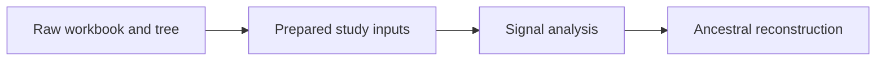

# PCM1: Primate Longevity Signal

PCM1 is the opening comparative case study in the evidence book. It follows
the primate dataset from raw workbook and tree inputs through data repair,
species alignment, phylogenetic signal, and ancestral reconstruction.

## Why PCM1 Matters

Later studies only make sense if these earlier steps are already clear. PCM1
shows where the primate data came from, how the tree was trimmed, how the
species alignment was made reviewable, and how the first comparative claims
were bounded.

## Read PCM1 In Order

1. [Data and tree preparation](data-and-tree-preparation.md)
2. [Signal and ancestral results](signal-and-ancestral-results.md)

## Checked-In Study Dossier

The full checked-in record lives under
[`evidence-book/studies/primate-longevity-signal/`](https://github.com/bijux/bijux-phylogenetics/blob/main/evidence-book/studies/primate-longevity-signal/README.md).

## Inputs And Evidence Map

- lecture source copies:
  `primate_raw.xlsx`, `primate.RData`, `primate.csv`, `primatetree.nex`, and
  `trimmed_primatetree.nex`
- governed derivatives:
  `reference_primate.csv` and `reference_trimmed_primatetree.nwk`
- catalogs:
  [dataset catalog](https://github.com/bijux/bijux-phylogenetics/blob/main/evidence-book/studies/primate-longevity-signal/datasets/README.md)
  and
  [provenance guide](https://github.com/bijux/bijux-phylogenetics/blob/main/evidence-book/studies/primate-longevity-signal/provenance/README.md)
- evidence bundles:
  `evidence-001` through `evidence-009`

## What To Take From PCM1

- preparation choices are visible before model fitting
- signal and ancestral outputs stay tied to the same prepared study state
- introductory evidence can be useful without pretending to close later
  regression or mixed-model questions

## What PCM1 Does Not Prove

- PCM1 does not close every comparative method in the repository.
- It does not turn one primate teaching family into a general claim about all
  datasets.
- It does not replace the broader freshness, integrity, or coverage reports.

## Read Next

- [PCM2: primate PGLS and signal](../pcm2-primate-pgls-and-signal/index.md)
