# PCM1 Signal And Ancestral Results

PCM1 evaluates Pagel's λ on simulated and primate traits, then compares
continuous ancestral-state estimates on the governed primate tree. The summary
bundle records both analytical comparisons as `matched_with_tolerance`.

```mermaid
flowchart LR
    prepared["Reconciled tree<br/>and longevity traits"]
    random["Random-trait<br/>λ fits"]
    primate["Primate longevity<br/>λ fit"]
    ancestral["Internal-node<br/>state estimates"]
    compare["R ↔ Bijux values<br/>under governed tolerances"]

    prepared --> random --> compare
    prepared --> primate --> compare
    prepared --> ancestral --> compare
```

## Phylogenetic Signal

Pagel's λ scales off-diagonal phylogenetic covariance under the fitted model.
Values near zero reduce that covariance; values near one retain the Brownian
tree covariance. The estimate is conditional on the response, tree, branch
lengths, model, bounds, and optimization convention.

The study separates random-trait fits from the primate longevity fit. Random
examples exercise expected low-signal behavior without becoming a null model
for the observed biological data.

## Ancestral Reconstruction

Internal-node estimates are conditional predictions, not observed historical
measurements. Comparison requires matching node identity, rooted topology,
branch lengths, tip values, and model convention. Node row number or plotting
order is not a durable identifier.

The governed claim compares ancestral-state outputs numerically within the
declared tolerance. Rendered node sizes, colors, and layouts are explicitly
outside figure-for-figure parity.

## Summary-Bundle Verdicts

| Claim | Verdict |
| --- | --- |
| random-data λ fits | `matched_with_tolerance` |
| primate λ inference | `matched_with_tolerance` |
| ancestral-state outputs | `matched_with_tolerance` |
| visual surface tracking | `not_comparable` |
| artifact provenance tracking | `not_comparable` |

`not_comparable` is intentional for governance or presentation records that do
not define a numerical parity target.

## Interpretation Limits

- Signal does not identify a causal evolutionary mechanism.
- A fitted λ does not prove Brownian motion is the best trait model.
- Ancestral estimates inherit uncertainty from data, tree, and parameters.
- Numerical parity on this dataset does not establish agreement for all trees
  or traits.
- Analytical agreement does not require pixel-identical plots.

The primary record is
[`evidence-001`](https://github.com/bijux/bijux-phylogenetics/tree/main/evidence-book/studies/primate-longevity-signal/evidence-001),
including claims, checks, results, provenance, and reviewer summary.
