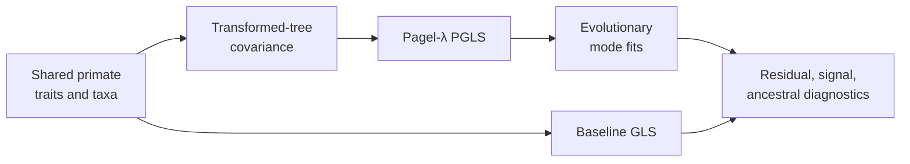

# PCM2: Primate PGLS And Signal

PCM2 evaluates how phylogenetic covariance changes regression, model
comparison, signal diagnostics, and ancestral inference on the prepared
primate data. Baseline GLS and phylogenetically corrected models remain in one
comparison chain so changes in coefficients and fit can be attributed.

## Scientific Questions

- How do coefficient estimates and residual structure change after
  phylogenetic covariance is introduced?
- Does estimating or transforming the covariance improve fit under a declared
  comparison rule?
- Are signal, evolutionary-mode, and ancestral results mutually consistent
  for the same taxa and response definition?

PGLS changes the residual covariance model. It does not simply add a
“phylogenetic correction” flag to ordinary regression, and it does not make
the fitted relationship causal.

## Evidence Decomposition

| Bundle | Evaluated surface | Current boundary |
| --- | --- | --- |
| `evidence-001` | reload semantics | governed parity deployed |
| `evidence-002` | baseline GLS | governed parity deployed |
| `evidence-003` | Pagel-λ regression | governed parity deployed |
| `evidence-004` | phylogenetic signal | governed parity deployed |
| `evidence-005` | residual diagnostics | governed parity deployed |
| `evidence-006` | transformed tree | governed parity deployed |
| `evidence-007` | evolutionary mode fits | governed parity deployed |
| `evidence-008` | likelihood-ratio comparison | governed parity deployed |
| `evidence-009` | ancestral modes | unresolved mismatches remain explicit |
| `evidence-010` | intercept sweep | parity verdict remains open |

The last two rows prevent a mostly aligned workflow from being summarized as
unqualified end-to-end parity.

## Inputs And Provenance

The dossier contains the source workspace and tree plus governed
`reference_primate.csv` and `reference_trimmed_primatetree.nwk` derivatives.
See the [dataset catalog](https://github.com/bijux/bijux-phylogenetics/blob/main/evidence-book/studies/primate-pgls-and-signal/datasets/README.md),
[provenance record](https://github.com/bijux/bijux-phylogenetics/blob/main/evidence-book/studies/primate-pgls-and-signal/provenance/README.md),
and [runtime mapping](https://github.com/bijux/bijux-phylogenetics/blob/main/evidence-book/studies/primate-pgls-and-signal/reference/README.md).

## Model Comparison Discipline

Likelihood-ratio conclusions require nested, comparably fitted models and a
declared degrees-of-freedom convention. Information-criterion comparisons
answer a different question. Residual diagnostics qualify both baseline and
phylogenetic fits; a better scalar score does not excuse a broken residual
contract.

## Review Priorities

- Verify shared taxa and response transformation across every fit.
- Inspect the covariance/tree transformation rather than only its fitted
  parameter.
- Compare coefficients, likelihoods, and diagnostics together.
- Keep ancestral mismatch details attached to `evidence-009`.
- Keep the intercept-sweep verdict open until its closure criterion is met.

Detailed analysis is divided between
[model comparisons and PGLS](model-comparisons-and-pgls.md) and
[signal diagnostics and open boundaries](signal-diagnostics-and-open-boundaries.md).
Continue to [PCM3](../pcm3-primate-continuous-and-categorical-regression/index.md)
for categorical predictors and interactions.
