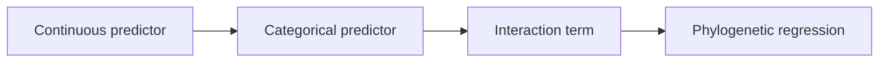

# PCM3: Primate Continuous And Categorical Regression

PCM3 is the multivariable regression study in the evidence book. It stays with
the primate dataset, but the main question changes: how should readers
interpret models once continuous predictors, categorical predictors,
interactions, and phylogenetic correction all appear together?

## Why PCM3 Matters

PCM3 is where the evidence book stops sounding like "PGLS" as a single broad
label and starts showing how interpretation really changes when coding,
standardization, interaction terms, and phylogenetic correction all matter at
once.

## What PCM3 Helps You Read

- how the intercept changes meaning after standardization or transformation
- how categorical predictors depend on a clear coding choice
- how interactions should be read as joint effects rather than isolated slopes
- how the regression story changes again after phylogenetic correction

## Checked-In Study Dossier

The full checked-in record lives under
[`evidence-book/studies/primate-continuous-and-categorical-regression/`](https://github.com/bijux/bijux-phylogenetics/blob/main/evidence-book/studies/primate-continuous-and-categorical-regression/README.md).

## Inputs And Evidence Map

- lecture source copies:
  `primate_raw.xlsx`, `primate.RData`, and `primatetree.nex`
- governed derivatives:
  `reference_primate.csv` and `reference_trimmed_primatetree.nwk`
- catalogs:
  [dataset catalog](https://github.com/bijux/bijux-phylogenetics/blob/main/evidence-book/studies/primate-continuous-and-categorical-regression/datasets/README.md)
  and
  [provenance guide](https://github.com/bijux/bijux-phylogenetics/blob/main/evidence-book/studies/primate-continuous-and-categorical-regression/provenance/README.md)
- evidence bundles:
  `evidence-001` through `evidence-008`

## Read PCM3 In Order

1. [Model design and phylogenetic regression](model-design-and-phylogenetic-regression.md)

## What To Take From PCM3

- the repository now exposes a structured regression study rather than a single
  undifferentiated "PGLS" claim
- interaction and coding choices are part of the scientific interpretation,
  not merely model syntax
- deployed bundles improve reviewability even when lecture-specific verdicts
  remain narrower than PCM1 or PCM2

## What Not To Overread

- bundle deployment is not a blanket claim of full numerical parity
- PCM3 does not replace the need to inspect the checked-in source record when
  provenance matters
- the study remains narrower than a full closed lecture-equivalent suite
