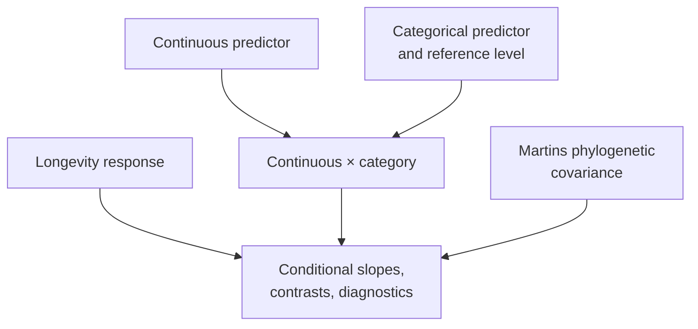

# PCM3: Primate Continuous And Categorical Regression

PCM3 moves from single-predictor comparative models to multivariable design.
Continuous predictors, categorical contrasts, interactions, transformations,
and phylogenetic covariance are evaluated as separate sources of meaning
rather than compressed into one PGLS label.

## Scientific Questions

- How does categorical coding change the intercept and reported contrasts?
- How should group-specific slopes be recovered from an interaction model?
- What changes when the response is transformed or the predictor standardized?
- Which differences remain after residual covariance follows the phylogeny?

An interaction coefficient is not an isolated effect. It modifies a
conditional slope under a specific reference coding. Standardization changes
the location represented by the intercept. Those semantics must match before
coefficients from different implementations can be compared.

## Evidence Decomposition

| Bundle | Evaluated surface |
| --- | --- |
| `evidence-001` | source intake, workspace reload, and shared data alignment |
| `evidence-002` | baseline GLS with continuous and categorical predictors |
| `evidence-003` | log response, residual diagnostics, marginal and sequential tests |
| `evidence-004` | intercept-free group estimates |
| `evidence-005` | continuous-by-categorical interaction |
| `evidence-006` | predictor scaling and intercept semantics |
| `evidence-007` | categorical phylogenetic regression with Martins covariance |
| `evidence-008` | post-correction diagnostics and hypothesis tests |

All eight bundles have governed structure and review artifacts. Their
lecture-specific parity verdicts remain open. Evidence infrastructure is
complete enough to localize the missing comparisons; it is not a passing
parity result.

## Inputs And Provenance

PCM3 reuses the primate source workspace and governed tree/trait derivatives
while carrying its own dataset registry and provenance. See the
[dataset catalog](https://github.com/bijux/bijux-phylogenetics/blob/main/evidence-book/studies/primate-continuous-and-categorical-regression/datasets/README.md),
[provenance record](https://github.com/bijux/bijux-phylogenetics/blob/main/evidence-book/studies/primate-continuous-and-categorical-regression/provenance/README.md),
and [runtime mapping](https://github.com/bijux/bijux-phylogenetics/blob/main/evidence-book/studies/primate-continuous-and-categorical-regression/reference/README.md).

## Review Priorities

- Match factor levels, reference category, design matrix, and missing-value
  exclusions before comparing coefficients.
- Compare transformed response and standardized predictor conventions exactly.
- Reconstruct conditional group slopes from main and interaction terms.
- Distinguish marginal from sequential hypothesis tests.
- Confirm that the phylogenetic fit uses the same taxa and response as the
  non-phylogenetic comparator.

## Current Scope

PCM3 supplies a complete claim decomposition and executable review locations
for the multivariable lecture. It does not yet claim lecture-level numerical
parity for any of the eight slices. The closure work is comparison and verdict
adjudication, not inventing broader runtime capability by implication.

See [model design and phylogenetic regression](model-design-and-phylogenetic-regression.md)
for the detailed interpretation contract.
