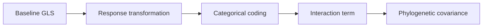

# PCM3 Model Design And Phylogenetic Regression

PCM3 is about model structure, not only model output. The lecture walks
through how one primate response changes interpretation as the regression
becomes more realistic.

## Main Analytical Steps

- fit a baseline GLS with one continuous and one categorical predictor
- transform the response to improve residual behavior
- remove the intercept when group-specific estimates are the real target
- add an interaction term to ask whether one slope depends on the categorical
  grouping
- standardize the continuous predictor to change the intercept meaning
- refit the model with a phylogenetic covariance structure through
  `corMartins`

## What Makes This Study Valuable

PCM3 forces the repository to be explicit about:

- how categorical levels are encoded
- which level is treated as the reference group
- how interaction coefficients should be read
- whether taxa were excluded before or after phylogenetic correction
- how diagnostic improvement is separated from biological interpretation

## What Readers Should Watch Closely

- whether the intercept is still biologically meaningful after transformation
  or standardization
- whether categorical coefficients are being read against the correct reference
  level
- whether the interaction term changes the meaning of the main effects rather
  than merely adding one more coefficient
- whether the move into `corMartins` changes the scientific interpretation or
  only the residual structure

## Current Repository Support

Nearby runtime surfaces already exist for categorical contrast reporting,
interaction-coefficient ledgers, comparative model-selection ledgers, and
residual review after phylogenetic regression.

Those surfaces make the study reviewable, but they do not yet turn PCM3 into a
fully closed lecture-equivalent parity suite.
