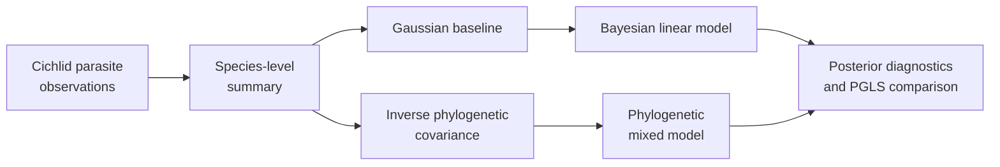

# PCM4: Cichlid Bayesian Linear And Phylogenetic Mixed Models

PCM4 introduces posterior inference and phylogenetic random effects through a
cichlid parasite study. It connects observation-level records to a
species-level analysis, compares a Gaussian baseline with Bayesian fits, and
uses the inverse phylogenetic covariance in an `MCMCglmm` model.

## Scientific Questions

- Does the parasite response retain the baseline predictor relationship after
  posterior uncertainty is represented?
- How much variation is assigned to the phylogenetic random effect?
- Are fixed-effect estimates and uncertainty coherent with the Brownian PGLS
  comparator?
- Do chain diagnostics support interpretation of posterior summaries?

The inverse covariance is not an implementation detail: taxon order,
rootedness, branch lengths, and alignment with the species table determine the
random-effect structure.

## Evidence Decomposition

| Bundle | Evaluated surface |
| --- | --- |
| `evidence-001` | data–tree alignment and species-level summarization |
| `evidence-002` | non-phylogenetic Gaussian baseline |
| `evidence-003` | Bayesian Gaussian chain diagnostics and summaries |
| `evidence-004` | inverse-tree construction and random-effect setup |
| `evidence-005` | phylogenetic mixed-model fixed-effect posterior |
| `evidence-006` | phylogenetic variance-component posterior |
| `evidence-007` | Brownian PGLS comparison |

All seven bundles are governed review units. Their posterior parity verdicts
remain open because the central computation is still the external `MCMCglmm`
workflow. The locally available PGLS comparator is useful evidence, but it is
not a replacement posterior.

## Inputs And Provenance

The study carries `cichlid.csv`, `cichlidtree.nex`, and `fishdata.RData` with
a [dataset catalog](https://github.com/bijux/bijux-phylogenetics/blob/main/evidence-book/studies/cichlid-bayesian-linear-and-phylogenetic-mixed-models/datasets/README.md),
[source provenance](https://github.com/bijux/bijux-phylogenetics/blob/main/evidence-book/studies/cichlid-bayesian-linear-and-phylogenetic-mixed-models/provenance/README.md),
and [runtime/reference mapping](https://github.com/bijux/bijux-phylogenetics/blob/main/evidence-book/studies/cichlid-bayesian-linear-and-phylogenetic-mixed-models/reference/README.md).

## Posterior Review Contract

A usable posterior comparison needs the prior, family, link, chain length,
burn-in, thinning, seed policy, effective sample size, autocorrelation, and
convergence evidence. Point estimates alone cannot establish parity. Fixed
effects, phylogenetic variance, residual variance, and their credible intervals
must be compared under matching parameterization.

## Review Priorities

- Reconcile observation species with tree tips before aggregation.
- Record exactly how repeated records become a species-level table.
- Verify inverse-covariance taxon order and scaling.
- Keep the Gaussian baseline, Bayesian non-phylogenetic fit, and phylogenetic
  mixed model as distinct comparisons.
- Preserve posterior diagnostics with every reported summary.
- State that `MCMCglmm` remains the posterior computation owner.

See the [mixed-model evidence boundary](mixed-model-evidence-boundary.md) for
the current closure requirements. PCM5 extends the same system to count,
binary-style, and repeated-measure models.
