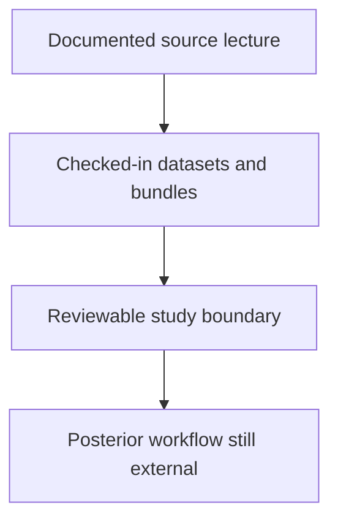

# PCM4 Mixed-Model Evidence Boundary

PCM4 deserves a direct boundary page because it is easy to over-read. The
lecture uses a Bayesian mixed-model workflow whose main outputs are posterior
summaries, convergence checks, and phylogenetic variance estimates.

## What Is Source-Backed And Deployed

- the cichlid dataset and tree provenance
- the species-level summarization step used by the lecture
- the decomposition of the lecture into smaller evidence slices
- governed bundle IDs for each checked-in evidence unit
- the Brownian PGLS comparator named at the end of the lecture

## What Is Not Yet A Repository-Owned Parity Claim

- Gaussian `MCMCglmm` posterior sampling
- chain-convergence diagnostics equivalent to the lecture
- governed posterior ledgers for phylogenetic random effects
- governed credible-interval summaries for the mixed-model parameters

## What Readers Can Safely Conclude

- the repository has preserved the lecture family in a reviewable, checked-in
  structure
- the repository has made the dataset, decomposition, and evidence units
  inspectable
- the repository has not yet reproduced the lecture's posterior engine under a
  governed native or parity-equivalent claim

## Why This Boundary Is Useful

This page separates two different questions:

1. Has the repository documented the lecture family well enough to review it?
2. Has the repository already reproduced the lecture's Bayesian posterior
   outputs under governed evidence?

For PCM4 today, the answer is yes to the first question and still no to the
second.
