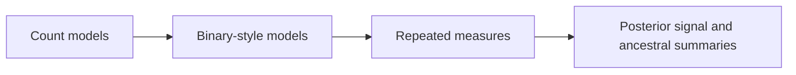

# PCM5: Cichlid Phylogenetic Generalized Linear Mixed Models

PCM5 is the most demanding lecture family in the current evidence book. It
combines posterior phylogenetic signal, ancestral-state extraction, count
models, binomial-style models, and repeated measures.

## Why PCM5 Matters

PCM5 needs careful documentation because it is easy to blur together distinct
model families and distinct scientific questions.

## Read PCM5 In Order

1. [Generalized mixed-model evidence boundary](generalized-mixed-model-evidence-boundary.md)

## Checked-In Study Dossier

The full checked-in record lives under
[`evidence-book/studies/cichlid-phylogenetic-generalized-linear-mixed-models/`](https://github.com/bijux/bijux-phylogenetics/blob/main/evidence-book/studies/cichlid-phylogenetic-generalized-linear-mixed-models/README.md).

## Inputs And Evidence Map

- lecture source copies:
  `cichlid.csv`, `cichlidtree.nex`, `fishdata.RData`, `PCM5_PGLMM.R`, and
  `PCM5_extra_code.R`
- catalogs:
  [dataset catalog](https://github.com/bijux/bijux-phylogenetics/blob/main/evidence-book/studies/cichlid-phylogenetic-generalized-linear-mixed-models/datasets/README.md)
  and
  [provenance guide](https://github.com/bijux/bijux-phylogenetics/blob/main/evidence-book/studies/cichlid-phylogenetic-generalized-linear-mixed-models/provenance/README.md)
- evidence bundles:
  `evidence-001` through `evidence-009`

## What To Take From PCM5

- count, binary-style, ancestral, and repeated-measure questions need to stay
  separate
- the repository already preserves that separation in the study breakdown
- nearby binary comparative utilities are context, not a substitute for the
  lecture's full posterior mixed-model workflow

## What Not To Overread

- PCM5 does not claim a repository-owned replacement for the lecture's full
  posterior PGLMM workflow
- it does not merge distinct model families into one oversimplified summary
- it does not treat nearby binary regression support as proof of full mixed
  model reproduction
