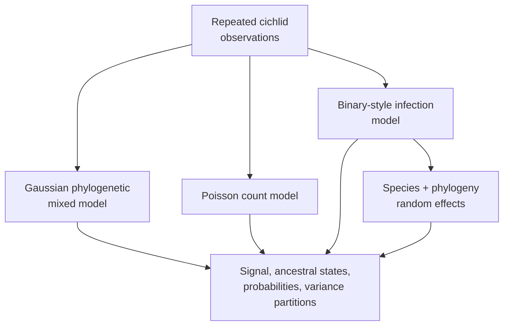

# PCM5: Cichlid Phylogenetic Generalized Linear Mixed Models

PCM5 extends the cichlid analysis beyond Gaussian responses. It covers
posterior-derived phylogenetic signal, ancestral node effects, Poisson parasite
counts, binary-style infection outcomes, probability-scale summaries, and
repeated observations with both species and phylogenetic random effects.

## Why Model Families Stay Separate

Gaussian, Poisson, and binary-style models operate on different likelihood and
link scales. A coefficient on the log or latent scale is not already a change
in expected count or infection probability. Residual variance conventions also
differ, which changes posterior phylogenetic-signal calculations.

Repeated observations add another variance component. Species identity and
phylogenetic relatedness must not be merged into one unnamed random effect.

## Evidence Decomposition

| Bundle | Evaluated surface |
| --- | --- |
| `evidence-001` | workspace reload and repeated-measure data contract |
| `evidence-002` | posterior phylogenetic signal for the Gaussian model |
| `evidence-003` | ancestral-node posterior extraction and export |
| `evidence-004` | tree-linked ancestral plotting contract |
| `evidence-005` | Poisson phylogenetic parasite-count model |
| `evidence-006` | infection model and logit-scale summaries |
| `evidence-007` | intercept and slope transformation to probability scale |
| `evidence-008` | repeated-measure `species + treetip` random effects |
| `evidence-009` | phylogenetic, species, and residual variance partition |

The bundle structure is deployed; posterior parity verdicts remain open. The
repository's binary comparative utilities provide adjacent capability but do
not reproduce the external generalized mixed-model posterior.

## Inputs And Provenance

The dossier contains `cichlid.csv`, `cichlidtree.nex`, `fishdata.RData`,
`PCM5_PGLMM.R`, and `PCM5_extra_code.R`. Identities and sources are recorded
in the [dataset catalog](https://github.com/bijux/bijux-phylogenetics/blob/main/evidence-book/studies/cichlid-phylogenetic-generalized-linear-mixed-models/datasets/README.md),
[provenance record](https://github.com/bijux/bijux-phylogenetics/blob/main/evidence-book/studies/cichlid-phylogenetic-generalized-linear-mixed-models/provenance/README.md),
and [runtime/reference mapping](https://github.com/bijux/bijux-phylogenetics/blob/main/evidence-book/studies/cichlid-phylogenetic-generalized-linear-mixed-models/reference/README.md).

## Derived Quantity Discipline

Probability-scale values must retain their link-scale source and transformation
formula. Posterior phylogenetic signal must name the variance components and
denominator; the convention for a binary-style model cannot be silently copied
from the Gaussian model. Ancestral node effects must retain node-to-tree
identity rather than relying on plotting order.

## Review Priorities

- Confirm response family, link, and observation unit for every model.
- Compare posterior values on matching scales and parameterizations.
- Preserve chain diagnostics before interpreting derived quantities.
- Keep species and phylogenetic variance components identifiable.
- Verify node identities in ancestral exports and figures.
- Retain the external `MCMCglmm` dependency in provenance and verdicts.

## Current Scope

PCM5 provides nine explicit review units and the data/source context needed to
close them. It does not claim a native PGLMM implementation or governed
posterior parity. See the
[generalized mixed-model evidence boundary](generalized-mixed-model-evidence-boundary.md)
for closure requirements.
