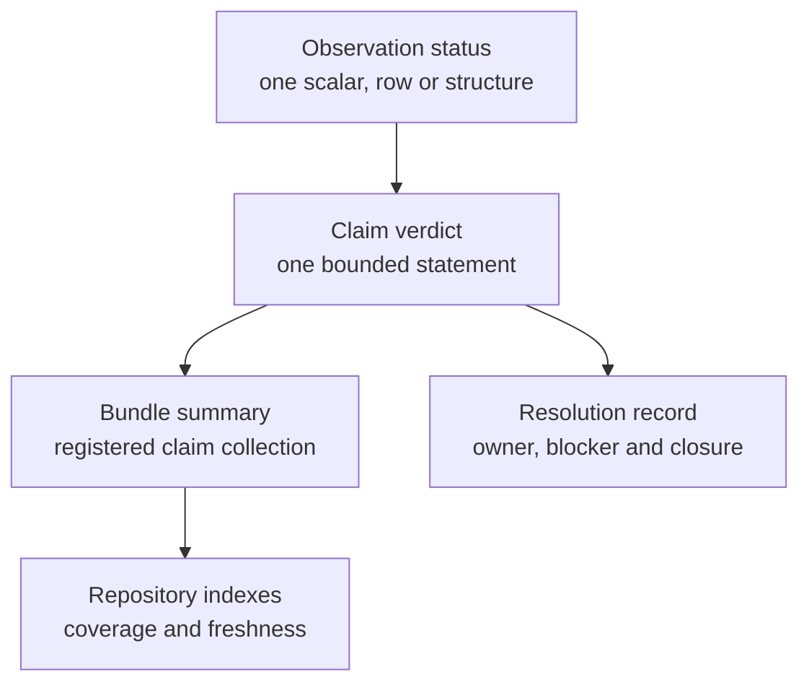

# Claim Verdicts And Resolution

A verdict reports the outcome of a registered comparison. Resolution reports
what happens next. Keeping them separate prevents open work from weakening a
real mismatch and prevents a detailed plan from masquerading as completed
evidence.

## Locate The Status Level

Never lift a favorable status upward without checking its denominator. A
matched observation does not make its claim matched; a matched claim does not
make every observation in the bundle matched; a repository readiness result
does not make every scientific method validated.

## Verdict Vocabulary

| Verdict | Required meaning | Honest downstream language |
| --- | --- | --- |
| `matched` | all claim-required comparable observations satisfy the registered exact or structural rule | the bounded claim matches under the recorded contract |
| `matched_with_tolerance` | all claim-required comparable observations satisfy the predeclared numerical budget | the bounded claim agrees within the named tolerance |
| `mismatch_explained` | a comparable difference exists and its registered cause and consequence are established | the claim differs for the recorded reason; state its impact |
| `mismatch_unexplained` | a comparable difference violates the rule without an accepted explanation | the claim does not currently correspond |
| `not_comparable` | the required estimand, identity, execution, or output alignment is unavailable | no valid comparison is currently owned |

`not_comparable` is not a polite match and `mismatch_unexplained` is not merely
“needs review.” Neither may be converted into `matched_with_tolerance` by
widening the tolerance after observing the result.

## Keep Other Statuses In Their Own Records

Execution states such as blocked, failed, partial, and complete belong to run
records. Freshness states belong to dependency review. Coverage gaps describe
missing proof. Plot-only, workflow-only, artifact-only, and seeded-input-only
classify tracked surfaces that are not analytical correspondence. Preserve
these dimensions beside the verdict instead of forcing them into it.

## Resolve By Earliest Owning Cause

| Problem | Owning layer | Closure evidence |
| --- | --- | --- |
| source or dataset unavailable | provenance and dataset registry | governed locator, checksum, license and admitted population |
| reference program never executed | reference execution | versioned invocation, terminal record and primary outputs |
| Bijux program never executed | Bijux execution | runtime identity, invocation, diagnostics and primary outputs |
| estimands or identities differ | comparison design | aligned parameterization and stable observation keys |
| registered tolerance fails | observation | corrected implementation or accepted causal explanation plus consequence |
| claim lacks required observations | claim dependency map | complete eligible observation denominator |
| material dependency changed | freshness record | regenerated bundle and current indexes |

Resolve the earliest broken edge. Editing a report cannot repair a missing
execution; rerunning a program cannot repair an ill-defined estimand; marking
an item closed cannot repair a failed tolerance.

## Preserve Contradictions

When bundle, claim, observation, report, and generated index disagree, retain
all conflicting records and stop the affected claim. Identify the owning
source, rebuild projections, and review whether the contradiction changed a
published interpretation. Do not choose the most favorable status or delete
the row that prevents a clean summary.

## Record Resolution Without Rewriting History

A resolution record names the affected claim and observations, current
verdict, blocker or causal explanation, responsible owner, required execution
or evidence, acceptance rule, and closure artifacts. When work closes, create
new governed outputs and freshness state. Historical mismatches and
non-comparable states remain part of the audit trail.

A corrected implementation may produce a matching new comparison, but it does
not mean the earlier mismatch never occurred. Report both when the history
matters to released artifacts or scientific conclusions.

## Write The Public Statement

Use this pattern:

> Claim `<claim_id>` is `<verdict>` for `<population and method>` under
> `<comparison rule>`. The record excludes `<limits>`. Freshness is `<state>`
> at `<repository revision>`. Resolution state is `<state and owner>`.

Omit no material qualifier. If a statement cannot name its claim identifier,
population, method, comparison rule, and current verdict, it is broader than
the Evidence Book record supports.
