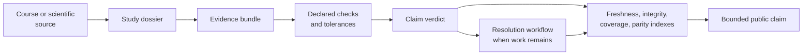
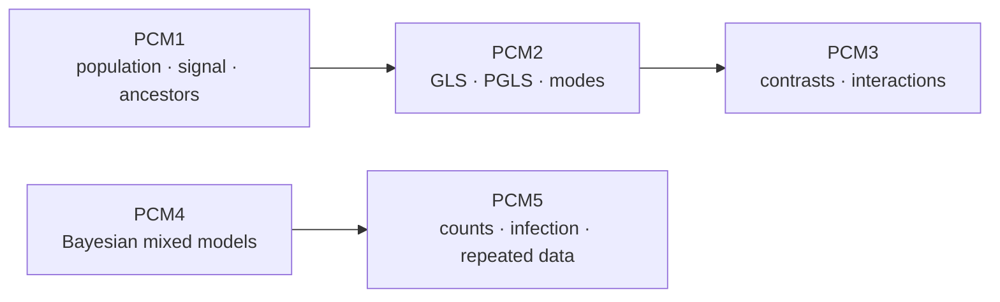
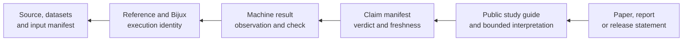
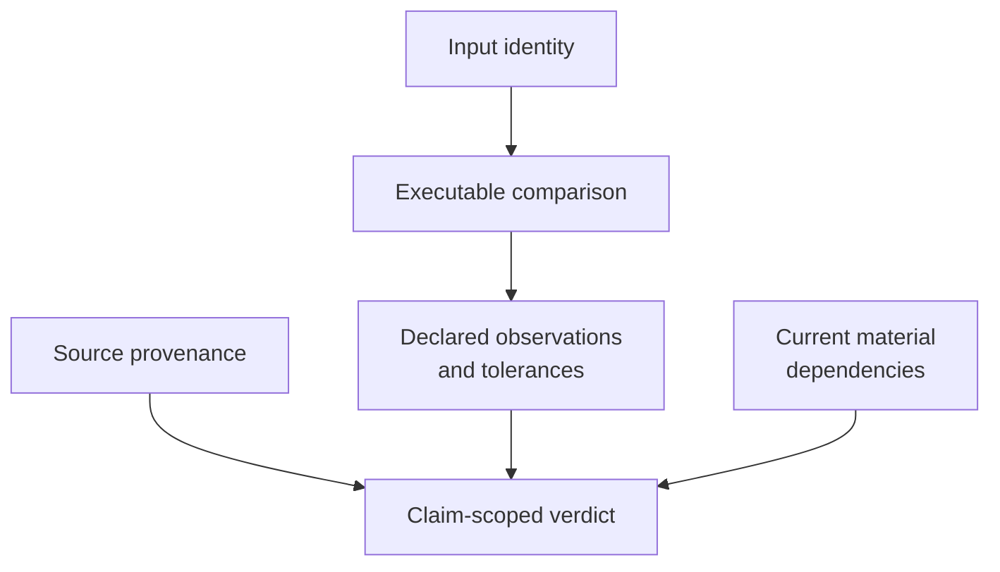
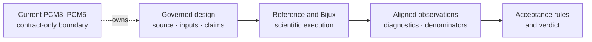

# Evidence Book

The Evidence Book is the review layer between scientific source material and
public claims. It records what was run, with which inputs and versions, which
checks were applied, and which governed comparison verdict each bounded claim
currently carries.

## Two Reading Layers

Use these public pages to understand study questions and limitations. Use the
checked-in [`evidence-book/`](https://github.com/bijux/bijux-phylogenetics/tree/main/evidence-book)
for primary bundle records, registries, sources, and repository-wide review
reports. The narrative explains; the checked-in record adjudicates.

For a first review, follow [Reading an evidence bundle](reading-an-evidence-bundle.md)
from identity through machine observations and freshness. Use [Claim verdicts
and resolution](claim-verdicts-and-resolution.md) to distinguish observation,
claim, bundle, repository, and follow-through statuses.

## At A Glance

- studies: `5`
- evidence bundles: `43`
- teaching studies: `2`
- migration studies: `2`
- freshness statuses: `current=43`
- coverage gaps still tracked: `28`
- foundational numerical trust: `bounded`
- reviewer readiness: `bounded`
- maturity tier: `reviewable_but_incomplete`

These values describe the checked-in revision reviewed on 2026-07-22. The
[freshness report](https://github.com/bijux/bijux-phylogenetics/blob/main/evidence-book/index/freshness-report.md)
is authoritative when the generated state changes.

## Understand The Five-Study Evidence Progression

The study families are related analytical lessons, not five interchangeable
votes on one implementation. PCM1 establishes a reusable primate population;
PCM2 changes its covariance and model comparisons; PCM3 changes the regression
design; PCM4 introduces posterior and phylogenetic random-effect estimation;
PCM5 changes response families and derives quantities from posterior draws.

| Study | Scientific contribution | Evidence contribution at this revision |
| --- | --- | --- |
| PCM1 | shows why type repair, duplicate aggregation, pruning, and tree–trait reconciliation are part of the analysis | governed preparation lineage plus matched or tolerance-matched signal and ancestral observations |
| PCM2 | shows how residual phylogenetic covariance changes regression, evolutionary-mode comparison, and diagnostics | claim-scoped matches coexist with one non-comparable bundle and a broader 12-row unexplained mismatch population |
| PCM3 | makes factor coding, transformations, interactions, and Martins covariance explicit before coefficients are compared | complete comparison design and closure locations; no governed numerical comparison yet |
| PCM4 | separates Gaussian, Bayesian, PGLS, and phylogenetic random-effect estimands | source, population, covariance, prior, chain, and output contract; no governed posterior yet |
| PCM5 | distinguishes Gaussian, count, infection, and repeated-measure models and their draw-wise derived quantities | model-family and derivation contract; no governed generalized mixed-model posterior yet |

The absence of a favorable PCM3–PCM5 verdict does not erase their value as
design records. It does bound that value: they prevent a future comparison
from silently changing the population, estimand, scale, or denominator, but
they do not supply coefficients, draws, diagnostics, or parity conclusions.

## Find The Record From The Statement

| Statement you want to make | First record to open | Continue only when |
| --- | --- | --- |
| an input table or tree was prepared correctly | preparation claim and its input/result manifests | transformations, exclusions, taxa, checksums, and verdict cover that exact object |
| a coefficient or likelihood corresponds with a reference | claim-level scalar/row observations and check | model identity, compared field, tolerance, and full eligible denominator are present |
| a topology or ancestral value corresponds | structurally keyed observation ledger | taxa, rooting, node/clade identity, model, and tree revision align |
| a posterior quantity corresponds | governed draws or summaries plus chain diagnostics | priors, parameterization, chains, transformations, exclusions, and verdict are governed |
| a figure is supported | machine-readable analytical rows and rendering provenance | every displayed value resolves to the analytical result; plot-only limits remain explicit |
| a study conclusion can be cited | exact claim manifest, current indexes, and freshness record | the statement stays inside the claim population, method, observation, and verdict |

Begin with the statement, not the most favorable dashboard row. If no record
owns the exact quantity and population, the statement is unsupported even when
a neighboring bundle is matched.

## Resolve A Value Through The Record Graph

The trace must remain one-to-one at the claim boundary. A study guide can
summarize several bundles, but a cited number must resolve to the observation
that owns it, and that observation must resolve to the exact computation and
inputs. When any edge is absent or stale, stop before the missing edge.

## Current Verdict Ledger

This table counts bundle-manifest verdicts. It does not replace
observation-level ledgers stored inside bundles.

| Study family | `matched` | `matched_with_tolerance` | `not_comparable` | Interpretation |
| --- | ---: | ---: | ---: | --- |
| primate longevity signal | 8 | 1 | 0 | analytical and structural comparisons are governed; numerical tolerances and plot-only limits remain explicit |
| primate PGLS and signal | 3 | 6 | 1 | most declared comparisons match; one bounded reference surface remains non-comparable |
| primate continuous and categorical regression | 0 | 0 | 8 | records and closure locations exist, but lecture-level comparisons are not yet adjudicated |
| cichlid Bayesian linear and phylogenetic mixed models | 0 | 0 | 7 | `MCMCglmm` posterior execution is not reproduced by a governed comparison lane |
| cichlid phylogenetic generalized linear mixed models | 0 | 0 | 9 | generalized mixed-model posterior execution remains external and non-comparable |

`not_comparable` is not a failed numerical tolerance. It means the repository
does not currently own a valid comparison under aligned execution,
parameterization, and outputs. The bundle remains useful because it identifies
the source, data, intended claim, and exact missing boundary.

The complete governed verdict vocabulary is `matched`,
`matched_with_tolerance`, `mismatch_explained`, `mismatch_unexplained`, and
`not_comparable`. Open follow-through and named blockers belong to the separate
resolution workflow.

## Distinguish The Kinds Of Absence

An absent value or comparison has an owning layer. Preserve that layer instead
of translating every gap into `not_comparable`, `failed`, or “open.”

| Observed absence | Owning record | Defensible conclusion |
| --- | --- | --- |
| source or governed input is missing | provenance or input manifest | the proposed claim cannot be reconstructed from the dossier |
| reference or Bijux execution did not occur | execution record | no observation exists for that computation lane |
| process ran but required output is missing or malformed | execution and output inventory | this execution failed or is incomplete |
| both outputs exist but estimands or identities do not align | comparison observation | the proposed quantities are not currently comparable |
| comparable values violate the registered rule | comparison observation | a numerical or structural mismatch was observed |
| comparison exists but no claim consumes it | claim dependency record | the observation is not yet evidence for the public statement |
| claim record exists but a material dependency changed | freshness record | the prior verdict cannot be cited as current |

Only the governed bundle assigns the claim verdict. A reader may encounter
several absence types in one study; report each one at its owner rather than
choosing a single favorable or pessimistic label for the whole dossier.

## What The Evidence Supports At This Revision

| Study | Safe use | Required qualification |
| --- | --- | --- |
| PCM1 | cite the governed 75-taxon preparation, tree–trait alignment, signal fit, and named ancestral observations | numerical conclusions are conditional on the prepared primate data, tree, and declared model; figure equivalence is outside the analytical verdict |
| PCM2 | cite matched baseline GLS, Pagel-λ, signal, and other claim-scoped bundles | retain the 12 unexplained scalar mismatches; do not describe the study as uniformly matching |
| PCM3 | inspect the design-matrix and claim decomposition needed for multivariable comparison | all eight claims are `not_comparable`; no lecture-level coefficient parity is established |
| PCM4 | inspect source, data, model intent, and missing posterior contract | all seven claims are `not_comparable`; no governed primary posterior output exists |
| PCM5 | inspect generalized mixed-model estimands and closure requirements | all nine claims are `not_comparable`; no governed primary posterior output exists |

This table is a decision aid, not a replacement for the manifests. A paper,
notebook, or release statement must cite the exact claim and bundle whose scope
contains the assertion.

## Observation-Level Mismatch Disclosure

The generated parity dashboard currently retains `12 mismatch_unexplained`
scalar rows for PCM2 under `evidence-001`, while that bundle's manifest verdict
is `matched` for its narrower workspace-reload claim. This is not erased by the
bundle ledger above. Reviewers making a PCM2-wide statement must inspect both
levels and carry the unresolved scalar rows into the conclusion.

The distinction matters: a bundle verdict applies to its registered claim,
while a scalar table can aggregate observations with broader scientific debt.
The location and scope of those observations still require scrutiny; a
matched bundle headline must never be used as proof that every attached scalar
comparison matched.

The 12 PCM2 rows are not an abstract warning. They cover four transformed-tree
branch-length observations, two early-burst fit observations, one
Brownian-versus-early-burst likelihood-ratio observation, four ancestral
estimate vectors, and one residual diagnostic. The PCM2 guide names the
observed deltas and separates them from the claim-scoped bundle verdicts.

## Review A Claim In This Order

1. Find the study and claim identifier.
2. Open the bundle manifest and input manifest.
3. Inspect source provenance and runtime or engine versions.
4. Read the declared checks and acceptance criteria.
5. Inspect machine-readable results before the reviewer summary.
6. Confirm the verdict in the current indexes and freshness report.
7. Carry exclusions, mismatches, the current verdict, and separate resolution
   state into any downstream statement.

The order matters. A reviewer summary is a projection of structured records;
it should not be used to bypass the manifest, check definitions, or
observation-level results.

## Cite The Record, Not This Summary

Use the public study guide to orient the scientific question. For an auditable
claim, cite the bundle manifest and the machine-readable result that contains
the observation. If a value appears only in narrative prose, it is not a new
evidence source; it must trace to a governed result file.

When a generated index and a bundle disagree, stop at the contradiction. Do
not choose the more favorable status. Rebuild or investigate the owning record
before using the claim.

## Study Atlas

| Study family | Scientific focus | Governed bundles | Material boundary |
| --- | --- | ---: | --- |
| [Cichlid Bayesian Linear And Phylogenetic Mixed Models](./pcm4-cichlid-bayesian-linear-and-phylogenetic-mixed-models/index.md) | Bayesian linear and phylogenetic mixed models | 7 | posterior computation remains external |
| [Cichlid Phylogenetic Generalized Linear Mixed Models](./pcm5-cichlid-phylogenetic-generalized-linear-mixed-models/index.md) | count, binary, repeated-measure models | 9 | posterior computation remains external |
| [Primate Continuous And Categorical Regression](./pcm3-primate-continuous-and-categorical-regression/index.md) | predictors, interactions, comparative regression | 8 | all bundle verdicts are `not_comparable`; comparison follow-through remains open |
| [Primate Longevity Signal](./pcm1-primate-longevity-signal/index.md) | preparation, signal, ancestral reconstruction | 9 | plotting boundary remains explicit |
| [Primate PGLS And Signal](./pcm2-primate-pgls-and-signal/index.md) | GLS/PGLS, transformed trees, signal tests | 10 | one coverage boundary remains explicit |

The bundle count describes inventory, not number of passing claims. Consult
the live indexes for verdicts.

## Repository-Wide Control Reports

| Report | Question it answers |
| --- | --- |
| [evidence index](https://github.com/bijux/bijux-phylogenetics/blob/main/evidence-book/index/evidence-index.json) | which bundles and claims exist? |
| [integrity report](https://github.com/bijux/bijux-phylogenetics/blob/main/evidence-book/index/integrity-report.md) | are declared records structurally coherent? |
| [freshness report](https://github.com/bijux/bijux-phylogenetics/blob/main/evidence-book/index/freshness-report.md) | do records still match their material dependencies? |
| [parity dashboard](https://github.com/bijux/bijux-phylogenetics/blob/main/evidence-book/index/parity-dashboard.md) | which scalar comparisons match, match within tolerance, or mismatch? |
| [verdict workflows](https://github.com/bijux/bijux-phylogenetics/blob/main/evidence-book/index/verdict-workflows.md) | which mismatches and non-comparable records require explicit follow-through? |
| [coverage gaps](https://github.com/bijux/bijux-phylogenetics/blob/main/evidence-book/index/coverage-gaps.md) | where are claim or workflow proofs incomplete? |
| [false-confidence audit](https://github.com/bijux/bijux-phylogenetics/blob/main/evidence-book/index/false-confidence-audit.md) | where could presentation overstate evidence strength? |
| [scientific debt register](https://github.com/bijux/bijux-phylogenetics/blob/main/evidence-book/index/scientific-debt-register.md) | which unresolved boundaries require durable follow-through? |

## What A Bundle Proves

A bundle proves only that its declared checks and acceptance rules produce its
recorded verdict for identified inputs, sources, versions, and configuration.
It may support a larger claim only when the claim mapping says so. It does not
certify untested datasets, models, external-engine versions, or biological
interpretations.

## Evidence Strength Is Multidimensional

A bundle can be structurally complete and current while remaining
`not_comparable`. It can also contain passing observations while leaving a
larger claim unresolved. Report each axis rather than replacing the record
with one unqualified word such as “validated.”

## Read Contract-Only Evidence As A Design Record

PCM3, PCM4, and PCM5 include bundles whose present value is design-level rather
than numerical adjudication. Read these records by the layer they genuinely
own:

| Retained layer | What a reviewer gains | Claim still unavailable |
| --- | --- | --- |
| source provenance | exact lecture/source program and scientific context | that the source program was executed successfully in the governed lane |
| governed datasets and input manifests | byte identity, schema, tree/table population and dependencies | that every model consumed the admitted inputs correctly |
| claim decomposition | stable estimands and one bundle per bounded question | any favorable comparison verdict |
| `reference.R` and `analysis.py` contract wrappers | executable statement of expected ownership, files and absent outputs | reference or Bijux scientific computation |
| checks and result manifests | structural completeness, freshness and explicit zero-primary-output state | coefficient, posterior, diagnostic or topology agreement |
| closure contract | exact executions, observations and acceptance rules still required | completion merely because the missing work is well specified |

This is durable scientific infrastructure: it prevents later comparison from
silently changing the question, inputs, or denominator. It is not numerical
evidence. A future execution must create new governed primary outputs and
observation records; it must not reinterpret the contract wrapper as an earlier
run.

The dotted edge locates the present evidence. It does not imply partial credit
for the unexecuted comparison stages.

## Non-Comparable Evidence Is First-Class

PCM4 and PCM5 remain valuable precisely because their external posterior
boundary is visible. Their bundle verdict is `not_comparable`; the associated
follow-through remains open until a governed posterior comparison exists. Use
[evidence honesty and limits](../01-bijux-phylogenetics/quality/evidence-honesty-and-limits.md)
when translating these records into public language.
