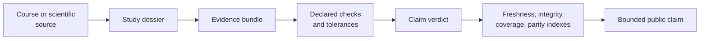
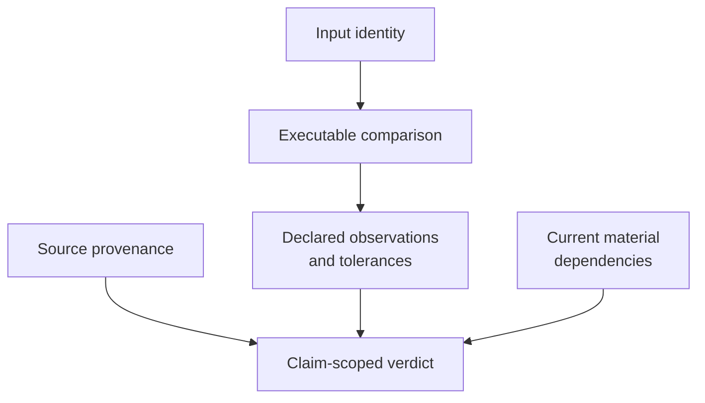

# Evidence Book

The Evidence Book is the review layer between scientific source material and
public claims. It records what was run, with which inputs and versions, which
checks were applied, and whether each bounded claim passes, fails, remains
open, or is blocked.

## Two Reading Layers

Use these public pages to understand study questions and limitations. Use the
checked-in [`evidence-book/`](https://github.com/bijux/bijux-phylogenetics/tree/main/evidence-book)
for primary bundle records, registries, sources, and repository-wide review
reports. The narrative explains; the checked-in record adjudicates.

## At A Glance

- studies: `5`
- evidence bundles: `43`
- teaching studies: `2`
- migration studies: `2`
- freshness statuses: `current=43`
- coverage gaps still tracked: `28`
- foundational numerical trust: `bounded`
- reviewer readiness: `bounded`
- maturity tier: `reviewable_but_incomplete`

These values describe the checked-in revision reviewed on 2026-07-21. The
[freshness report](https://github.com/bijux/bijux-phylogenetics/blob/main/evidence-book/index/freshness-report.md)
is authoritative when the generated state changes.

## Current Verdict Ledger

| Study family | `matched` | `matched_with_tolerance` | `not_comparable` | Interpretation |
| --- | ---: | ---: | ---: | --- |
| primate longevity signal | 8 | 1 | 0 | analytical and structural comparisons are governed; numerical tolerances and plot-only limits remain explicit |
| primate PGLS and signal | 3 | 6 | 1 | most declared comparisons match; one bounded reference surface remains non-comparable |
| primate continuous and categorical regression | 0 | 0 | 8 | records and closure locations exist, but lecture-level comparisons are not yet adjudicated |
| cichlid Bayesian linear and phylogenetic mixed models | 0 | 0 | 7 | `MCMCglmm` posterior execution is not reproduced by a governed comparison lane |
| cichlid phylogenetic generalized linear mixed models | 0 | 0 | 9 | generalized mixed-model posterior execution remains external and non-comparable |

`not_comparable` is not a failed numerical tolerance. It means the repository
does not currently own a valid comparison under aligned execution,
parameterization, and outputs. The bundle remains useful because it identifies
the source, data, intended claim, and exact missing boundary.

## Review A Claim In This Order

1. Find the study and claim identifier.
2. Open the bundle manifest and input manifest.
3. Inspect source provenance and runtime or engine versions.
4. Read the declared checks and acceptance criteria.
5. Inspect machine-readable results before the reviewer summary.
6. Confirm the verdict in the current indexes and freshness report.
7. Carry exclusions and open boundaries into any downstream statement.

The order matters. A reviewer summary is a projection of structured records;
it should not be used to bypass the manifest, check definitions, or
observation-level results.

## Study Atlas

| Study family | Scientific focus | Governed bundles | Material boundary |
| --- | --- | ---: | --- |
| [Cichlid Bayesian Linear And Phylogenetic Mixed Models](./pcm4-cichlid-bayesian-linear-and-phylogenetic-mixed-models/index.md) | Bayesian linear and phylogenetic mixed models | 7 | posterior computation remains external |
| [Cichlid Phylogenetic Generalized Linear Mixed Models](./pcm5-cichlid-phylogenetic-generalized-linear-mixed-models/index.md) | count, binary, repeated-measure models | 9 | posterior computation remains external |
| [Primate Continuous And Categorical Regression](./pcm3-primate-continuous-and-categorical-regression/index.md) | predictors, interactions, comparative regression | 8 | lecture-specific verdicts remain open |
| [Primate Longevity Signal](./pcm1-primate-longevity-signal/index.md) | preparation, signal, ancestral reconstruction | 9 | plotting boundary remains explicit |
| [Primate PGLS And Signal](./pcm2-primate-pgls-and-signal/index.md) | GLS/PGLS, transformed trees, signal tests | 10 | one coverage boundary remains explicit |

The bundle count describes inventory, not number of passing claims. Consult
the live indexes for verdicts.

## Repository-Wide Control Reports

| Report | Question it answers |
| --- | --- |
| [evidence index](https://github.com/bijux/bijux-phylogenetics/blob/main/evidence-book/index/evidence-index.json) | which bundles and claims exist? |
| [integrity report](https://github.com/bijux/bijux-phylogenetics/blob/main/evidence-book/index/integrity-report.md) | are declared records structurally coherent? |
| [freshness report](https://github.com/bijux/bijux-phylogenetics/blob/main/evidence-book/index/freshness-report.md) | do records still match their material dependencies? |
| [parity dashboard](https://github.com/bijux/bijux-phylogenetics/blob/main/evidence-book/index/parity-dashboard.md) | which declared parity comparisons pass or remain open? |
| [coverage gaps](https://github.com/bijux/bijux-phylogenetics/blob/main/evidence-book/index/coverage-gaps.md) | where are claim or workflow proofs incomplete? |
| [false-confidence audit](https://github.com/bijux/bijux-phylogenetics/blob/main/evidence-book/index/false-confidence-audit.md) | where could presentation overstate evidence strength? |
| [scientific debt register](https://github.com/bijux/bijux-phylogenetics/blob/main/evidence-book/index/scientific-debt-register.md) | which unresolved boundaries require durable follow-through? |

## What A Bundle Proves

A bundle proves only that its declared checks and acceptance rules produce its
recorded verdict for identified inputs, sources, versions, and configuration.
It may support a larger claim only when the claim mapping says so. It does not
certify untested datasets, models, external-engine versions, or biological
interpretations.

## Evidence Strength Is Multidimensional

A bundle can be structurally complete and current while remaining
`not_comparable`. It can also contain passing observations while leaving a
larger claim open. Report each axis rather than replacing the record with one
unqualified word such as “validated.”

## Open Evidence Is First-Class

PCM4 and PCM5 remain valuable precisely because their external posterior
boundary is visible. An open or blocked verdict identifies the missing work
more honestly than a polished narrative that implies completion. Use
[evidence honesty and limits](../01-bijux-phylogenetics/quality/evidence-honesty-and-limits.md)
when translating these records into public language.
