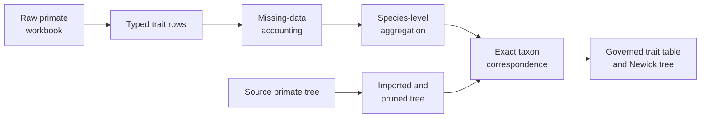

# PCM1 Data And Tree Preparation

PCM1 turns heterogeneous lecture inputs into a single comparative-analysis
state. Every repair is observable because type conversion, missingness,
duplicate aggregation, tree pruning, and taxon reconciliation can change the
sample used by later models.

## Preparation Contracts

| Operation | Evidence requirement | Primary bundle | Current verdict |
| --- | --- | --- | --- |
| workbook loading | source sheet and row interpretation remain attributable | `evidence-002` | `matched` |
| type repair | converted fields and invalid values are enumerated | `evidence-003` | `matched` |
| missingness | included, excluded, and incomplete observations are counted | `evidence-004` | `matched` |
| duplicate aggregation | grouping key and aggregation rule are explicit | `evidence-005` | `matched` |
| tree import | format and imported tip identities agree | `evidence-006` | `matched` |
| tree diagnostics | rootedness, tips, branches, and structural checks are recorded | `evidence-007` | `matched` |
| tree–trait join | missing and extra taxa are resolved explicitly | `evidence-008` | `matched` |
| processed export | governed derivatives match the reviewed state | `evidence-009` | `matched` |

All eight focused preparation bundles therefore support their bounded claims.
The aggregate `evidence-001` manifest is `matched_with_tolerance` because it
also covers numerical and non-comparable surfaces outside preparation. Its
aggregate verdict must not weaken or broaden the focused preparation verdicts.

## Taxon Reconciliation

Tree tips and trait species must be compared after the same normalization
policy. A successful inner join is insufficient because it can silently drop
unmatched taxa. Record both set differences, duplicate labels, pruning
decisions, final order, and the reason for every exclusion.

Ordering matters when values are converted to vectors or matrices. The final
trait vector must be aligned explicitly to tree-tip identity rather than
assuming source row order.

## Governed Derivatives

`reference_primate.csv` and `reference_trimmed_primatetree.nwk` are the prepared
inputs reused by subsequent comparisons. They are derived records with
provenance, not replacements for the original workbook, workspace, and tree.

Treat the derivatives as a handoff boundary. A downstream result must identify
their checksums and taxon order; matching filenames alone does not establish
that it consumed the governed PCM1 state.

## Claim Scope At This Boundary

The preparation verdicts establish source interpretation, repair,
aggregation, tree intake, reconciliation, and exported identity. They do not
establish phylogenetic signal, fitted lambda, ancestral estimates, figure
equivalence, or the suitability of the preprocessing choices for another
study. Those claims require their own observations and verdicts.

## Review Checklist

- Can every final row be traced to source observations?
- Are non-numeric values and coercion failures visible?
- Is the duplicate-species summary rule scientifically appropriate?
- Are tree pruning and topology operations separated from label normalization?
- Do the final trait and tree taxon sets match exactly?
- Are exported identities checked before model fitting begins?

The summary bundle records matched preparation, tree import/pruning, topology,
and tree–trait join claims. Those verdicts establish this study state; they do
not make later signal or ancestral claims automatic.

Continue with [signal and ancestral results](signal-and-ancestral-results.md).
