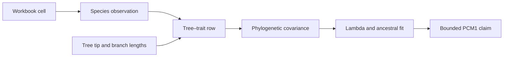
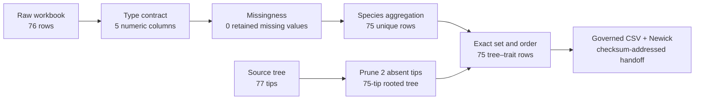

# PCM1 Data And Tree Preparation

PCM1 converts a 76-row workbook and a 77-tip primate tree into a reconciled
75-species comparative state. That contraction is scientifically material:
one duplicated species record is aggregated and two tree tips absent from the
trait table are removed. Eight focused evidence bundles make every boundary
reviewable before signal or ancestral inference begins.

## Why Preparation Is Part Of The Evidence

Pagel's lambda and ancestral reconstruction both depend on the correspondence
between trait rows and tree tips. A parsing error changes a trait value; an
aggregation decision changes the species observation; pruning changes the
covariance matrix; reordered taxa can attach correct values to the wrong
species. Numerical agreement downstream cannot diagnose or repair those
identity failures.



The eight preparation bundles therefore do more than show that files load.
Together they establish the analytical population and the object identity on
which every later scalar comparison depends. Their claim scope stops at that
handoff: they cannot establish the fitted model merely because the model uses
their accepted inputs.



## Keep The Three Populations Separate

PCM1 begins with different row and taxon populations. The final value `75`
appears several times, but each occurrence answers a different question.

| Population | Starting denominator | Material operation | Accepted denominator |
| --- | ---: | --- | ---: |
| workbook records | 76 rows | aggregate the duplicate-species contract after type and missingness review | 75 species rows |
| source-tree tips | 77 tips | prune `Lagothrix_lagotricha` and `Eulemur_fulvus`, which lack retained trait rows | 75 tips |
| comparative join | 75 species rows and 75 tips | establish exact set and order correspondence | 75 aligned taxa |

Equality of the accepted counts is necessary but not sufficient. The join must
also prove label normalization, one-to-one membership, exact order, tree
identity, and trait-row identity. Otherwise two different 75-taxon analyses
could be mistaken for the same population.

## Governed Input And Handoff Records

| Role | Repository record | Identity carried forward |
| --- | --- | --- |
| raw observations | `datasets/primate_raw.xlsx` | original 76-row workbook boundary |
| processed reference | `datasets/reference_primate.csv` | 75 rows, 75 species, nine-column order and repaired types |
| source phylogeny | `datasets/primatetree.nex` | 77 tips with branch lengths |
| trimmed analysis tree | `datasets/reference_trimmed_primatetree.nwk` | 75 tips with the governed set and order |
| dataset registry | `datasets/registry.json` | source role, locator, schema summary, and SHA-256 identity |

The checked-in workbook supports auditability, but the focused Python review
starts from the governed processed reference rather than claiming to replay the
external workbook import. This is an explicit limitation in `evidence-002`,
not an invisible substitution.

## Preparation Evidence Ledger

| Bundle | Claim boundary | Governed observation | Current verdict |
| --- | --- | --- | --- |
| `evidence-002` | workbook loading | 76 raw rows contract to the checked-in 75-row processed reference | `matched` |
| `evidence-003` | type repair | five numeric columns parse without failures; factor/text roles are explicit | `matched` |
| `evidence-004` | missing-data accounting | 75 post-repair rows; no missing values in the governed processed table | `matched` |
| `evidence-005` | duplicate aggregation | one duplicate-species contraction; zero duplicates remain | `matched` |
| `evidence-006` | tree import | R and Bijux both report 77 original and 75 trimmed tips with branch lengths | `matched` |
| `evidence-007` | tree diagnostics | rooted, binary, ultrametric, with an explicit node-label correspondence | `matched` |
| `evidence-008` | tree–trait join | two named missing tips removed; final set, order, and example node IDs agree | `matched` |
| `evidence-009` | processed export | checked-in CSV and Newick identities match the governed handoff | `matched` |

All eight focused preparation bundles support their bounded claims. The
aggregate `evidence-001` manifest is `matched_with_tolerance` because it also
contains signal and ancestral comparisons plus plot-only and artifact-only
surfaces. Its aggregate status neither weakens the eight exact preparation
verdicts nor promotes later claims.

## Read The Type Contract

The processed table uses this reviewed interpretation:

| Role | Columns or states |
| --- | --- |
| numeric | `body_mass`, `gestation`, `home_range`, `longevity`, `social_group_size` |
| binary factor | `sex_dimorphism` with governed values `0` and `1` |
| categorical text | `mating_system`, including Pair, Polyandrous, and Polygynous states |
| identity text | `family`, `species` |

`evidence-003` records empty parse-failure arrays for all five numeric columns.
That proves the governed processed artifact satisfies this parsing contract; it
does not prove that every workbook cell was semantically correct before
processing.

## Account For Missingness And Aggregation

The reference rule aggregates numeric values by species with missing-value
removal. In the retained processed artifact, every governed column has a
missing count of zero. The raw-to-processed delta is one row, and
`evidence-005` records one duplicate-species contract with zero duplicates
after grouping.

These facts must be read together:

```text
76 raw rows - 1 duplicate-species contraction = 75 processed species
```

The evidence establishes the observed contraction and resulting unique-species
state. It does not independently replay every workbook transformation. A
different aggregation rule would define a different analysis input even if it
also produced 75 rows.

## Reconcile Tree And Trait Identity

The source tree has 77 tips; the processed table has 75 species. The two tree
tips absent from the trait table are:

- `Lagothrix_lagotricha`;
- `Eulemur_fulvus`.

After pruning, `evidence-008` records equality of the tree-tip set, tree-tip
order, and aligned species order. It also matches representative node IDs:

| Identity | R | Bijux |
| --- | ---: | ---: |
| `Hylobates_lar` | 29 | 29 |
| `Pan_paniscus` | 33 | 33 |
| `Node32` | 107 | 107 |

Node numbers are valid only within this governed tree identity. The stronger
durable identity for an internal node is its descendant-taxon signature; a
different pruning or traversal can renumber nodes without changing a clade.

## Verify Tree State Before Modeling

`evidence-006` and `evidence-007` jointly establish:

- original and trimmed tip counts agree across R and Bijux;
- both retained tree records carry branch lengths;
- the trimmed tree is rooted, binary, and ultrametric;
- R node 77 labeled `Node2` resolves to the same taxa as the Bijux `Node2`
  match.

Rooting, topology, branch lengths, taxon set, and node identity are independent
parts of the model input. Matching the tip count alone would not establish the
same comparative covariance.

## Accept The Downstream Handoff

Before fitting a model, a consumer should verify:

1. the processed CSV and trimmed Newick digests against the dataset registry or
   input manifest;
2. the nine-column table contract and 75 unique species;
3. the 75-tip tree set and exact order;
4. rooted, binary, ultrametric, and branch-length state;
5. the two explicit pruning exclusions;
6. any node reference by descendant-taxon signature as well as local node ID.

Matching filenames are insufficient. A downstream result should retain input
checksums, reconciliation state, and model-specific exclusions in its own
manifest.

Reject the handoff if any count is reported without its members, if pruning is
recoverable only from prose, if tree and table order were assumed rather than
checked, or if an internal node is identified only by a local integer. Those
conditions can preserve the headline number 75 while changing the actual
population or ancestral target.

## Claim Boundary

The preparation verdicts establish source interpretation at the governed
handoff, processed types and missingness, duplicate contraction, tree import,
diagnostics, pruning, alignment, and exported identity. They do not establish:

- the biological appropriateness of mean aggregation for another question;
- phylogenetic signal or a fitted lambda value;
- a Brownian trait model;
- ancestral-state estimates or their historical truth;
- plot equivalence;
- general behavior on other datasets.

Continue with [signal and ancestral results](signal-and-ancestral-results.md),
where each numerical statement is tied to the aggregate scalar ledger.
