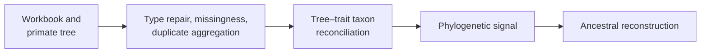
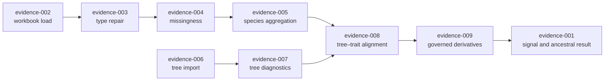

# PCM1: Primate Longevity Signal

PCM1 establishes the data contract reused by the later primate studies. Raw
trait records and a primate phylogeny are normalized, reconciled by species,
and reduced to governed derivatives before phylogenetic signal or ancestral
values are interpreted.

## The Evidence Question In One View

| Dimension | PCM1 contract |
| --- | --- |
| scientific object | one reconciled 75-taxon primate tree–longevity population derived from the governed workbook and tree |
| central idea | data repair, duplicate aggregation, pruning, and taxon reconciliation are part of the signal analysis, not clerical preparation |
| evidence role | establishes the reusable primate population, then compares registered signal and ancestral observations on that exact state |
| present conclusion | eight focused bundles are `matched`; the aggregate bundle is `matched_with_tolerance`, with 31 scalar observations split into 16 `matched` and 15 tolerance matches |
| downstream role | supplies the population and tree identity that PCM2 and PCM3 must either reuse exactly or replace with an explicit derived identity |
| forbidden inference | a matched preparation or signal observation does not prove figure equivalence, biological adequacy, causality, or every later primate model |

PCM1 is therefore both a scientific result and the admission ledger for the
primate evidence sequence. Its strongest claim is not “the files loaded”; it
is that the published observations resolve through one governed preparation
chain.

## Scientific Question

Do primate longevity traits retain phylogenetic structure after the raw table
and tree are made analytically compatible, and how are reconstructed ancestral
values tied to that same prepared state?

The preparation is scientifically material. Type coercion, missing-data
handling, duplicate-species aggregation, pruning, and label reconciliation can
change both the observations and the covariance structure used downstream.

## What PCM1 Contributes

PCM1 is both a scientific comparison and an admission record for later primate
models. Its evidence has four distinct jobs:

| Evidence role | Question answered | Bundles that own it |
| --- | --- | --- |
| population evidence | which workbook rows become one row per species, and which records are excluded or aggregated? | `evidence-002` through `evidence-005` |
| structural evidence | which tree, rooting, branch lengths, tips, and node identities define relatedness? | `evidence-006` through `evidence-008` |
| analytical handoff evidence | which exact CSV and Newick enter signal and ancestral computation? | `evidence-009` |
| comparative result evidence | do the registered R and Bijux signal and ancestral observations correspond? | `evidence-001` |

The roles cannot substitute for one another. A matched tree import does not
establish a matched tree–trait join. A matched join does not establish a
signal estimate. A matched signal estimate does not prove that the selected
model is biologically sufficient.

## Study Inputs

| Input | Role |
| --- | --- |
| `primate_raw.xlsx`, `primate.RData`, `primate.csv` | source trait records and lecture workspace |
| `primatetree.nex`, `trimmed_primatetree.nex` | source and lecture-prepared phylogenies |
| `reference_primate.csv` | governed normalized trait derivative |
| `reference_trimmed_primatetree.nwk` | governed reconciled tree derivative |

Input identity and provenance are recorded in the
[dataset catalog](https://github.com/bijux/bijux-phylogenetics/blob/main/evidence-book/studies/primate-longevity-signal/datasets/README.md)
and [provenance record](https://github.com/bijux/bijux-phylogenetics/blob/main/evidence-book/studies/primate-longevity-signal/provenance/README.md).

## Evidence Decomposition

| Bundle | Evaluated surface | Manifest verdict |
| --- | --- | --- |
| `evidence-001` | end-to-end study summary | `matched_with_tolerance` |
| `evidence-002` | workbook loading | `matched` |
| `evidence-003` | type repair | `matched` |
| `evidence-004` | missing-data accounting | `matched` |
| `evidence-005` | duplicate-species aggregation | `matched` |
| `evidence-006` | tree import | `matched` |
| `evidence-007` | tree diagnostics | `matched` |
| `evidence-008` | tree–data correspondence | `matched` |
| `evidence-009` | processed exports | `matched` |

The manifest ledger is the status authority: eight focused contracts match
directly, while the aggregate comparison matches under its declared numerical
tolerances. Plot-only blocks remain observations about coverage, not numerical
parity claims. Read the aggregate status together with its `status_counts` and
limitations; `matched_with_tolerance` does not flatten those block-level
distinctions.

## Analytical Population Dependency Graph

The graph is the analysis population contract. A change in coercion,
missingness, duplicate aggregation, tree identity, pruning, or label mapping
changes the downstream population and reopens signal and ancestral evidence.
The aggregate result cannot be detached from the preparation chain merely
because its final taxa count remains 75.

## Governed Observations

The aggregate result for the prepared 75-taxon analysis records these values:

| Observation | Bijux result | Interpretation boundary |
| --- | ---: | --- |
| longevity range | 103.0–657.6 | values use the prepared source trait and its recorded units |
| mean longevity | 317.362133 | descriptive value for the reconciled taxa |
| estimated Pagel λ | 0.803 | fitted signal at the precision retained by the PCM1 aggregate record |
| λ=0 likelihood-ratio statistic | 41.030408 | comparison with the registered zero-signal model |
| λ=0 p-value | 1.4988 × 10⁻¹⁰ | model-based evidence against that registered null, not a causal result |
| named MRCA ancestral estimate | 520.078423 | conditional estimate for the five-taxon descendant signature retained in the result |
| branches with positive reconstructed change | 72 | count under the declared ancestral reconstruction |
| branches with reconstructed increase greater than 12 | 55 | thresholded model output, not 55 observed evolutionary events |

The source values live in
[`bijux_reference_results.json`](https://github.com/bijux/bijux-phylogenetics/blob/main/evidence-book/studies/primate-longevity-signal/evidence-001/results/bijux_reference_results.json).
The aggregate scalar table contains 31 comparisons: 16 `matched` and 15
`matched_with_tolerance`. The focused preparation bundles separate workbook
loading, type repair, missingness, duplicate aggregation, tree import,
diagnostics, correspondence, and export so a passing headline cannot hide
which transformation produced the analytical population.

## Reconstruct The Verdict

Review PCM1 from dependencies to conclusion:

1. Open `evidence-001/manifest.json` and confirm the study, claim IDs, source
   locators, freshness basis, and `matched_with_tolerance` verdict.
2. Use `inputs.manifest.json` and the focused preparation bundles to establish
   the workbook, tree, repaired types, exclusions, aggregation, and joined
   taxon population.
3. Compare `r_reference_results.json` with `bijux_reference_results.json`, then
   inspect `scalar-parity-table.json` for the rule and tolerance applied to
   each scalar.
4. Read the block payloads and `status_counts` so plot-only, artifact-only,
   seeded-input-only, and workflow-only blocks remain outside analytical
   equivalence.
5. Use `reviewer-summary.json` and `scientific_debt_register.json` last; they
   summarize the retained records but do not replace them.

This order prevents the favorable aggregate verdict from hiding a changed
input population or promoting a presentation-only block into a scientific
comparison.

## Citation Packet For PCM1

A citation of the signal or ancestral result should retain the PCM1 claim and
bundle identifier, source and prepared input identities, 75-taxon analytical
population, tree and trait derivative checksums, model and software identity,
the exact result row, comparison rule and tolerance, bundle verdict, freshness,
and the plotting limitation. For a branch count, also retain the eligible
branch population and threshold definition; for an ancestral value, retain the
descendant-taxon node key.

Do not cite the 0.803 lambda estimate from this guide alone. The guide is the
interpretation route; the governed JSON observation and its manifests are the
auditable record.

## Interpreting The Analysis

Phylogenetic signal asks whether observed trait similarity is structured by
the tree under the chosen model; it is not a measure of causal inheritance.
Ancestral reconstruction estimates internal-node states conditional on the
prepared tips, tree, branch lengths, and model. Neither analysis repairs a bad
taxon mapping retroactively.

Signal and ancestral reconstruction also remain separate claims. Signal asks
how the observed tip covariance is structured under the fitted λ model.
Ancestral reconstruction estimates conditional internal-node values under a
declared reconstruction model. A favorable signal test is not a validation of
each ancestral estimate, and close ancestral parity is not independent support
for the signal model.

## Review Priorities

- Confirm that excluded and aggregated observations are enumerated.
- Confirm identical taxon sets and label normalization for traits and tree.
- Separate source-tree pruning from model-driven transformations.
- Inspect signal and ancestral outputs against the same governed derivatives.
- Treat figures as projections of recorded results, not independent evidence.

## Scope

PCM1 supports the registered preparation, correspondence, export, signal, and
ancestral workflow claims for this primate study family. It does not establish
general performance across datasets, validate every comparative method, or
close plotting equivalence beyond the declared boundary.

Continue with [data and tree preparation](data-and-tree-preparation.md),
[signal and ancestral results](signal-and-ancestral-results.md), or
[PCM2](../pcm2-primate-pgls-and-signal/index.md) for regression and evolutionary
mode comparisons on the primate data.
