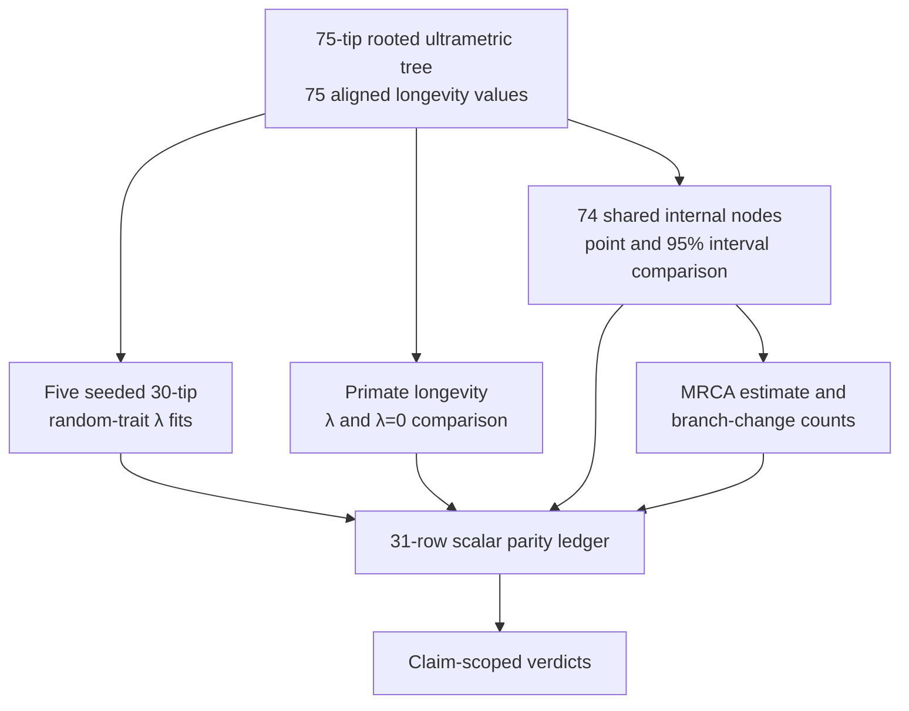

# PCM1 Signal And Ancestral Results

PCM1 compares Pagel-λ fits and continuous ancestral reconstruction between the
governed R reference and Bijux on fixed, reconciled inputs. The aggregate
`evidence-001` bundle is `matched_with_tolerance`: 31 scalar observations
contain 16 exact `matched` rows and 15 `matched_with_tolerance` rows. Visual and
artifact-governance claims remain `not_comparable` by design.



## Model Identity

Pagel's λ transforms the off-diagonal elements of the Brownian phylogenetic
covariance while retaining the diagonal. Under this parameterization:

- λ = 0 removes shared off-diagonal phylogenetic covariance;
- λ = 1 retains the Brownian shared-path covariance;
- intermediate λ values scale that shared covariance.

The estimate is conditional on tree, branch lengths, taxon order, trait scale,
likelihood definition, bounds, and optimizer behavior. It is not a universal
property of “primates” or “longevity.”

For a Brownian covariance matrix `V`, the compared parameterization can be
read conceptually as:

```text
V(lambda)[i, i] = V[i, i]
V(lambda)[i, j] = lambda * V[i, j]    for i != j
```

This makes the estimand concrete. λ changes modeled cross-species covariance;
it does not rescale the longevity observations and does not represent the
fraction of longevity “caused by phylogeny.” Agreement on λ therefore requires
agreement on the untransformed covariance, diagonal convention, bounds,
likelihood, and taxon order before the scalar values are compared.

## Governed Lambda Observations

The five seeded random datasets are parity fixtures, not evidence that random
traits must yield low λ. In this exact roster, every fitted λ is at or extremely
near the upper boundary:

| Case | R λ | Bijux λ | absolute difference | λ verdict |
| --- | ---: | ---: | ---: | --- |
| `random_data` | 0.9999681477851246 | 1.0 | 0.00003185221487544965 | `matched_with_tolerance` |
| `random_data2` | 1.0 | 1.0 | 0 | `matched` |
| `random_data3` | 1.0 | 1.0 | 0 | `matched` |
| `random_data4` | 1.0 | 1.0 | 0 | `matched` |
| `random_data5` | 1.0 | 1.0 | 0 | `matched` |

The λ tolerance is `0.001`. Log-likelihood differences for the same five cases
also remain within `0.001`; the largest is approximately `0.0009008053` for
`random_data`.

These observations establish cross-implementation agreement for the seeded
fixtures. They do not establish the sampling distribution of λ under a
no-signal null. A boundary estimate also deserves optimizer and profile review;
agreement between implementations does not remove that diagnostic obligation.

## Primate Longevity Lambda

| Quantity | R | Bijux | absolute difference | tolerance |
| --- | ---: | ---: | ---: | ---: |
| λ | 0.8027301202530401 | 0.803 | 0.00026987974695991124 | 0.001 |
| log likelihood | -446.94323405402366 | -446.94323951456334 | 0.000005460539682644594 | 0.001 |

Both rows are `matched_with_tolerance`. The separate λ-versus-zero block also
records:

- likelihood-ratio absolute difference `0.00001092107925160235` against a
  `0.0001` tolerance;
- p-value absolute difference `8.374938977420018e-16` against a `1e-12`
  tolerance;
- λ=0 covariance top-three maximum absolute difference
  `9.99999993922529e-9` against a `1e-8` tolerance;
- observed-λ covariance top-three maximum absolute difference `0`.

This supports numerical correspondence of the declared fitted and λ=0
comparison surfaces. It does not by itself establish that Brownian covariance
with transformed λ is the best biological model.

## Match Ancestral Nodes By Clade

The ancestral comparison uses 74 shared internal nodes. Rows are matched by
descendant-taxon signature rather than plotting order or an unqualified node
number.

| Surface | maximum absolute R–Bijux difference | tolerance | verdict |
| --- | ---: | ---: | --- |
| point estimates | `5.115907697472721e-13` | `1e-9` | `matched_with_tolerance` |
| lower 95% limits | `5.684341886080801e-13` | `1e-9` | `matched_with_tolerance` |
| upper 95% limits | `5.115907697472721e-13` | `1e-9` | `matched_with_tolerance` |

The observed differences are floating-point scale. The claim is numerical
parity under the same Brownian/PIC convention; it is not proof that the
ancestral states are observed historical facts.

## Bonobo–Gibbon MRCA Spot Check

The governed MRCA clade contains:

- `Hylobates_lar`;
- `Hylobates_pileatus`;
- `Nomascus_concolor`;
- `Pan_paniscus`;
- `Symphalangus_syndactylus`.

The R estimate is `520.0784230077601`; the Bijux estimate is
`520.07842300776`. Their absolute difference is
`1.1368683772161603e-13`, within the `1e-9` near-exact tolerance. The R record
also identifies local node 107, species label `Node32`, and a 95% interval of
`[518.7152277621561, 521.441618253364]`.

The clade signature is the cross-runtime identity. Node 107 is useful within
this retained tree but should not be carried into a differently pruned or
ordered topology without remapping.

## Branch-Wise Increase Counts

R and Bijux both record:

| Count | Value | Verdict |
| --- | ---: | --- |
| branches with an inferred increase | 72 | `matched` |
| branches with an inferred increase greater than 12 units | 55 | `matched` |

These are deterministic summaries of inferred parent/child states on this
tree. They are not 72 or 55 independently observed evolutionary events. The
counts inherit the ancestral model, branch mapping, trait units, and threshold
definition.

## Claim And Observation Status

The bundle contains three different record grains:

| Grain | Current state | Meaning |
| --- | --- | --- |
| bundle manifest | `matched_with_tolerance` | aggregate PCM1 analytical and structural contract |
| analytical claims | preparation/tree/join `matched`; λ and ancestral claims `matched_with_tolerance` | bounded claim-level adjudication |
| visual/provenance claims | `not_comparable` | tracked without a numerical equivalence target |

The block registry is more detailed: 10 `verified`, 6
`verified_with_tolerance`, 10 `plot_only`, 2 `artifact_only`, 1
`seeded_input_only`, and 1 `workflow_only`. The scalar ledger contains the 31
numerically adjudicated rows. Do not mix block status counts with claim
verdicts or the bundle verdict.

## Separate Statistical Evidence From Historical Interpretation

| Observation | Statistical conclusion available | Historical conclusion unavailable |
| --- | --- | --- |
| fitted λ near 0.803 | the registered model estimates λ near 0.803 on this population | a causal fraction of longevity explained by ancestry |
| λ=0 likelihood-ratio result | the registered zero-signal model fits materially worse under the compared likelihood contract | proof that every lineage evolved longevity through one process |
| clade-keyed ancestral estimate | R and Bijux produce corresponding conditional node estimates under the declared reconstruction | direct observation of an ancestor's longevity |
| branch increase count | the inferred parent/child state difference exceeds the declared threshold on named branches | independently observed evolutionary events or rates |

These interpretation limits are part of the result, not optional caveats added
after the comparison.

## What The Evidence Supports

The current record supports these precise statements:

- fixed PCM1 input preparation and tree/trait alignment match their governed
  reference contracts;
- five seeded λ fits agree within the declared scalar tolerances;
- the primate λ, log likelihood, λ=0 likelihood-ratio comparison, and sampled
  covariance entries agree within their declared tolerances;
- 74 clade-aligned ancestral point and interval rows agree to floating-point
  scale;
- the MRCA estimate and branch-wise increase counts agree.

It does not support:

- causal interpretation of phylogenetic signal;
- a general null distribution from the five random fixtures;
- proof that λ-transformed Brownian covariance is the best trait model;
- historical certainty of reconstructed ancestors or inferred increases;
- pixel-identical plot parity;
- generalization to other trees, traits, parameterizations, or optimizers.

## Follow The Authoritative Record

Begin with the
[`evidence-001` manifest](https://github.com/bijux/bijux-phylogenetics/tree/main/evidence-book/studies/primate-longevity-signal/evidence-001),
then read `claims.json`, `checks.json`, `inputs.manifest.json`,
`results/scalar-parity-table.json`, the relevant block payloads, and
`provenance.json`. The scalar ledger owns numerical tolerance decisions; the
plots are interpretation surfaces, not substitute data.
