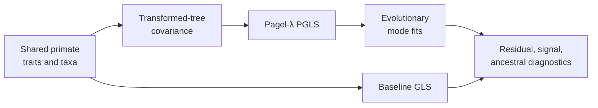

# PCM2: Primate PGLS And Signal

PCM2 evaluates how phylogenetic covariance changes regression, model
comparison, signal diagnostics, and ancestral inference on the prepared
primate data. Baseline GLS and phylogenetically corrected models remain in one
comparison chain so changes in coefficients and fit can be attributed.

## Scientific Questions

- How do coefficient estimates and residual structure change after
  phylogenetic covariance is introduced?
- Does estimating or transforming the covariance improve fit under a declared
  comparison rule?
- Are signal, evolutionary-mode, and ancestral results mutually consistent
  for the same taxa and response definition?

PGLS changes the residual covariance model. It does not simply add a
“phylogenetic correction” flag to ordinary regression, and it does not make
the fitted relationship causal.

## Evidence Decomposition

| Bundle | Evaluated surface | Current boundary |
| --- | --- | --- |
| `evidence-001` | reload semantics | governed parity deployed |
| `evidence-002` | baseline GLS | governed parity deployed |
| `evidence-003` | Pagel-λ regression | governed parity deployed |
| `evidence-004` | phylogenetic signal | governed parity deployed |
| `evidence-005` | residual diagnostics | governed parity deployed |
| `evidence-006` | transformed tree | governed parity deployed |
| `evidence-007` | evolutionary mode fits | governed parity deployed |
| `evidence-008` | likelihood-ratio comparison | governed parity deployed |
| `evidence-009` | ancestral modes | `matched_with_tolerance` for named node identities |
| `evidence-010` | intercept sweep | `not_comparable`; coverage follow-through remains open |

The final row prevents a mostly aligned bundle ledger from being summarized as
unqualified end-to-end parity.

## Bundle And Scalar Verdicts

The ten bundle manifests currently record `3 matched`,
`6 matched_with_tolerance`, and `1 not_comparable`. The observation ledger is
not uniformly passing: the generated scalar parity table associated with
`evidence-001` retains `12 mismatch_unexplained` rows involving ancestral,
early-burst, likelihood-ratio, transformed-tree, and residual quantities.

Those rows are registered scientific debt even though `evidence-001` itself
has a `matched` manifest verdict for the narrower workspace-reload contract.
Therefore, quote the claim identifier and ledger level. Do not summarize PCM2
as clean parity from the bundle counts alone.

## Governed Findings

The claim-scoped result files expose the scientific changes that the bundle
headlines summarize:

| Fit or test | Bijux observation | Reference relationship |
| --- | ---: | --- |
| baseline GLS social-group-size slope | 3.591156 | agrees with the registered R baseline within numerical precision |
| baseline GLS R² | 0.257170 | agrees with the registered R baseline |
| baseline GLS log likelihood | −456.310147 | agrees under the registered likelihood convention |
| Pagel-λ PGLS estimated λ | 0.768657 | agrees with the R estimate to less than 10⁻⁶ |
| Pagel-λ PGLS social-group-size slope | 1.662147 | agrees with the registered R coefficient within tolerance |
| Pagel-λ PGLS log likelihood | −444.069148 | agrees with the registered R result within tolerance |
| longevity signal λ | 0.802734 | agrees with the registered R signal fit |
| λ=0 likelihood-ratio statistic | 41.030419 | agrees with the registered R test |

The slope change from 3.591156 in baseline GLS to 1.662147 under the fitted
phylogenetic covariance is the substantive comparison. It shows why model
identity must accompany a coefficient; it does not, by itself, establish that
either model is causal or biologically sufficient.

## Unexplained Observation Inventory

The aggregate scalar ledger retains all 12 non-matches:

| Surface | Rows | Recorded discrepancy |
| --- | ---: | --- |
| transformed trees | 4 | exact branch-length totals disagree, including reversed early- and late-burst totals |
| early-burst fit | 2 | rate change differs by 10.6718757865625; log likelihood differs by 15.170304341821 |
| Brownian versus early-burst LRT | 1 | statistic differs by 30.340684573422 |
| ancestral reconstruction | 4 | Brownian and early-burst estimate vectors fail the registered exact rule |
| estimated-λ residual diagnostic | 1 | absolute residual–fitted correlation differs by 0.095590314522858 |

These observations remain `mismatch_unexplained` even where a neighboring
bundle has a favorable verdict for a narrower claim. The early-burst mismatch,
for example, prevents the continuous-mode material from being cited as uniform
numerical correspondence despite aligned Brownian and OU observations.

Inspect the
[`scalar-parity-table.json`](https://github.com/bijux/bijux-phylogenetics/blob/main/evidence-book/studies/primate-pgls-and-signal/evidence-001/results/scalar-parity-table.json)
for row identifiers, values, tolerances, and comparison kinds.

## Inputs And Provenance

The dossier contains the source workspace and tree plus governed
`reference_primate.csv` and `reference_trimmed_primatetree.nwk` derivatives.
See the [dataset catalog](https://github.com/bijux/bijux-phylogenetics/blob/main/evidence-book/studies/primate-pgls-and-signal/datasets/README.md),
[provenance record](https://github.com/bijux/bijux-phylogenetics/blob/main/evidence-book/studies/primate-pgls-and-signal/provenance/README.md),
and [runtime mapping](https://github.com/bijux/bijux-phylogenetics/blob/main/evidence-book/studies/primate-pgls-and-signal/reference/README.md).

## Model Comparison Discipline

Likelihood-ratio conclusions require nested, comparably fitted models and a
declared degrees-of-freedom convention. Information-criterion comparisons
answer a different question. Residual diagnostics qualify both baseline and
phylogenetic fits; a better scalar score does not excuse a broken residual
contract.

The baseline and Pagel-λ residual summaries use different residual scales in
some fields across implementations. The aggregate ledger therefore preserves
the residual diagnostic mismatch instead of treating matching coefficients
and likelihoods as proof that every diagnostic definition is equivalent.

## Review Priorities

- Verify shared taxa and response transformation across every fit.
- Inspect the covariance/tree transformation rather than only its fitted
  parameter.
- Compare coefficients, likelihoods, and diagnostics together.
- Preserve the scalar `mismatch_unexplained` rows in PCM2-wide summaries.
- Keep `evidence-009` bounded to its named-node tolerance contract.
- Keep the `evidence-010` verdict as `not_comparable` while its intercept-sweep
  resolution work remains open.

Detailed analysis is divided between
[model comparisons and PGLS](model-comparisons-and-pgls.md) and
[signal diagnostics and open boundaries](signal-diagnostics-and-open-boundaries.md).
Continue to [PCM3](../pcm3-primate-continuous-and-categorical-regression/index.md)
for categorical predictors and interactions.
