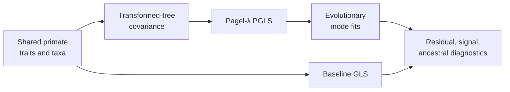
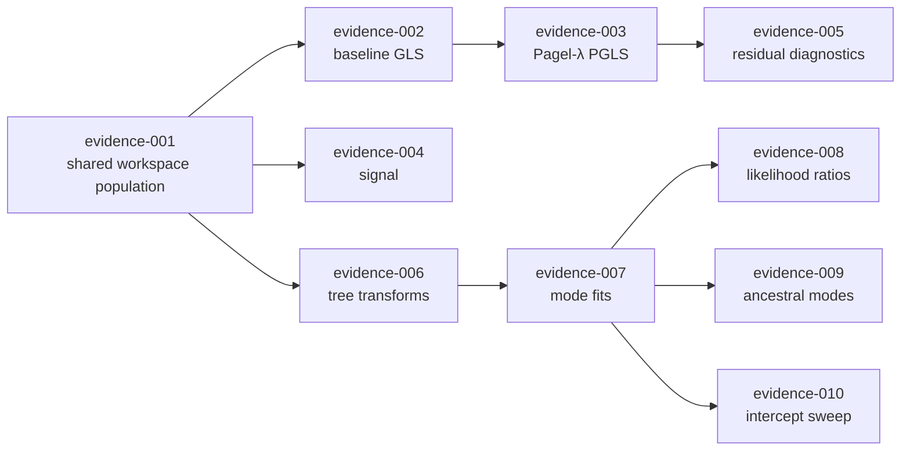

# PCM2: Primate PGLS And Signal

PCM2 evaluates how phylogenetic covariance changes regression, model
comparison, signal diagnostics, and ancestral inference on the prepared
primate data. Baseline GLS and phylogenetically corrected models remain in one
comparison chain so changes in coefficients and fit can be attributed.

## The Covariance Question In One View

| Dimension | PCM2 contract |
| --- | --- |
| scientific object | the PCM1 primate population evaluated through independent GLS, tree-transformed covariance, Pagel-λ PGLS, evolutionary modes, residual diagnostics, and ancestral models |
| central idea | changing residual covariance can change coefficients, uncertainty, likelihood, diagnostics, and ancestral estimates even when response and taxa remain fixed |
| evidence role | tests which conclusions survive the move from independent errors to phylogenetically structured dependence and which discrepancies remain model-specific |
| present conclusion | bundle manifests record 3 `matched`, 6 `matched_with_tolerance`, and 1 `not_comparable`; the broader scalar ledger still retains 12 `mismatch_unexplained` observations |
| downstream role | supplies the covariance and model-comparison discipline that PCM3 must extend when categorical coding and interactions change the design matrix |
| forbidden inference | favorable claim-scoped bundles do not make PCM2 uniformly matching, interchangeable with the reference ecosystem, or biologically causal |

PCM2 is deliberately a two-ledger study. The claim ledger says whether each
bounded bundle closes; the scalar ledger preserves wider numerical debt. A
reader needs both before summarizing correspondence.

## Scientific Questions

- How do coefficient estimates and residual structure change after
  phylogenetic covariance is introduced?
- Does estimating or transforming the covariance improve fit under a declared
  comparison rule?
- Are signal, evolutionary-mode, and ancestral results mutually consistent
  for the same taxa and response definition?

PGLS changes the residual covariance model. It does not simply add a
“phylogenetic correction” flag to ordinary regression, and it does not make
the fitted relationship causal.

## Keep Cross-Implementation And Cross-Model Contrasts Orthogonal

PCM2 contains two comparison axes. They answer different questions and use
different denominators.

| Axis | Comparison | Quantity held fixed | Conclusion available |
| --- | --- | --- | --- |
| implementation correspondence | R baseline GLS versus Bijux baseline GLS | population, formula, independent covariance, likelihood convention | whether two implementations reproduce the registered baseline result |
| implementation correspondence | R Pagel-λ PGLS versus Bijux Pagel-λ PGLS | population, formula, tree covariance parameterization, likelihood convention | whether two implementations reproduce the registered phylogenetic fit |
| scientific model contrast | baseline GLS versus Pagel-λ PGLS within an accepted implementation record | population and mean design | how the estimate changes when residual covariance changes |
| scientific model contrast | Brownian, OU, early-burst, and other registered modes | population, response, and declared comparison basis | how candidate evolutionary models differ when their identities are aligned |

The fall in the social-group-size slope from roughly 3.59 to 1.66 is a
cross-model scientific contrast. The close R–Bijux values within each model
are correspondence observations. Subtracting the R baseline slope from the
Bijux PGLS slope would cross both axes and would not isolate either question.

## What PCM2 Adds Beyond PCM1

PCM1 established the admitted primate population and a signal/ancestral
comparison. PCM2 keeps that population fixed while changing the model layer.
This lets the study ask whether a result changes because covariance changed,
rather than because different taxa or traits entered the fit.

| Analytical move | New question | Evidence required |
| --- | --- | --- |
| independent GLS → Pagel-λ PGLS | how do coefficients and uncertainty change when residual covariance follows the tree? | same response/design population, covariance identity, fitted λ, coefficients, likelihood, residual diagnostics |
| source tree → transformed trees | how do OU or time-dependent branch transformations change evolutionary-mode fits? | parent tree, transform convention and direction, parameters, branch totals, fitted objectives |
| fitted modes → likelihood-ratio tests | does a more complex registered mode improve fit under the declared comparison? | same observations and likelihood convention, nesting, degrees of freedom, optimizer state, statistic |
| fitted process → ancestral estimates | how do conditional node values change under Brownian or early-burst assumptions? | model and tree revision, clade-keyed node identity, estimates, uncertainty, complete node denominator |
| model family → intercept sweep | can the source `corBlomberg` likelihood surface be reproduced? | aligned execution and observations that are currently absent |

The study therefore contributes more than a list of coefficients. It exposes
which conclusions remain stable under a covariance change and where transform,
residual, ancestral, or coverage semantics still disagree.

## Evidence Decomposition

| Bundle | Evaluated surface | Manifest verdict |
| --- | --- | --- |
| `evidence-001` | reload semantics | `matched` |
| `evidence-002` | baseline GLS | `matched` |
| `evidence-003` | Pagel-λ regression | `matched_with_tolerance` |
| `evidence-004` | phylogenetic signal | `matched_with_tolerance` |
| `evidence-005` | residual diagnostics | `matched_with_tolerance` |
| `evidence-006` | transformed tree | `matched` |
| `evidence-007` | evolutionary mode fits | `matched_with_tolerance` |
| `evidence-008` | likelihood-ratio comparison | `matched_with_tolerance` |
| `evidence-009` | ancestral modes | `matched_with_tolerance` for named node identities |
| `evidence-010` | intercept sweep | `not_comparable`; required observations are absent |

The final row prevents a mostly aligned bundle ledger from being summarized as
unqualified end-to-end parity.

These verdicts are claim-scoped. They coexist with the aggregate scalar table's
12 `mismatch_unexplained` rows because the scalar table compares a broader set
of observations than several focused bundle claims. The bundle ledger and
scalar ledger answer different questions; neither may be used to erase the
other.

## Comparison Dependency Graph

Each downstream claim must retain the exact upstream artifact identities it
consumed. A favorable baseline or PGLS bundle does not repair a transformed-tree
or early-burst mismatch, and a named-node ancestral tolerance does not close the
non-comparable intercept sweep.

## Bundle And Scalar Verdicts

The ten bundle manifests currently record `3 matched`,
`6 matched_with_tolerance`, and `1 not_comparable`. The observation ledger is
not uniformly passing: the generated scalar parity table associated with
`evidence-001` retains `12 mismatch_unexplained` rows involving ancestral,
early-burst, likelihood-ratio, transformed-tree, and residual quantities.

Those rows are registered scientific debt even though `evidence-001` itself
has a `matched` manifest verdict for the narrower workspace-reload contract.
Therefore, quote the claim identifier and ledger level. Do not summarize PCM2
as clean parity from the bundle counts alone.

## Governed Findings

The claim-scoped result files expose the scientific changes that the bundle
headlines summarize:

| Fit or test | Bijux observation | Reference relationship |
| --- | ---: | --- |
| baseline GLS social-group-size slope | 3.591156 | agrees with the registered R baseline within numerical precision |
| baseline GLS R² | 0.257170 | agrees with the registered R baseline |
| baseline GLS log likelihood | −456.310147 | agrees under the registered likelihood convention |
| Pagel-λ PGLS estimated λ | 0.768657 | agrees with the R estimate to less than 10⁻⁶ |
| Pagel-λ PGLS social-group-size slope | 1.662147 | agrees with the registered R coefficient within tolerance |
| Pagel-λ PGLS log likelihood | −444.069148 | agrees with the registered R result within tolerance |
| longevity signal λ | 0.802734 | agrees with the registered R signal fit |
| λ=0 likelihood-ratio statistic | 41.030419 | agrees with the registered R test |

The slope change from 3.591156 in baseline GLS to 1.662147 under the fitted
phylogenetic covariance is the substantive comparison. It shows why model
identity must accompany a coefficient; it does not, by itself, establish that
either model is causal or biologically sufficient.

## Unexplained Observation Inventory

The aggregate scalar ledger retains all 12 non-matches:

| Surface | Rows | Recorded discrepancy |
| --- | ---: | --- |
| transformed trees | 4 | exact branch-length totals disagree, including reversed early- and late-burst totals |
| early-burst fit | 2 | rate change differs by 10.6718757865625; log likelihood differs by 15.170304341821 |
| Brownian versus early-burst LRT | 1 | statistic differs by 30.340684573422 |
| ancestral reconstruction | 4 | Brownian and early-burst estimate vectors fail the registered exact rule |
| estimated-λ residual diagnostic | 1 | absolute residual–fitted correlation differs by 0.095590314522858 |

These observations remain `mismatch_unexplained` even where a neighboring
bundle has a favorable verdict for a narrower claim. The early-burst mismatch,
for example, prevents the continuous-mode material from being cited as uniform
numerical correspondence despite aligned Brownian and OU observations.

Inspect the
[`scalar-parity-table.json`](https://github.com/bijux/bijux-phylogenetics/blob/main/evidence-book/studies/primate-pgls-and-signal/evidence-001/results/scalar-parity-table.json)
for row identifiers, values, tolerances, and comparison kinds.

## Cite PCM2 Without Flattening It

| Statement | Records that must travel together |
| --- | --- |
| baseline versus Pagel-λ slope change | `evidence-002` and `evidence-003` model identities, coefficients, covariance, diagnostics, verdicts |
| signal result | `evidence-004` statistic, null rule, reference observation, tolerance, verdict |
| evolutionary-mode comparison | `evidence-006` through `evidence-008` plus the unresolved transformed-tree, early-burst, and LRT rows |
| ancestral estimate | `evidence-009` named-node identity, model, interval/tolerance, and tree revision |
| PCM2-wide conclusion | all ten bundle verdicts plus the 12 `mismatch_unexplained` scalar rows and open intercept-sweep boundary |

The first four statements can be narrower than the whole study. The last one
cannot be constructed by counting favorable bundle manifests while omitting
the scalar mismatch ledger or `evidence-010`.

## Reconstruct The Two-Ledger Decision

1. Read the relevant bundle `manifest.json` to identify the exact claim and
   its current verdict.
2. Follow its input manifest and freshness locators to the registered primate
   derivatives, reference result, and owned PCM2 runtime definition.
3. For a PCM2-wide statement, inspect
   `evidence-001/results/scalar-parity-table.json` and retain all 12 unexplained
   mismatches in the denominator.
4. Read `evidence-010` separately: `not_comparable` means the required
   intercept-sweep observations are not available under a registered
   comparison contract.
5. Cite a favorable focused claim only at its own scope. Do not promote it to
   evolutionary-mode, ancestral, or study-wide equivalence.

This route explains an apparent contradiction without weakening either
record: a narrow registered claim can match while broader retained
observations still disagree.

## Inputs And Provenance

The dossier contains the source workspace and tree plus governed
`reference_primate.csv` and `reference_trimmed_primatetree.nwk` derivatives.
See the [dataset catalog](https://github.com/bijux/bijux-phylogenetics/blob/main/evidence-book/studies/primate-pgls-and-signal/datasets/README.md),
[provenance record](https://github.com/bijux/bijux-phylogenetics/blob/main/evidence-book/studies/primate-pgls-and-signal/provenance/README.md),
and [runtime mapping](https://github.com/bijux/bijux-phylogenetics/blob/main/evidence-book/studies/primate-pgls-and-signal/reference/README.md).

## Model Comparison Discipline

Likelihood-ratio conclusions require nested, comparably fitted models and a
declared degrees-of-freedom convention. Information-criterion comparisons
answer a different question. Residual diagnostics qualify both baseline and
phylogenetic fits; a better scalar score does not excuse a broken residual
contract.

The baseline and Pagel-λ residual summaries use different residual scales in
some fields across implementations. The aggregate ledger therefore preserves
the residual diagnostic mismatch instead of treating matching coefficients
and likelihoods as proof that every diagnostic definition is equivalent.

## Review Priorities

- Verify shared taxa and response transformation across every fit.
- Inspect the covariance/tree transformation rather than only its fitted
  parameter.
- Compare coefficients, likelihoods, and diagnostics together.
- Preserve the scalar `mismatch_unexplained` rows in PCM2-wide summaries.
- Keep `evidence-009` bounded to its named-node tolerance contract.
- Keep the `evidence-010` verdict as `not_comparable` while its intercept-sweep
  resolution work remains open.

Detailed analysis is divided between
[model comparisons and PGLS](model-comparisons-and-pgls.md) and
[signal diagnostics and open boundaries](signal-diagnostics-and-open-boundaries.md).
Continue to [PCM3](../pcm3-primate-continuous-and-categorical-regression/index.md)
for categorical predictors and interactions.
