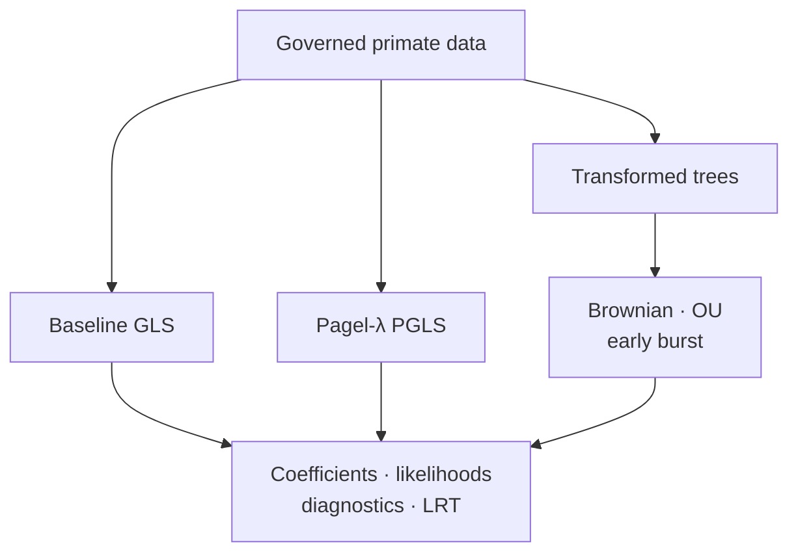

# PCM2 Model Comparisons And PGLS

PCM2 compares ordinary residual independence with phylogenetically structured
covariance and evaluates continuous evolutionary modes on the same prepared
primate data. Shared response, predictors, taxa, and transformation conventions
make changes attributable to the covariance/model rather than data drift.

## Baseline And Phylogenetic Regression

Baseline GLS provides the non-phylogenetic residual model. PGLS changes the
covariance matrix according to tree structure and its fitted transformation.
Coefficient differences can arise from changed weighting and correlation even
when the formula and observations are unchanged.

The baseline GLS bundle (`evidence-002`) records `matched`; the Pagel-λ
regression bundle (`evidence-003`) records `matched_with_tolerance`.

## Model Evidence Ledger

| Bundle | Comparison | Current verdict | Meaning |
| --- | --- | --- | --- |
| `evidence-002` | baseline GLS coefficients and fit | `matched` | exact governed checks agree before phylogenetic covariance is introduced |
| `evidence-003` | Pagel-λ PGLS | `matched_with_tolerance` | bounded numerical drift preserves the governed regression conclusion |
| `evidence-006` | OU, early-burst, and late-burst tree transformation | `matched` | governed branch summaries agree deterministically |
| `evidence-007` | Brownian, OU, and early-burst intercept fits | `matched_with_tolerance` | parameter and fit observations satisfy declared tolerances |
| `evidence-008` | pairwise likelihood-ratio comparisons | `matched_with_tolerance` | test statistics agree under the governed comparison rules |

`matched_with_tolerance` is a favorable verdict with an explicit numerical
acceptance rule. It is not “approximately implemented,” and it must not be
reported without the tolerance, compared estimand, and raw observations.

## Tree Transformations And Evolutionary Modes

`evidence-006` covers transformed-tree behavior. `evidence-007` covers the
continuous mode fits. Brownian, OU, and early-burst families encode different
expectations about trait covariance or rate through time; their parameters and
likelihoods are meaningful only under matching conventions.

## Likelihood-Ratio Comparison

`evidence-008` records the likelihood-ratio parity surface. A valid comparison
requires matching data, likelihood definition, optimization treatment, and a
defensible nesting and degrees-of-freedom rule. Information criteria and
likelihood-ratio tests answer related but different selection questions.

## Comparison Ledger

For each fitted model retain:

- response transformation, predictor formula, and included taxa;
- covariance or tree transformation and parameter bounds;
- coefficient estimates and uncertainty;
- log likelihood, parameter count, and optimization status;
- residual diagnostics;
- comparison statistic, degrees of freedom, and decision rule.

This ledger prevents a change in taxa or transformation from being mistaken
for a model effect.

### Denominator And Identity

For a model family, count every declared coefficient, likelihood, parameter,
diagnostic, transformed branch summary, and pairwise comparison. Report
missing or excluded observations alongside matches. The study-level verdict
cannot be reconstructed from a table that contains only values which passed.

The comparison identity includes the reference package and version, objective
and intercept convention, tree scaling, parameter bounds, optimizer treatment,
and transformation definitions. The same model label under different
conventions is not the same comparison.

## Interpretation Limits

- PGLS accounts for the declared covariance; it does not remove confounding or
  establish causality.
- Better fit does not prove the evolutionary process is literally true.
- Boundary parameters can invalidate naive asymptotic test interpretations.
- Parity establishes agreement under the study contract, not universal model
  recovery.

Continue with
[signal diagnostics and open boundaries](signal-diagnostics-and-open-boundaries.md).
