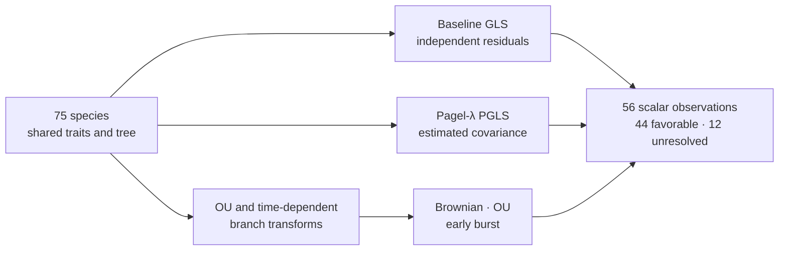

# PCM2 Model Comparisons And PGLS

PCM2 asks a deceptively simple question: what changes when the residuals of a
primate regression are allowed to covary along a phylogeny? The answer is
tracked from an independence model through Pagel-λ covariance, transformed
trees, continuous-mode fits, and likelihood-ratio comparisons. The shared
response, predictors, taxa, and source tree make each change scientifically
attributable—but only where the recorded observations actually agree.



## The Regression Result

The non-phylogenetic and phylogenetic fits use the same substantive formula,
but not the same residual model. That difference materially changes the
social-group-size coefficient:

| Quantity | R reference | Bijux observation | Evidence state |
| --- | ---: | ---: | --- |
| baseline intercept | 263.916162624481 | 263.916162626577 | matched |
| baseline social-group-size slope | 3.591155530518 | 3.591155530471 | matched |
| baseline R² | 0.257169890829 | 0.257169890829 | matched |
| baseline log likelihood | −456.310146562924 | −456.310146563131 | matched |
| estimated Pagel λ | 0.768656451899 | 0.768657155570 | matched with tolerance |
| Pagel-λ PGLS intercept | 249.95843496 | 249.95843742 | matched with tolerance |
| Pagel-λ PGLS slope | 1.662148237 | 1.662147437 | matched with tolerance |
| Pagel-λ PGLS slope p-value | 0.0168886063 | 0.0168886611 | matched with tolerance |
| Pagel-λ PGLS log likelihood | −444.069148162235 | −444.069148162290 | matched with tolerance |

The slope falls from approximately 3.59 to 1.66 after phylogenetic covariance
is fitted. This is the central PCM2 result: coefficient meaning depends on the
declared covariance, not just the formula printed above the table. The fitted
relationship remains associational; neither model establishes causality.

## Model Evidence Ledger

| Bundle | Governed comparison | Manifest verdict |
| --- | --- | --- |
| `evidence-002` | baseline GLS coefficients and fit | `matched` |
| `evidence-003` | Pagel-λ PGLS | `matched_with_tolerance` |
| `evidence-006` | OU, early-burst, and late-burst tree transformations | `matched` |
| `evidence-007` | Brownian, OU, and early-burst intercept fits | `matched_with_tolerance` |
| `evidence-008` | pairwise likelihood-ratio comparisons | `matched_with_tolerance` |

These are claim-scoped manifest verdicts. They do not supersede the aggregate
observation record. The 56-row scalar ledger contains 8 `matched`, 36
`matched_with_tolerance`, and 12 `mismatch_unexplained` observations.

## Focused Bundle Verdicts Do Not Erase Scalar Mismatches

The favorable manifests and unresolved scalar rows coexist because they are
different levels of evidence. A bundle verdict summarizes its declared claim
and checks; the aggregate ledger preserves every registered numerical
observation, including observations outside or stricter than those checks.

| Surface | Reference observation | Bijux observation | Integrity consequence |
| --- | ---: | ---: | --- |
| early-burst transform, parameter `2` | total branch length 87.5076762141263 | 4.1181 | direction or sign convention is not aligned |
| late-burst transform, parameter `−2` | total branch length 4.11805690444875 | 87.5077 | values are reversed relative to the reference labels |
| early-burst fit | rate change 10.6718757865625 | 0 | mode parameter is unresolved |
| early-burst fit | log likelihood −461.253095658179 | −476.4234 | difference is 15.170304341821 |
| Brownian versus early-burst | LRT statistic 30.340684573422 | 0 | the governed comparison does not agree |

Two OU branch-length totals also remain `mismatch_unexplained` under an exact
zero-tolerance rule: 11.8428761446323 versus 11.8429, and 3.20350911964606
versus 3.2035. Those discrepancies look like output precision, but the record
does not classify them as rounding matches. Readers must not silently change
the adjudication rule after seeing the values.

The early- and late-burst reversal is evidence of a probable parameterization
boundary, not proof of its cause. Resolution requires an explicit mapping of
the reference rate-through-time convention to the Bijux transform, followed
by regenerated observations and adjudication.

## Likelihood-Ratio Discipline

For models fitted to the same observations under the same likelihood
convention, the statistic is

```text
LR = 2 × (logLik_complex − logLik_simple)
```

The Brownian-versus-OU statistic agrees: 30.340684116704 in the R reference
and 30.3406 in the Bijux observation. Brownian-versus-early-burst does not.
Consequently, `evidence-008` may be cited for its claim-scoped
`matched_with_tolerance` verdict, but it cannot support a statement that all
pairwise mode comparisons agree.

A defensible likelihood-ratio claim also records nesting, degrees of freedom,
parameter boundaries, optimization status, and whether models use maximum or
restricted likelihood. AIC ranks fitted candidates under a penalty; it is not
a substitute name for the likelihood-ratio test.

## Reconstruct A Model Comparison

Retain the following identity with every coefficient or fit statistic:

- the response transformation, formula, factor coding, included taxa, and row
  order;
- the tree, branch scale, covariance transform, parameter bounds, and root
  treatment;
- coefficient estimates and uncertainty, log likelihood, parameter count,
  and optimizer outcome;
- the residual definition and diagnostic scale;
- the comparison pair, test statistic, degrees of freedom, and acceptance
  tolerance.

Without that identity, a matching decimal may refer to a different estimand.
With it, the baseline and Pagel-λ regression result is reproducible, while the
early-burst family remains visibly unresolved.

Inspect the complete
[`scalar-parity-table.json`](https://github.com/bijux/bijux-phylogenetics/blob/main/evidence-book/studies/primate-pgls-and-signal/evidence-001/results/scalar-parity-table.json)
before making a PCM2-wide parity statement. Continue with
[signal diagnostics and open boundaries](signal-diagnostics-and-open-boundaries.md)
for the residual, ancestral, and uncovered comparison surfaces.
