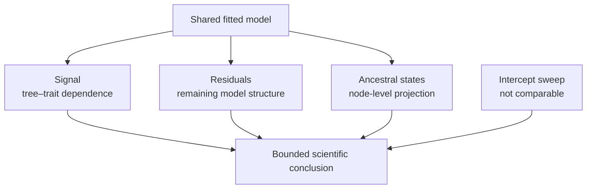

# PCM2 Diagnostics And Open Boundaries

Regression agreement is only one part of PCM2. Phylogenetic signal tests the
response–tree relationship; residual diagnostics test the fitted model;
ancestral reconstruction projects a process onto internal nodes; and the
intercept-mode sweep remains uncovered. These surfaces answer different
questions and retain separate verdicts.

## Read Each Surface As A Constraint

| Surface | Constraint on interpretation | Failure does not automatically invalidate |
| --- | --- | --- |
| phylogenetic signal | names the covariance evidence for this response and tree | exact preparation correspondence |
| residual diagnostics | tests whether fitted-error summaries retain aligned definitions and scales | the coefficient values already recorded under their own contract |
| ancestral reconstruction | binds internal estimates to clades, mode, and uncertainty | the regression estimand, which is a different question |
| intercept sweep | identifies a source analysis with no aligned runtime execution | neighboring PGLS or ancestral claims with complete observations |

These constraints prevent an omnibus pass or fail. A residual mismatch narrows
the residual claim; it also warns readers not to assume identical diagnostic
semantics when interpreting the fit. It does not erase an exact input identity
or silently become evidence against a different model surface.

## Evidence State

| Bundle | Surface | Manifest verdict |
| --- | --- | --- |
| `evidence-004` | phylogenetic signal | `matched_with_tolerance` |
| `evidence-005` | residual diagnostics | `matched_with_tolerance` |
| `evidence-009` | Brownian and early-burst ancestral reconstruction | `matched_with_tolerance` |
| `evidence-010` | intercept-mode likelihood sweep | `not_comparable`; boundary register |

The first three manifest verdicts are favorable within their claim contracts.
The aggregate scalar ledger nevertheless retains five unresolved observations
across residual and ancestral outputs. Cite both levels when describing PCM2.

## Phylogenetic Signal

The longevity signal fit agrees closely across implementations:

| Quantity | R reference | Bijux observation |
| --- | ---: | ---: |
| estimated Pagel λ | 0.802734424042 | 0.802734483419 |
| λ=0 likelihood-ratio statistic | 41.030418693040 | 41.030418692855 |
| likelihood-ratio p-value | 1.498782717 × 10⁻¹⁰ | 1.498782717 × 10⁻¹⁰ |

Under the registered model, the fitted λ is about 0.803 and the λ=0 comparison
is rejected at the recorded p-value. This supports a nonzero-signal conclusion
for the governed response, taxa, tree, bounds, and likelihood convention. It
does not turn λ into a causal fraction, certify the downstream regression, or
imply that every covariance family is adequate.

## Residual Diagnostics Use Named Scales

The baseline fit agrees on the registered summaries: QQ correlation is about
0.97495, absolute-residual–fitted correlation is about 0.02344, and both
implementations identify five outliers under the governed rule.

The estimated-λ diagnostics are not uniformly aligned:

| Diagnostic | R reference | Bijux observation | Ledger state |
| --- | ---: | ---: | --- |
| QQ correlation | 0.980223544139 | 0.977685036394 | within 0.02 tolerance |
| absolute residual–fitted correlation | 0.205562548326 | 0.109972233803 | `mismatch_unexplained` |
| outlier count | 3 | 4 | within the registered count tolerance |

The correlation difference is 0.095590314522858 against a 0.05 tolerance.
The underlying residual magnitudes also reveal different scales: the R
summary is near unit scale while the Bijux residual standard deviation is near
112. This is consistent with normalized versus response-scale residuals, but
the evidence record has not adjudicated that explanation. A reader must not
interpret similar QQ correlations as proof of identical residual semantics.

For any diagnostic comparison, preserve residual type, standardization,
fitted-value scale, outlier rule, row exclusions, and covariance fit. A plot
that looks similar is not a machine-verifiable observation contract.

### Resolve A Residual Discrepancy At Its Definition

The estimated-λ correlation mismatch must be investigated before changing its
tolerance. The shortest defensible resolution path is:

1. align the fitted observation order and exclusions;
2. identify raw, normalized, studentized, or phylogenetically transformed
   residuals in each implementation;
3. identify the fitted-value scale and any centering or variance transform;
4. recompute the diagnostic from retained row-level residual and fitted-value
   vectors;
5. compare the aligned vectors before comparing their correlation summary;
6. retain the original mismatch and adjudicate a new observation under a
   predeclared rule.

If a deterministic scale transform fully explains the difference, the new
claim may become `mismatch_explained`; it does not become exact agreement by
renaming the residuals. If the row vectors differ after alignment, resolution
must move upstream to the fitted model or residual construction.

## Ancestral Reconstruction Is Node-Indexed

`evidence-009` records 74 internal nodes for both Brownian and early-burst
reconstruction. Node count agreement is necessary but insufficient. The
aggregate ledger retains four `mismatch_unexplained` vector observations:
Brownian and early-burst values at the first and most recent five node
positions.

The Brownian differences appear numerically small, but their registered rule
requires exact agreement. The early-burst differences are substantive and
track the unresolved mode parameterization seen in the transformed-tree and
fit observations. The manifest’s `matched_with_tolerance` verdict is bounded
to its named-node contract; it does not erase those aggregate vector rows.

Node identity must be carried explicitly through comparison. Array position,
plotting order, or visual node size is not a stable biological identifier.

## Intercept-Sweep Boundary

`evidence-010` identifies `mode-linked-intercept-models`, the `corBlomberg`
intercept-mode likelihood sweep from the source material. The current runtime
mapping does not supply a comparable execution, so the verdict is
`not_comparable`.

The boundary closes only when the record contains:

- a reference and Bijux implementation of the same intercept-mode sweep;
- matching taxa, response, tree scaling, parameter direction, and intercept
  convention;
- retained likelihood observations and optimizer outcomes;
- an explicit tolerance and adjudicated claim-scoped checks.

Neighboring PGLS or continuous-mode results cannot be borrowed to fill this
gap. The boundary register is the evidence: it names what is absent and what
would make the comparison reviewable.

This is useful evidence even without a numerical verdict. It prevents a reader
from inferring coverage from nearby API capability, preserves the source
analysis as a concrete target, and states the minimum outputs needed for a
future comparison. Its role is to bound the public claim, not to contribute a
favorable row to the parity denominator.

## Distinguish The Four Review Outcomes

| Surface | Present outcome | Why it matters |
| --- | --- | --- |
| signal scalar observations | corresponding within registered tolerances | supports only the named λ and λ=0 claim |
| estimated-λ residual correlation | `mismatch_unexplained` in the aggregate ledger | comparable values exist and violate the registered rule |
| aggregate ancestral vectors | `mismatch_unexplained` under their exact rule | named-node bundle tolerance does not erase broader vector differences |
| intercept sweep | `not_comparable` | required aligned execution and observation rows do not exist |

The last two states are not synonyms. A mismatch requires comparable
observations that disagree; `not_comparable` records that the comparison
cannot yet be made. Their resolution work therefore starts at different
owners.

## What PCM2 Supports

PCM2 supports the baseline and Pagel-λ regression correspondence and the
governed phylogenetic-signal observations. It also supplies reviewable
diagnostic and ancestral contracts. It does **not** support uniform parity for
early-burst behavior, every residual statistic, every ancestral vector, or the
intercept-mode likelihood sweep.

That mixed conclusion is stronger than an unqualified pass: readers can see
which scientific statements are reproduced, which depend on tolerance, and
which observations still require resolution.

A citable PCM2 statement should therefore name the surface. “The baseline GLS
and Pagel-lambda PGLS coefficients correspond under their bundle contracts” is
supported. “PCM2 reproduces all comparative methods” is contradicted by the 12
unresolved scalar observations and the non-comparable intercept sweep.
