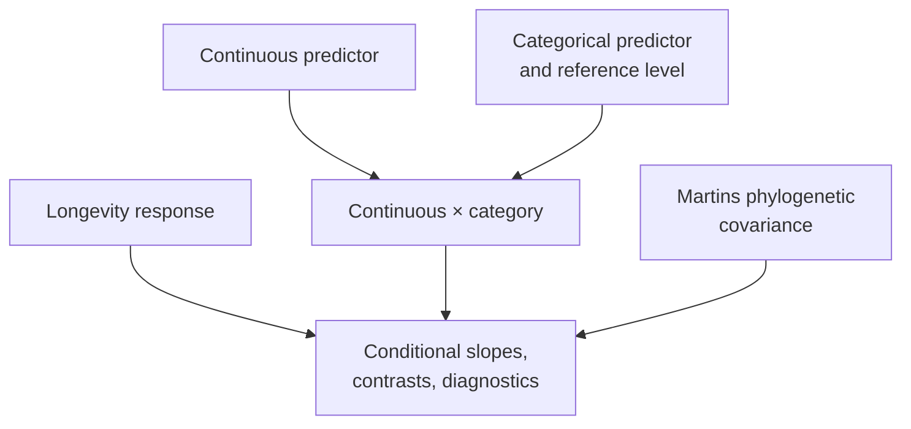

# PCM3: Primate Continuous And Categorical Regression

PCM3 moves from single-predictor comparative models to multivariable design.
Continuous predictors, categorical contrasts, interactions, transformations,
and phylogenetic covariance are evaluated as separate sources of meaning
rather than compressed into one PGLS label.



## Scientific Questions

- How does categorical coding change the intercept and reported contrasts?
- How should group-specific slopes be recovered from an interaction model?
- What changes when the response is transformed or the predictor standardized?
- Which differences remain after residual covariance follows the phylogeny?

An interaction coefficient is not an isolated effect. It modifies a
conditional slope under a specific reference coding. Standardization changes
the location represented by the intercept. Those semantics must match before
coefficients from different implementations can be compared.

## Read Coefficients From The Design Matrix

For a model with continuous predictor `x`, group indicator `B`, and interaction
`x:B`, the fitted mean is interpreted as:

```text
reference group:  beta_0 + beta_x * x
group B:          (beta_0 + beta_B) + (beta_x + beta_x:B) * x
```

`beta_B` is the group difference at the point represented by `x = 0`.
`beta_x:B` is the change in slope for group B. Centering or standardizing `x`
therefore changes the intercept and group contrast without changing the raw
observations. A comparison must align the reference level and transformation
before interpreting coefficient differences.

## Evidence Decomposition

| Bundle | Evaluated surface |
| --- | --- |
| `evidence-001` | source intake, workspace reload, and shared data alignment |
| `evidence-002` | baseline GLS with continuous and categorical predictors |
| `evidence-003` | log response, residual diagnostics, marginal and sequential tests |
| `evidence-004` | intercept-free group estimates |
| `evidence-005` | continuous-by-categorical interaction |
| `evidence-006` | predictor scaling and intercept semantics |
| `evidence-007` | categorical phylogenetic regression with Martins covariance |
| `evidence-008` | post-correction diagnostics and hypothesis tests |

All eight bundles have governed structure and review artifacts. Their
bundle verdicts are `not_comparable`; the work to create lecture-specific
comparisons remains open. Evidence infrastructure is complete enough to
localize the missing comparisons, but it is not a passing parity result.

## Current Verdict

All eight bundle manifests record `not_comparable`. The repository has the
source programs, identified inputs, claim decomposition, runtime mapping,
checks, and review locations, but it does not yet have governed
observation-level lecture outputs under aligned factor coding, transformations,
covariance, and hypothesis-test semantics.

Closing a bundle requires more than executing a neighboring regression API.
The comparison must reconstruct the same design matrix, analysis population,
coefficient names, test type, and phylogenetic covariance, then retain the
reference and Bijux observations with an explicit tolerance or structural
rule.

## Verdict And Resolution State

`not_comparable` is the current evidence conclusion, not a placeholder for
`failed` and not a runtime skip. It records that aligned lecture-level
observations do not yet exist for the proposed comparison. Open follow-through
describes the work needed to create and adjudicate those observations. Keep
both facts visible without calling the follow-through itself a verdict.

## Inputs And Provenance

PCM3 reuses the primate source workspace and governed tree/trait derivatives
while carrying its own dataset registry and provenance. See the
[dataset catalog](https://github.com/bijux/bijux-phylogenetics/blob/main/evidence-book/studies/primate-continuous-and-categorical-regression/datasets/README.md),
[provenance record](https://github.com/bijux/bijux-phylogenetics/blob/main/evidence-book/studies/primate-continuous-and-categorical-regression/provenance/README.md),
and [runtime mapping](https://github.com/bijux/bijux-phylogenetics/blob/main/evidence-book/studies/primate-continuous-and-categorical-regression/reference/README.md).

## Review Priorities

- Match factor levels, reference category, design matrix, and missing-value
  exclusions before comparing coefficients.
- Compare transformed response and standardized predictor conventions exactly.
- Reconstruct conditional group slopes from main and interaction terms.
- Distinguish marginal from sequential hypothesis tests.
- Confirm that the phylogenetic fit uses the same taxa and response as the
  non-phylogenetic comparator.

For every coefficient table, retain the term-to-design-column mapping. For
every hypothesis-test table, identify whether the test is marginal,
sequential, or based on nested-model comparison. Equal labels across tools do
not guarantee equal hypotheses.

## Current Scope

PCM3 supplies a complete claim decomposition and executable review locations
for the multivariable lecture. It does not yet claim lecture-level numerical
parity for any of the eight slices. The closure work is comparison and verdict
adjudication, not inventing broader runtime capability by implication.

See [model design and phylogenetic regression](model-design-and-phylogenetic-regression.md)
for the detailed interpretation contract.
