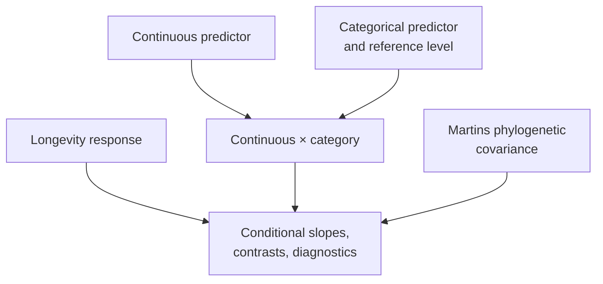
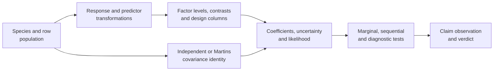

# PCM3: Primate Continuous And Categorical Regression

PCM3 moves from single-predictor comparative models to multivariable design.
Continuous predictors, categorical contrasts, interactions, transformations,
and phylogenetic covariance are evaluated as separate sources of meaning
rather than compressed into one PGLS label.



## The Design-Matrix Question In One View

| Dimension | PCM3 contract |
| --- | --- |
| scientific object | primate longevity regressions whose rows, response scale, factor levels, contrasts, interaction columns, standardization, and Martins covariance must resolve together |
| central idea | a familiar formula label is not an estimand; coding and transformation determine what every intercept, slope, contrast, and test means |
| evidence role | decomposes a multivariable comparison into eight independently closable claims so a coefficient cannot hide a population, design, covariance, or hypothesis mismatch |
| present conclusion | all eight manifests are `not_comparable`; they retain source, inputs, claim boundaries, checks, and explicit closure requirements but no governed primary numerical outputs |
| relation to PCM1–PCM2 | inherits the need for a governed primate population and covariance identity, then adds design-matrix identity as a separate comparison gate |
| forbidden inference | runtime support for regression or PGLS does not establish lecture coefficients, p-values, likelihoods, diagnostics, or parity |

PCM3 is a governed comparison design, not a weak numerical result. Its evidence
value is that it makes the missing denominator and estimand observable before
any future values are allowed into a parity ledger.

## Scientific Questions

- How does categorical coding change the intercept and reported contrasts?
- How should group-specific slopes be recovered from an interaction model?
- What changes when the response is transformed or the predictor standardized?
- Which differences remain after residual covariance follows the phylogeny?

An interaction coefficient is not an isolated effect. It modifies a
conditional slope under a specific reference coding. Standardization changes
the location represented by the intercept. Those semantics must match before
coefficients from different implementations can be compared.

### Coefficient Labels Are Coordinates, Not The Model Itself

A fitted mean can be expressed through different but equivalent design bases.
Changing the factor reference level, removing the intercept, or centering a
predictor changes the coefficient coordinates and their labels even when the
model predicts the same value for every admitted row. By contrast, filtering
rows, changing a response transform, or testing a different linear combination
changes the scientific question.

PCM3 therefore requires both a prediction-level identity and a
coefficient-to-design-column identity. Similar predictions cannot prove that
named coefficients have the same meaning, and similar coefficient labels
cannot prove that the fitted population or hypothesis is the same.

## What PCM3 Is Designed To Distinguish

PCM3 turns one multivariable analysis into eight bounded questions because
changes that look cosmetic in formula notation change the estimand.

| Design choice | Quantity that becomes interpretable | Identity needed for evidence |
| --- | --- | --- |
| continuous plus categorical main effects | reference-group intercept, common slope, and group contrast at `x = 0` | admitted rows, response scale, factor levels, reference level, design columns |
| log-transformed response | multiplicative rather than additive response interpretation | transform rule, zero handling, units, back-transform policy |
| intercept-free group parameterization | one directly estimated intercept per group | contrast/design matrix and coefficient mapping, not label similarity |
| continuous-by-category interaction | reference slope and group-specific slope differences | centered/scaled predictor, reference group, interaction column |
| standardized predictor | intercept at the predictor mean and slopes per standard deviation | training population, mean, scale, and application rule |
| Martins phylogenetic covariance | coefficients and tests under tree-structured residual dependence | tree/taxon order, covariance definition, fitted parameter, likelihood convention |

The evidence question is therefore not “did both tools fit PGLS?” It is
whether they fitted the same population, design matrix, covariance, estimand,
and hypothesis before any coefficient or p-value was compared.

## Design Identity Must Be Inspectable, Not Inferred

A future PCM3 execution needs a machine-readable design identity before it
needs a coefficient table. Formula text is only one input to that identity.

| Design layer | Minimum retained evidence | Failure hidden by formula text alone |
| --- | --- | --- |
| row population | ordered species keys, source-row keys, exclusions, and response values | different complete-case populations |
| transformation | response transform, zero/domain policy, predictor center and scale, and fitted/application population | different intercept location or units |
| categorical coding | raw levels, normalized levels, reference level, and contrast matrix | reversed or renamed contrasts |
| numerical design | stable column keys, ordered column values, rank, and aliased-column state | same label attached to different vectors |
| covariance | tree digest, ordered taxa, branch scale, Martins definition, bounds, and fitted parameter state | same mean design fitted under different dependence |
| hypothesis | explicit tested column combination or hypothesis matrix, term order, and degrees of freedom | marginal and sequential tests mislabeled as equivalent |

The strongest join key is a fingerprint over these governed components plus
their independently reviewable rows—not a hash with no readable decomposition.
Only after both executions resolve to the same design identity do numerical
tolerances become meaningful.

## Read Coefficients From The Design Matrix

For a model with continuous predictor `x`, group indicator `B`, and interaction
`x:B`, the fitted mean is interpreted as:

```text
reference group:  beta_0 + beta_x * x
group B:          (beta_0 + beta_B) + (beta_x + beta_x:B) * x
```

`beta_B` is the group difference at the point represented by `x = 0`.
`beta_x:B` is the change in slope for group B. Centering or standardizing `x`
therefore changes the intercept and group contrast without changing the raw
observations. A comparison must align the reference level and transformation
before interpreting coefficient differences.

## Evidence Decomposition

| Bundle | Evaluated surface | Manifest verdict |
| --- | --- | --- |
| `evidence-001` | source intake, workspace reload, and shared data alignment | `not_comparable` |
| `evidence-002` | baseline GLS with continuous and categorical predictors | `not_comparable` |
| `evidence-003` | log response, residual diagnostics, marginal and sequential tests | `not_comparable` |
| `evidence-004` | intercept-free group estimates | `not_comparable` |
| `evidence-005` | continuous-by-categorical interaction | `not_comparable` |
| `evidence-006` | predictor scaling and intercept semantics | `not_comparable` |
| `evidence-007` | categorical phylogenetic regression with Martins covariance | `not_comparable` |
| `evidence-008` | post-correction diagnostics and hypothesis tests | `not_comparable` |

All eight bundles have governed structure and review artifacts. Their
bundle verdicts are `not_comparable`; the work to create lecture-specific
comparisons remains open. Evidence infrastructure is complete enough to
localize the missing comparisons, but it is not a passing parity result.

## Current Verdict

All eight bundle manifests record `not_comparable`. The repository has the
source programs, identified inputs, claim decomposition, runtime mapping,
checks, and review locations, but it does not yet have governed
observation-level lecture outputs under aligned factor coding, transformations,
covariance, and hypothesis-test semantics.

## What The Present Record Contributes

| Retained evidence | Decision it enables now | Decision it does not enable |
| --- | --- | --- |
| checked lecture source and provenance | identify the intended formulas, objects, and source boundary | claim that the lecture execution completed in the governed lane |
| governed table and tree derivatives | inspect exact candidate inputs and their identities | claim that both implementations admitted identical rows and design columns |
| eight separated claim contracts | prevent baseline, interaction, transform, and phylogenetic tests from being collapsed | assign a favorable numerical verdict to any claim |
| executable contract wrappers and zero-primary-output manifests | verify that absence is explicit and machine-readable | treat wrapper completion as regression execution |
| closure requirements | run a future comparison without redefining its population or estimands | publish coefficients, likelihoods, p-values, or diagnostic correspondence today |

PCM3 is evidence of a governed comparison design and its current absence of
primary observations. That is useful evidence about readiness and scope, not
numerical evidence about regression correspondence.

## No Numerical Headline Is Supported

PCM3 has no governed coefficient, p-value, likelihood, or model-comparison
observation that can be presented as lecture parity. The checked-in reviewer
summaries establish record completeness and expose the absent execution
boundary; they are not primary scientific outputs.

The runtime can express multivariable regression, but capability proximity is
not evidence that the eight PCM3 lecture claims were executed or adjudicated.

## Retained Record And Missing Evidence

| Evidence component | Current state | Consequence |
| --- | --- | --- |
| lecture source and copied study inputs | retained with provenance | the intended study and source boundary can be inspected |
| eight claim identities and bundle manifests | retained | the comparison denominator and required surfaces are explicit |
| nearby comparative runtime implementations | identified by governed code paths | implementation relevance is traceable but does not prove execution |
| governed primary R outputs | absent from every bundle | no reference coefficient, test, or diagnostic can enter comparison |
| governed primary Bijux outputs | absent from every bundle | no repository observation can enter comparison |
| aligned observation rules and tolerances | not instantiated with paired outputs | no numerical correspondence verdict can be calculated |

All eight manifests currently have zero governed primary output paths. That is
the earliest owning reason for `not_comparable`; reviewer summaries and rich
runtime APIs cannot close it.

## Claim Closure Contract

| Claim family | Reference record required | Bijux record required | Comparison identity |
| --- | --- | --- | --- |
| baseline continuous and categorical GLS | fitted population, design columns, coefficients, uncertainty, likelihood | same fields under the same row exclusions | factor levels, reference group, formula, test convention |
| transformed response and model tests | transform, fitted models, marginal and sequential tables | matching transformed response and hypotheses | response scale, degrees of freedom, test ordering |
| intercept-free group estimates | group-specific parameterization and uncertainty | same design columns and covariance | no-intercept coding and group order |
| interaction model | conditional slopes and contrasts | main and interaction terms plus reconstructed slopes | centering, reference group, term mapping |
| predictor scaling | center, scale, and transformed coefficients | same scaling constants and coefficient projection | numerical transform and intercept meaning |
| phylogenetic regression | tree, Martins covariance, fitted parameters, coefficient table | identical taxa, tree scale, covariance, and design | covariance convention and likelihood scale |
| post-correction diagnostics | residual definition and hypothesis tests | corresponding diagnostics and tests | residual scale, leverage, test family |

Each bundle remains `not_comparable` until its row has both primary outputs and
a declared observation rule. Structural completeness alone cannot satisfy a
scientific comparison.

## Close Dependencies Before Coefficients

PCM3 coefficients are downstream observations. They cannot close while the
analysis population, design, covariance, or hypothesis identity remains open.



An observation row must point to the immutable parent records it consumed.
Reusing the same formula text does not establish the same design; reusing the
same species names does not establish the same ordered population; and a
matching coefficient cannot close a claim whose tested hypothesis differs.

The bundle denominator remains all claims and all eligible observations
selected before execution. Failed fits, missing terms, aliased columns, and
non-comparable tests remain in that denominator rather than disappearing from
the successful coefficient table.

Closing a bundle requires more than executing a neighboring regression API.
The comparison must reconstruct the same design matrix, analysis population,
coefficient names, test type, and phylogenetic covariance, then retain the
reference and Bijux observations with an explicit tolerance or structural
rule.

## Verdict And Resolution State

`not_comparable` is the current evidence conclusion, not a placeholder for
`failed` and not a runtime skip. It records that aligned lecture-level
observations do not yet exist for the proposed comparison. Open follow-through
describes the work needed to create and adjudicate those observations. Keep
both facts visible without calling the follow-through itself a verdict.

## Inputs And Provenance

PCM3 reuses the primate source workspace and governed tree/trait derivatives
while carrying its own dataset registry and provenance. See the
[dataset catalog](https://github.com/bijux/bijux-phylogenetics/blob/main/evidence-book/studies/primate-continuous-and-categorical-regression/datasets/README.md),
[provenance record](https://github.com/bijux/bijux-phylogenetics/blob/main/evidence-book/studies/primate-continuous-and-categorical-regression/provenance/README.md),
and [runtime mapping](https://github.com/bijux/bijux-phylogenetics/blob/main/evidence-book/studies/primate-continuous-and-categorical-regression/reference/README.md).

## Review Priorities

- Match factor levels, reference category, design matrix, and missing-value
  exclusions before comparing coefficients.
- Compare transformed response and standardized predictor conventions exactly.
- Reconstruct conditional group slopes from main and interaction terms.
- Distinguish marginal from sequential hypothesis tests.
- Confirm that the phylogenetic fit uses the same taxa and response as the
  non-phylogenetic comparator.

For every coefficient table, retain the term-to-design-column mapping. For
every hypothesis-test table, identify whether the test is marginal,
sequential, or based on nested-model comparison. Equal labels across tools do
not guarantee equal hypotheses.

## Current Scope

PCM3 supplies a complete claim decomposition and executable review locations
for the multivariable lecture. It does not yet claim lecture-level numerical
parity for any of the eight slices. The closure work is comparison and verdict
adjudication, not inventing broader runtime capability by implication.

PCM3 defines the model semantics and evidence needed for a defensible
comparison while making no numerical correspondence claim at this revision.

See [model design and phylogenetic regression](model-design-and-phylogenetic-regression.md)
for the detailed interpretation contract.
