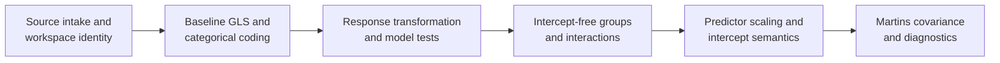
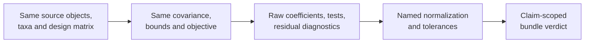

# PCM3 Model Design And Phylogenetic Regression

PCM3 changes the design matrix, response scale, and covariance structure in a
deliberate sequence. Each change alters the meaning of at least one
coefficient. The repository governs eight claim bundles for that sequence, but
none yet contains a comparable lecture execution; every current bundle verdict
is `not_comparable`.

## Governed Claim Ledger

| Bundle | Governed claim | Current verdict | Missing comparison |
| --- | --- | --- | --- |
| `evidence-001` | source intake and workspace alignment | `not_comparable` | lecture-specific object and input correspondence |
| `evidence-002` | baseline GLS with a categorical predictor | `not_comparable` | coefficient, fit, coding, and residual observations |
| `evidence-003` | transformed response and model tests | `not_comparable` | transformation identity and comparable test outputs |
| `evidence-004` | intercept-free group parameterization | `not_comparable` | group-estimate design and coefficient correspondence |
| `evidence-005` | interaction coefficient interpretation | `not_comparable` | aligned design columns and interaction estimates |
| `evidence-006` | scaling and intercept semantics | `not_comparable` | scaling constants and recentered coefficient outputs |
| `evidence-007` | Martins covariance phylogenetic regression | `not_comparable` | aligned covariance parameterization and fitted results |
| `evidence-008` | post-correction diagnostics and tests | `not_comparable` | comparable diagnostic and hypothesis-test observations |

The bundles are structurally reviewable: source mapping, code surfaces, input
manifests, checks, provenance, and explicit verdicts exist. Structural
completeness does not establish any lecture-equivalent numerical claim.

## Read Coefficients From The Design Matrix

| Model change | Coefficient meaning that changes |
| --- | --- |
| response transformation | all effects move to the transformed response scale; back-transformation is nonlinear |
| categorical reference level | intercept and group contrasts are defined relative to the selected level |
| intercept removal | group coefficients become group-specific intercepts rather than differences from one reference |
| interaction term | main effects become conditional effects at the other variable's reference or zero value |
| predictor standardization | the intercept moves to the mean predictor value and slopes change units |
| phylogenetic covariance | coefficient names can remain unchanged while weighting, uncertainty, likelihood, and residual interpretation change |

A future comparison must retain the exact formula and design columns, factor
levels and contrasts, response transformation, centering/scaling constants,
included taxa and order, covariance family and parameter, coefficient scale,
likelihood convention, and diagnostic definitions.

## Comparable Execution Requirements

Nearby runtime surfaces for categorical contrasts, interaction ledgers,
comparative model selection, PGLS, and residual review are relevant building
blocks. They cannot inherit PCM3 verdicts. The current `not_comparable` state
must remain until the lecture and Bijux executions share model identity and
produce adjudicated observations for each bundle.

## Interpretation Boundaries

- Transformation can improve residual behavior without making a model
  biologically adequate.
- An interaction changes the meaning of its lower-order terms; it is not an
  isolated extra coefficient.
- Phylogenetic covariance addresses declared residual dependence, not omitted
  variables, measurement error, or causal identification.
- A diagnostic improvement is evidence about a named model check, not proof of
  the biological interpretation.
- Open work to construct the comparison is resolution state; the recorded
  bundle verdict remains `not_comparable`.
