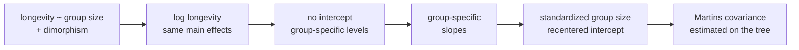
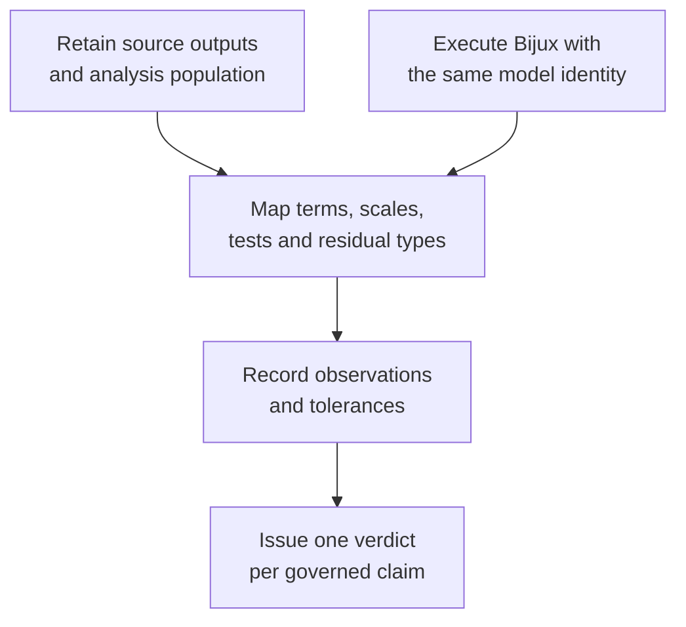

# PCM3 Model Design And Phylogenetic Regression

PCM3 follows one primate analysis through categorical coding, a log response,
intercept removal, interactions, predictor standardization, and Martins
phylogenetic covariance. Each operation changes either the estimand or its
uncertainty. The Evidence Book has decomposed that path into eight governed
claims, but no bundle yet retains comparable lecture and Bijux observations;
every current bundle verdict
is `not_comparable`.



## The Source Model Sequence

The checked-in source program names the intended statistical operations. Its
formulas make the coefficient semantics concrete:

| Source fit | Formula or operation | Scientific role |
| --- | --- | --- |
| `gls2` | `longevity ~ social_group_size + sex_dimorphism` | baseline continuous and categorical GLS |
| `gls3` | `log(longevity) ~ social_group_size + sex_dimorphism` | response-scale repair and marginal/sequential tests |
| `gls4` | `log(longevity) ~ sex_dimorphism - 1 + social_group_size` | group-specific intercept estimates |
| `gls5` | main effects plus `social_group_size:sex_dimorphism` | conditional group slopes |
| `gls6` | `sex_dimorphism + social_group_size:sex_dimorphism - 1` | explicit group intercepts and slopes |
| `gls7` | interaction model using standardized group size | intercept at mean group size and slopes per standard deviation |
| `pgls5` | scaled interaction model with estimated `corMartins` | same design under phylogenetic residual covariance |

This table describes the source analysis, not verified Bijux results. No
coefficient, p-value, likelihood, covariance parameter, or diagnostic from
this sequence is currently a governed parity observation.

## Governed Claim Ledger

| Bundle | Governed claim | Current verdict | Observation gap |
| --- | --- | --- | --- |
| `evidence-001` | source intake and workspace alignment | `not_comparable` | aligned source objects, taxa, and row identity |
| `evidence-002` | baseline GLS with a categorical predictor | `not_comparable` | design columns, coefficients, fit, and residuals |
| `evidence-003` | transformed response and model tests | `not_comparable` | transformed rows plus marginal and sequential tests |
| `evidence-004` | intercept-free group parameterization | `not_comparable` | group estimates under the same factor ordering |
| `evidence-005` | interaction coefficient interpretation | `not_comparable` | aligned interaction columns and conditional slopes |
| `evidence-006` | scaling and intercept semantics | `not_comparable` | center, scale, and projected coefficients |
| `evidence-007` | Martins covariance phylogenetic regression | `not_comparable` | covariance identity, fitted parameter, and model outputs |
| `evidence-008` | post-correction diagnostics and tests | `not_comparable` | comparable residual and hypothesis-test observations |

Each bundle contains an explicit claim, source locators, required artifact
inventory, limitations, and reviewer summary. Each `checks.json` currently has
an empty `primary_output_paths` list. Those files make the absence auditable;
they do not turn contract structure into scientific evidence.

## Read Coefficients From The Design Matrix

Let `x` be group size and `B` indicate one dimorphism category. With an
intercept and interaction, the two fitted lines are:

```text
reference category:  beta_0 + beta_x * x
category B:          (beta_0 + beta_B) + (beta_x + beta_x:B) * x
```

`beta_B` is a difference at `x = 0`, not an average group effect.
`beta_x:B` is a difference between slopes, not the slope for category B. After
standardization, zero denotes the recorded mean of group size and one unit
denotes the recorded standard deviation. After removing the intercept, the
category coefficients become category-specific intercepts rather than
contrasts against a reference.

Therefore, coefficient parity requires the design matrix—not merely the
printed formula—to agree. Factor level order, contrast encoding, missing-value
exclusions, centering, scaling, and term-column mapping are part of the result.

## See How Each Design Changes The Estimand

For a two-level factor with indicator `B`, the relevant row vectors make the
changes visible:

| Model form | Design row | Meaning changed by the operation |
| --- | --- | --- |
| baseline main effects | `[1, x, B]` | one reference intercept, one shared slope, one category contrast |
| no intercept | `[1-B, B, x]` | separate category intercepts replace the reference contrast |
| interaction | `[1, x, B, x*B]` | the category difference may vary with group size |
| no-intercept interaction | `[1-B, B, x*(1-B), x*B]` | each category owns an explicit intercept and slope |
| standardized interaction | replace `x` with `z = (x-center)/scale` | intercepts move to the recorded center; slopes become effects per recorded scale unit |

Column order alone is not the contract: the evidence needs stable term keys and
the actual column values after exclusions. Two tools can print the same formula
while using different reference levels, missing-row populations, or
standardization denominators. In that state, numerical coefficient comparison
has no shared estimand and must remain `not_comparable`.

## Marginal And Sequential Tests Are Different Questions

The source requests both sequential and marginal ANOVA tables. A sequential
test evaluates a term after terms entered before it; its result depends on
term order. A marginal test evaluates a term conditional on the other retained
terms under the tool’s declared hypothesis convention. Their labels, degrees
of freedom, and test statistics cannot be interchanged.

An executable comparison must retain the tested hypothesis matrix or an
equivalent term-level definition. Matching p-values without matching the
hypothesis is not parity.

## Phylogenetic Covariance Changes The Fit, Not The Design

The final source model keeps the scaled interaction design and adds a Martins
covariance initialized at 0.5 and estimated on `primatetree`. The coefficient
names can remain identical while estimates, uncertainty, likelihood, and
residuals change because observations no longer receive independent weight.

A comparable execution must align:

- the  trait rows and exact species-to-tip ordering;
- tree topology, branch lengths, rooting, and scale;
- the Martins covariance definition, bounds, initialization, and fixed versus
  estimated treatment;
- maximum-likelihood convention and optimizer outcome;
- normalized versus response-scale residual definitions.

Runtime support for PGLS and interaction coefficients shows that these
components exist. It does not establish that this lecture model was executed
under the same identity.

## Comparable Execution Requirements



For each bundle, closure requires primary reference and Bijux outputs, their
input identities, a normalization rule where names or encodings differ, and
machine-adjudicated observations. The evidence must include failures and
missing values; a table of successful coefficients alone cannot establish the
denominator.

## Key Every Comparable Observation

A coefficient or test becomes comparable only after its observation key
resolves the analytical object on both sides. Printed term labels are display
text and are insufficient as join keys.

| Key component | Coefficient observation | Hypothesis-test observation |
| --- | --- | --- |
| population | ordered included species and excluded-row ledger | the same fitted population for every tested model |
| response | source column, transform, units, and missing policy | response and transform shared by null and alternative fits |
| design | formula, contrast matrix, factor levels, column vector identity | tested column set or explicit hypothesis matrix |
| covariance | independence or tree/covariance digest, scale, and fitted parameter state | covariance convention held fixed across compared fits |
| fit | likelihood convention, optimizer state, coefficient key, and uncertainty definition | model pair or term-order identity, statistic, degrees of freedom, and tail rule |
| projection | source-to-Bijux term mapping and any scale transformation | source-to-Bijux test mapping without relabeling marginal as sequential |

If one key component cannot be aligned, retain both outputs as separate
observations and keep the claim `not_comparable`. Do not tune a tolerance for
values that have not first been shown to estimate or test the same quantity.

## What Can Be Cited Now

PCM3 can be cited as a governed decomposition of a multivariable comparative
analysis and as an exact statement of the comparison work still required. It
cannot be cited for numerical correspondence, recovered biological effects,
or successful Martins-covariance reproduction.

`not_comparable` is the evidence conclusion. It is neither a failed numerical
comparison nor an informal promise that parity exists elsewhere. Keeping that
boundary explicit protects future results from inheriting claims that have
never been observed.
