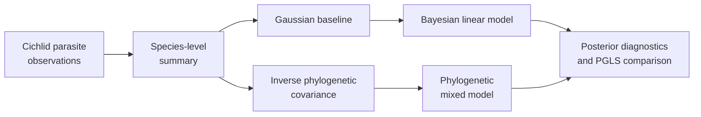
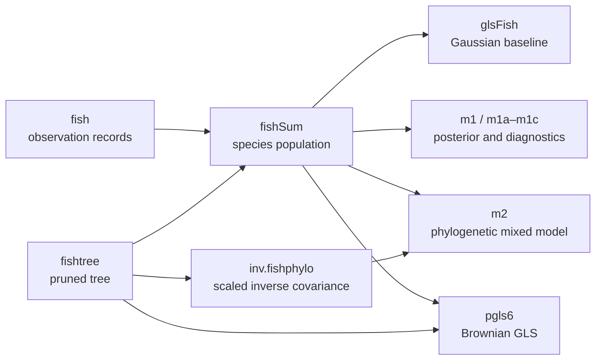

# PCM4: Cichlid Bayesian Linear And Phylogenetic Mixed Models

PCM4 introduces posterior inference and phylogenetic random effects through a
cichlid parasite study. It connects observation-level records to a
species-level analysis, compares a Gaussian baseline with Bayesian fits, and
uses the inverse phylogenetic covariance in an `MCMCglmm` model.



## Scientific Questions

- Does the parasite response retain the baseline predictor relationship after
  posterior uncertainty is represented?
- How much variation is assigned to the phylogenetic random effect?
- Are fixed-effect estimates and uncertainty coherent with the Brownian PGLS
  comparator?
- Do chain diagnostics support interpretation of posterior summaries?

The inverse covariance is not an implementation detail: taxon order,
rootedness, branch lengths, and alignment with the species table determine the
random-effect structure.

## Why PCM4 Is More Than Bayesian PGLS

PCM4 deliberately preserves four related estimators because each changes a
different part of the scientific contract.

| Estimator | Dependence model | Uncertainty object | Question it answers |
| --- | --- | --- | --- |
| Gaussian GLS baseline | independent residuals | maximum-likelihood sampling uncertainty | what fixed relationship appears without phylogenetic covariance? |
| Bayesian Gaussian model | independent residuals with declared priors | posterior draws for fixed and residual terms | how do prior and posterior estimation change the same mean structure? |
| phylogenetic mixed model | phylogenetic random effect plus residual variation | joint posterior for fixed effects and variance components | how much modeled variation is assigned to the tree-linked random effect? |
| Brownian PGLS comparator | residual covariance derived directly from the tree | maximum-likelihood coefficient and fit uncertainty | how does a covariance-model treatment compare with the random-effect treatment? |

Close fixed-effect point estimates would not make these estimators
interchangeable. A comparison must preserve priors, variance components,
posterior dependence, chain diagnostics, covariance scaling, and the different
meaning of PGLS versus random-effect uncertainty.

## Model Components

The central phylogenetic mixed model can be read as:

```text
y = X beta + Z u_phylogeny + epsilon
u_phylogeny ~ Normal(0, sigma_phylogeny^2 A)
epsilon     ~ Normal(0, sigma_residual^2 I)
```

`A` is the tree-derived covariance in the aligned species order. The source
workflow supplies its inverse to `MCMCglmm`. A valid comparison must therefore
align not only fixed-effect formulas but also covariance scaling, random-effect
levels, priors on variance components, observation aggregation, and posterior
summaries.

## The Preserved Source Analysis

The preserved Lund program is a connected analysis, not a collection of
interchangeable model calls. These source objects define the handoffs that a
reproduction must retain:

| Source object | Computation | Evidence responsibility |
| --- | --- | --- |
| `fish` | observation-level `cichlid.csv` records | preserves repeated measurements before aggregation |
| `fishtree` | `cichlidtree.nex`, pruned to represented taxa | fixes topology, branch lengths, and the eligible taxon set |
| `fishSum` | records grouped by `treetip`, `species`, and `mating_system` | fixes the species-level population used by the Gaussian analyses |
| `glsFish` | maximum-likelihood GLS for `log(parasite_abundance + 1) ~ gut_length` | supplies the non-phylogenetic Gaussian baseline |
| `m1` | Gaussian `MCMCglmm` with the same fixed formula | introduces posterior estimation without a phylogenetic random effect |
| `m1a`, `m1b`, `m1c` | independently invoked Gaussian chains | supply the between-chain diagnostic population |
| `inv.fishphylo` | `inverseA(..., nodes = "TIPS", scale = TRUE)` | supplies the ordered, scaled inverse covariance |
| `m2` | Gaussian `MCMCglmm` with random effect `treetip` | estimates fixed effects and phylogenetic and residual variance |
| `pgls6` | Brownian GLS with `corBrownian(..., form = ~treetip)` | supplies a maximum-likelihood phylogenetic comparator |



Matching only the final coefficient discards this structure. A governed
comparison must show that each output was computed from the same analytical
population and the same tree identity before it compares numerical values.

## Evidence Decomposition

| Bundle | Evaluated surface | Manifest verdict |
| --- | --- | --- |
| `evidence-001` | data–tree alignment and species-level summarization | `not_comparable` |
| `evidence-002` | non-phylogenetic Gaussian baseline | `not_comparable` |
| `evidence-003` | Bayesian Gaussian chain diagnostics and summaries | `not_comparable` |
| `evidence-004` | inverse-tree construction and random-effect setup | `not_comparable` |
| `evidence-005` | phylogenetic mixed-model fixed-effect posterior | `not_comparable` |
| `evidence-006` | phylogenetic variance-component posterior | `not_comparable` |
| `evidence-007` | Brownian PGLS comparison | `not_comparable` |

All seven bundles are governed review units. Their comparison verdicts are
`not_comparable` because no governed comparison lane currently executes and
adjudicates the claim-specific reference and Bijux computations. The locally
available PGLS comparator is useful adjacent capability, but it is not a
replacement posterior.

## Keep The Four Estimation Questions Separate

The source analysis contains four related estimators. Similar coefficient
names do not make their likelihoods, uncertainty, or covariance structures
interchangeable.

| Estimator | Scientific role | Required comparison identity | Invalid substitution |
| --- | --- | --- | --- |
| `glsFish` | non-phylogenetic Gaussian maximum-likelihood baseline | species population, response transform, formula, variance and likelihood convention | a successful fit does not establish posterior behavior |
| `m1` and independent chains | non-phylogenetic Gaussian posterior | priors, proposal/chain policy, monitored parameters, draw and diagnostic population | a baseline GLS standard error is not a credible interval |
| `m2` | phylogenetic Gaussian mixed-model posterior | all `m1` identity plus inverse covariance, `treetip` levels, scaling and variance components | PGLS covariance does not reproduce random-effect posterior draws |
| `pgls6` | Brownian maximum-likelihood phylogenetic comparator | tree, taxon order, Brownian covariance, response/formula and ML convention | agreement cannot promote `m2` fixed or variance posteriors |

These questions can form a coherent triangulation only when each estimator has
its own governed execution and result. A favorable baseline or PGLS result may
diagnose a future posterior difference; it cannot inherit the missing
`MCMCglmm` computation or verdict.

For a cross-estimator conclusion, compare the estimand first: coefficient
scale, conditional or marginal interpretation, covariance treatment, and
uncertainty object. Then retain each result and diagnostic separately before
asking whether their bounded conclusions agree.

## Retained Record State

| Record layer | Present in every bundle | What it establishes |
| --- | --- | --- |
| claim and manifest | yes | claim identity, direct-parity intent, source basis, ownership, limitation, and `not_comparable` verdict |
| authored `reference.R` | yes | writes a reference-contract record pointing to the preserved Lund source; it does not execute `MCMCglmm` |
| authored `analysis.py` | yes | writes a `bundle_contract_only` run record; `BUILD_SCRIPT` is `None` and `PRIMARY_OUTPUTS` is empty |
| checks and provenance | yes | required files, source locators, expected verdict, and freshness dependencies |
| reviewer summaries | yes | human and JSON projections of the manifest and claim record |
| governed primary outputs | no | every results manifest records `governed_primary_output_count: 0` |
| claim-level comparison observations | no | there are no aligned coefficients, posterior draws, diagnostics, tolerances, or adjudicated mismatch rows |

The authored programs are real and executable contract wrappers, but they are
not yet scientific reproductions. The results manifests name
`reference-contract.json` and `analysis-run.json` as local rerun products; those
ephemeral records are not governed primary outputs and are not retained in the
checked-in results directories.

## Verify The Present Record Without Inferring A Posterior

A reader can audit PCM4 today without pretending that the missing posterior
comparison ran. Read each bundle in this order:

1. use the manifest and claim record to identify the bounded statement and
   current `not_comparable` verdict;
2. use the input manifest, dataset registry, and provenance to establish which
   source program, cichlid records, tree, and workspace objects are named;
3. inspect `reference.R` and `analysis.py` to confirm that they emit contract
   records rather than `MCMCglmm` and Bijux scientific outputs;
4. inspect `checks.json` and the results manifest to confirm that governed
   primary-output count is zero;
5. use the closure contract to identify the missing execution, posterior,
   diagnostic, and observation records.

This traversal supports a precise present-tense statement: PCM4 preserves the
source, input identities, model decomposition, and review contract. It does
not support a coefficient, credible interval, variance component, convergence
finding, or Brownian-comparator correspondence result.

## Current Verdict

All seven bundle manifests record `not_comparable`. This is the correct status
for the present record: source and data provenance are governed, and nearby
Gaussian and PGLS surfaces can be inspected, but the bundles retain zero
governed primary outputs and no repository-owned lane currently executes the
reference posterior and compares aligned samples or summaries.

The status must remain separate from data preparation quality. A verified
tree–table join or Brownian PGLS coefficient can support its own bounded claim
without causing fixed-effect, variance-component, or convergence claims from
the mixed model to match.

## Why Native Bayesian Capability Does Not Close PCM4

The runtime owns native Bayesian surfaces for several DNA, clock, continuous
trait, discrete trait, posterior-diagnostic, and posterior-predictive
contracts. PCM4 asks a different question: a Gaussian hierarchical model with
the lecture's fixed formula, a `treetip` random effect, the scaled inverse
phylogenetic covariance, `MCMCglmm` priors, and comparable fixed-effect and
variance-component posteriors.

Reusing a sampler, effective-sample-size calculation, Brownian trait model, or
PGLS covariance does not create that hierarchical estimand. A PCM4 comparison
needs an explicitly owned mixed-model state and execution contract or a
governed adapter that preserves the external computation. Until then, nearby
Bayesian code is relevant engineering context, not PCM4 primary evidence.

## Verdict And Follow-Through

| Axis | Current state | Consequence |
| --- | --- | --- |
| bundle verdict | all seven are `not_comparable` | no PCM4 bundle currently establishes posterior correspondence |
| source and input identity | governed | reviewers can identify the lecture, data, tree, workspace objects, and intended analysis; this does not prove a successful analytical rerun |
| local adjacent capability | Gaussian and Brownian PGLS surfaces exist | these methods can support their own claims but cannot inherit `MCMCglmm` posterior claims |
| resolution work | open | a matched-prior, matched-parameterization posterior lane and adjudicated observations are still required |

The open item is a workflow state, not a sixth verdict value. Retain the
`not_comparable` verdict until the missing execution and comparison record
exists; do not rewrite it as “open,” “pending,” or “partially matched.”

## What Would Make The Posterior Comparable

A comparison must first replace contract-only wrappers with governed reference
and Bijux executions. It must identify the exact source formula, family, link, fixed and
random terms, tree inverse, taxon order, covariance scaling, priors, chain
policy, monitored quantities, and summary transformations. It must execute the
reference and comparison surfaces, retain raw and normalized posterior
observations, define tolerances or distributional rules, and account for every
failed or excluded chain and parameter. Source reconstruction alone does not
satisfy this contract.

### Minimum Numerical Denominator

Every governed run must report the number of initialized chains, completed
chains, retained draws per chain, monitored parameters, and eligible comparison
rows. The source schedule uses 110,000 iterations, a burn-in of 10,000, and
thinning by 100, but those arguments do not prove how many rows were emitted
or usable. The retained artifacts must establish the actual denominator and make
failed chains, absent parameters, non-finite draws, and exclusions explicit.

Posterior summaries then need a stable parameter key, chain identity, draw or
summary identity, scale, interval convention, and source model. That record is
what permits a reviewer to distinguish missing computation from numerical
disagreement.

## Inputs And Provenance

The study carries `cichlid.csv`, `cichlidtree.nex`, and `fishdata.RData` with
a [dataset catalog](https://github.com/bijux/bijux-phylogenetics/blob/main/evidence-book/studies/cichlid-bayesian-linear-and-phylogenetic-mixed-models/datasets/README.md),
[source provenance](https://github.com/bijux/bijux-phylogenetics/blob/main/evidence-book/studies/cichlid-bayesian-linear-and-phylogenetic-mixed-models/provenance/README.md),
and [runtime/reference mapping](https://github.com/bijux/bijux-phylogenetics/blob/main/evidence-book/studies/cichlid-bayesian-linear-and-phylogenetic-mixed-models/reference/README.md).

## Posterior Review Contract

A usable posterior comparison needs the prior, family, link, chain length,
burn-in, thinning, seed policy, effective sample size, autocorrelation, and
convergence evidence. Point estimates alone cannot establish parity. Fixed
effects, phylogenetic variance, residual variance, and their credible intervals
must be compared under matching parameterization.

At least two independently initialized chains or an explicitly justified
alternative are needed to assess between-chain behavior. Effective sample size
and autocorrelation qualify each monitored quantity; a large retained row
count does not by itself demonstrate effective posterior information.

## Review Priorities

- Reconcile observation species with tree tips before aggregation.
- Record exactly how repeated records become a species-level table.
- Verify inverse-covariance taxon order and scaling.
- Keep the Gaussian baseline, Bayesian non-phylogenetic fit, and phylogenetic
  mixed model as distinct comparisons.
- Preserve posterior diagnostics with every reported summary.
- State that `MCMCglmm` remains the posterior computation owner.

See the [mixed-model evidence boundary](mixed-model-evidence-boundary.md) for
the current closure requirements. PCM5 extends the same system to count,
binary-style, and repeated-measure models.
