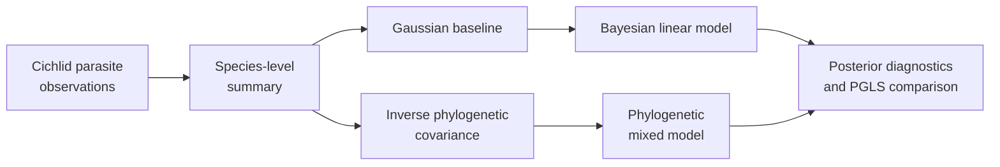

# PCM4: Cichlid Bayesian Linear And Phylogenetic Mixed Models

PCM4 introduces posterior inference and phylogenetic random effects through a
cichlid parasite study. It connects observation-level records to a
species-level analysis, compares a Gaussian baseline with Bayesian fits, and
uses the inverse phylogenetic covariance in an `MCMCglmm` model.



## Scientific Questions

- Does the parasite response retain the baseline predictor relationship after
  posterior uncertainty is represented?
- How much variation is assigned to the phylogenetic random effect?
- Are fixed-effect estimates and uncertainty coherent with the Brownian PGLS
  comparator?
- Do chain diagnostics support interpretation of posterior summaries?

The inverse covariance is not an implementation detail: taxon order,
rootedness, branch lengths, and alignment with the species table determine the
random-effect structure.

## Model Components

The central phylogenetic mixed model can be read as:

```text
y = X beta + Z u_phylogeny + epsilon
u_phylogeny ~ Normal(0, sigma_phylogeny^2 A)
epsilon     ~ Normal(0, sigma_residual^2 I)
```

`A` is the tree-derived covariance in the aligned species order. The source
workflow supplies its inverse to `MCMCglmm`. A valid comparison must therefore
align not only fixed-effect formulas but also covariance scaling, random-effect
levels, priors on variance components, observation aggregation, and posterior
summaries.

## Evidence Decomposition

| Bundle | Evaluated surface |
| --- | --- |
| `evidence-001` | data–tree alignment and species-level summarization |
| `evidence-002` | non-phylogenetic Gaussian baseline |
| `evidence-003` | Bayesian Gaussian chain diagnostics and summaries |
| `evidence-004` | inverse-tree construction and random-effect setup |
| `evidence-005` | phylogenetic mixed-model fixed-effect posterior |
| `evidence-006` | phylogenetic variance-component posterior |
| `evidence-007` | Brownian PGLS comparison |

All seven bundles are governed review units. Their posterior parity verdicts
are `not_comparable` because the central computation is still the external
`MCMCglmm` workflow and no governed comparison lane reproduces it. The locally
available PGLS comparator is useful evidence, but it is not a replacement
posterior.

## Current Verdict

All seven bundle manifests record `not_comparable`. This is the correct status
for the present execution boundary: source and data provenance are governed,
and nearby Gaussian and PGLS surfaces can be inspected, but no repository-owned
lane currently executes the reference posterior and compares aligned samples
or summaries.

The status must remain separate from data preparation quality. A verified
tree–table join or Brownian PGLS coefficient can support its own bounded claim
without causing fixed-effect, variance-component, or convergence claims from
the mixed model to match.

## Verdict And Follow-Through

| Axis | Current state | Consequence |
| --- | --- | --- |
| bundle verdict | all seven are `not_comparable` | no PCM4 bundle currently establishes posterior correspondence |
| source and input identity | governed | reviewers can identify the lecture, data, tree, workspace objects, and intended analysis |
| local adjacent capability | Gaussian and Brownian PGLS surfaces exist | these methods can support their own claims but cannot inherit `MCMCglmm` posterior claims |
| resolution work | open | a matched-prior, matched-parameterization posterior lane and adjudicated observations are still required |

The open item is a workflow state, not a sixth verdict value. Retain the
`not_comparable` verdict until the missing execution and comparison record
exists; do not rewrite it as “open,” “pending,” or “partially matched.”

## What Would Make The Posterior Comparable

A comparison must identify the exact source formula, family, link, fixed and
random terms, tree inverse, taxon order, covariance scaling, priors, chain
policy, monitored quantities, and summary transformations. It must execute the
reference and comparison surfaces, retain raw and normalized posterior
observations, define tolerances or distributional rules, and account for every
failed or excluded chain and parameter. Source reconstruction alone does not
satisfy this contract.

## Inputs And Provenance

The study carries `cichlid.csv`, `cichlidtree.nex`, and `fishdata.RData` with
a [dataset catalog](https://github.com/bijux/bijux-phylogenetics/blob/main/evidence-book/studies/cichlid-bayesian-linear-and-phylogenetic-mixed-models/datasets/README.md),
[source provenance](https://github.com/bijux/bijux-phylogenetics/blob/main/evidence-book/studies/cichlid-bayesian-linear-and-phylogenetic-mixed-models/provenance/README.md),
and [runtime/reference mapping](https://github.com/bijux/bijux-phylogenetics/blob/main/evidence-book/studies/cichlid-bayesian-linear-and-phylogenetic-mixed-models/reference/README.md).

## Posterior Review Contract

A usable posterior comparison needs the prior, family, link, chain length,
burn-in, thinning, seed policy, effective sample size, autocorrelation, and
convergence evidence. Point estimates alone cannot establish parity. Fixed
effects, phylogenetic variance, residual variance, and their credible intervals
must be compared under matching parameterization.

At least two independently initialized chains or an explicitly justified
alternative are needed to assess between-chain behavior. Effective sample size
and autocorrelation qualify each monitored quantity; a large retained row
count does not by itself demonstrate effective posterior information.

## Review Priorities

- Reconcile observation species with tree tips before aggregation.
- Record exactly how repeated records become a species-level table.
- Verify inverse-covariance taxon order and scaling.
- Keep the Gaussian baseline, Bayesian non-phylogenetic fit, and phylogenetic
  mixed model as distinct comparisons.
- Preserve posterior diagnostics with every reported summary.
- State that `MCMCglmm` remains the posterior computation owner.

See the [mixed-model evidence boundary](mixed-model-evidence-boundary.md) for
the current closure requirements. PCM5 extends the same system to count,
binary-style, and repeated-measure models.
