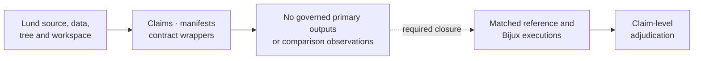

# PCM4 Mixed-Model Evidence Boundary

PCM4 uses a Bayesian mixed-model workflow whose decisive outputs are posterior
summaries, convergence diagnostics, and phylogenetic variance estimates. The
checked-in dossiers currently govern the claim map and source boundary; they do
not retain a completed reference-versus-Bijux comparison.

## Current Boundary By Record

| Record | Current state | Review consequence |
| --- | --- | --- |
| source program | preserved Lund PCM4 source with repository-owned provenance | the intended computation can be located and inspected |
| datasets | cichlid observations, tree, and workspace objects have governed identities | input provenance is available; derived workspace correctness is not implied |
| claim decomposition | seven claim IDs and evidence IDs are checked in | each analytical question has a stable review address |
| reference wrapper | writes source locators and the named source script | it records intent but does not invoke the posterior workflow |
| Python wrapper | `BUILD_SCRIPT = None`, `PRIMARY_OUTPUTS = []`, execution mode `bundle_contract_only` | no Bijux scientific result is produced by the bundle wrapper |
| results manifest | `governed_primary_output_count` is zero in all seven bundles | no coefficient, posterior, variance, chain, or PGLS output is governed here |
| bundle verdict | all seven are `not_comparable` | numerical correspondence has not been adjudicated |

## Claim Closure Matrix

| Bundle | Missing comparison evidence |
| --- | --- |
| `evidence-001` | aligned species table, tree-tip reconciliation observations, and comparison rule |
| `evidence-002` | Gaussian baseline coefficients, uncertainty, fit convention, and adjudication |
| `evidence-003` | retained chains, burn-in, autocorrelation, ESS, convergence, and comparable summaries |
| `evidence-004` | exact inverse covariance, taxon order, scaling, and structural comparison |
| `evidence-005` | aligned fixed-effect posterior draws or declared summaries under matched priors |
| `evidence-006` | phylogenetic and residual variance-component posteriors under matching parameterization |
| `evidence-007` | Brownian PGLS and posterior-model quantities with an explicit comparison rationale |

## Comparable Posterior Identity

A comparable run fixes:

- observation unit and species-level aggregation;
- taxon names, order, pruning, rootedness, branch lengths, and inverse
  covariance scaling;
- response, predictors, fixed and random terms, family, and link;
- fixed-effect and variance-component priors;
- chain count, initialization, seed, iterations, burn-in, thinning, and tuning;
- monitored parameters, transformation rules, and interval definitions;
- failed-chain, excluded-parameter, and missing-output denominators.

If one of these identities differs, the observation must classify the
difference before comparing values.

## Required Observation Ledger

Each claim needs rows that identify the bundle, parameter or structure,
reference value or distribution, Bijux value or distribution, comparison rule,
tolerance or distributional criterion, outcome, and mismatch reason. Posterior
claims additionally need chain-level diagnostics and retained-sample counts.

Missing execution produces `not_comparable`; it is not a numerical failure.
Completed execution with unexplained disagreement may justify
`mismatch_unexplained`. Agreement can justify `matched` or
`matched_with_tolerance` only after all eligible observations are adjudicated.

## Safe Present-Tense Claims

- PCM4 source material, datasets, claim decomposition, and provenance are
  checked in and reviewable.
- Seven governed bundles declare direct-parity intent and currently record
  `not_comparable`.
- Bijux contains adjacent native Gaussian, PGLS, Bayesian, and covariance
  capabilities, but these bundles do not establish their equivalence to the
  PCM4 `MCMCglmm` workflow.
- No PCM4 bundle currently retains a governed primary scientific output.

Do not describe the posterior, coefficient, variance-component, convergence,
or Brownian-comparator claims as reproduced until the missing execution and
observation ledgers exist.
