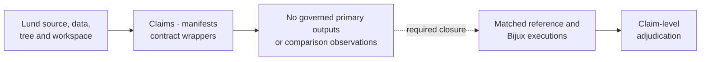
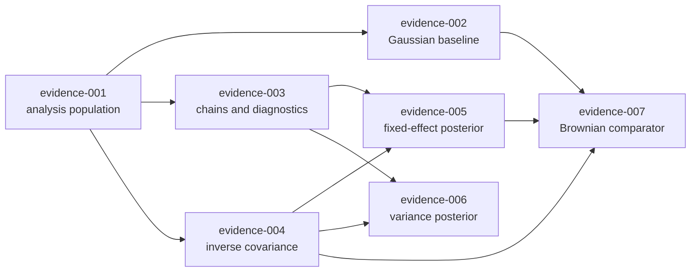
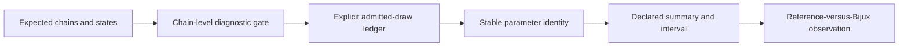

# PCM4 Mixed-Model Evidence Boundary

PCM4 uses a Bayesian mixed-model workflow whose decisive outputs are posterior
summaries, convergence diagnostics, and phylogenetic variance estimates. The
checked-in dossiers currently govern the claim map and source boundary; they do
not retain a completed reference-versus-Bijux comparison.

## What PCM4 Is Designed To Establish

PCM4 asks whether a Gaussian trait model can separate its population-level
effects from phylogenetic and residual variation while retaining a trustworthy
posterior. Its evidence roles are distinct:

| Evidence role | Required scientific object |
| --- | --- |
| establish the analysis population | reconciled cichlid observations, ordered tree tips, and exclusions |
| establish posterior usability | identified chains, retained draws, convergence, autocorrelation, and effective sample size |
| establish fixed-effect correspondence | aligned coefficient parameters under matched design and priors |
| establish variance correspondence | phylogenetic and residual components on explicitly matched scales |
| establish a comparator | Brownian PGLS quantities linked to the same population and covariance identity |

The current dossiers make these dependencies and absences reviewable. Their
evidentiary contribution is a claim-complete closure contract, not a posterior
result. Adjacent Bayesian or PGLS capability cannot satisfy a row until the
PCM4 population, priors, draws, and parameter identities are governed together.

### What Is Known Without A Posterior

The current record identifies the intended cichlid population, source model
sequence, formulas, tree-derived covariance role, priors and chain questions,
seven claim boundaries, and the primary outputs required to compare them.
Those facts make the missing computation precise and reproducible as future
work.

It does not establish that a chain mixed, a parameter existed, a coefficient
had a particular sign, or phylogeny explained any share of variance. Those
statements require governed posterior draws and diagnostics. A complete map of
missing evidence is stronger than an ambiguous claim of coverage, but it
remains a map rather than a numerical result.

## What The First Governed Posterior Must Prove

The first acceptable PCM4 execution cannot be only a posterior summary table.
It must join four independently reviewable objects:

1. the exact species-level population and ordered tree covariance;
2. the model identity, including fixed effects, random effects, family, priors,
   and covariance scaling;
3. every expected chain with terminal state, burn-in, retained draw keys, and
   parameter-specific diagnostics;
4. primary draws and summaries whose parameter keys and transforms align
   across the reference and Bijux records.

This packet could close one bounded Gaussian posterior claim while variance or
PGLS-comparator claims remain open. Evidence advances by closing a complete
dependency slice, not by collecting disconnected favorable means from several
claims.

## Current Boundary By Record

| Record | Current state | Review consequence |
| --- | --- | --- |
| source program | preserved Lund PCM4 source with repository-owned provenance | the intended computation can be located and inspected |
| datasets | cichlid observations, tree, and workspace objects have governed identities | input provenance is available; derived workspace correctness is not implied |
| claim decomposition | seven claim IDs and evidence IDs are checked in | each analytical question has a stable review address |
| reference wrapper | writes source locators and the named source script | it records intent but does not invoke the posterior workflow |
| Python wrapper | `BUILD_SCRIPT = None`, `PRIMARY_OUTPUTS = []`, execution mode `bundle_contract_only` | no Bijux scientific result is produced by the bundle wrapper |
| results manifest | `governed_primary_output_count` is zero in all seven bundles | no coefficient, posterior, variance, chain, or PGLS output is governed here |
| bundle verdict | all seven are `not_comparable` | numerical correspondence has not been adjudicated |

## Claim Closure Matrix

| Bundle | Missing comparison evidence |
| --- | --- |
| `evidence-001` | aligned species table, tree-tip reconciliation observations, and comparison rule |
| `evidence-002` | Gaussian baseline coefficients, uncertainty, fit convention, and adjudication |
| `evidence-003` | retained chains, burn-in, autocorrelation, ESS, convergence, and comparable summaries |
| `evidence-004` | exact inverse covariance, taxon order, scaling, and structural comparison |
| `evidence-005` | aligned fixed-effect posterior draws or declared summaries under matched priors |
| `evidence-006` | phylogenetic and residual variance-component posteriors under matching parameterization |
| `evidence-007` | Brownian PGLS and posterior-model quantities with an explicit comparison rationale |

## Closure Dependency Order

The claims do not close independently. Later numerical claims consume the
population, chain, and covariance identities established by earlier records:

A later bundle may retain its own verdict, but it cannot silently substitute a
different species population, tree order, chain set, or covariance scaling.
The dependency must be recorded by immutable artifact identities rather than
assumed from execution order.

## Comparable Posterior Identity

A comparable run fixes:

- observation unit and species-level aggregation;
- taxon names, order, pruning, rootedness, branch lengths, and inverse
  covariance scaling;
- response, predictors, fixed and random terms, family, and link;
- fixed-effect and variance-component priors;
- chain count, initialization, seed, iterations, burn-in, thinning, and tuning;
- monitored parameters, transformation rules, and interval definitions;
- failed-chain, excluded-parameter, and missing-output denominators.

If one of these identities differs, the observation must classify the
difference before comparing values.

## Build The Posterior Denominator Before Comparing Summaries

A posterior mean or interval is a projection of selected draws. The comparable
unit is therefore not the printed table row but an identified parameter over
an admissible draw population:

> **model × parameter × chain set × retained states × transform × summary rule**

| Denominator defect | Why a similar summary is insufficient |
| --- | --- |
| a chain is absent or silently discarded | the retained posterior population differs |
| burn-in, thinning, or terminal state differs | the draw indices do not represent the same sampling contract |
| a variance parameter is transformed on one side | labels may match while scale and distribution differ |
| non-finite or failed draws vanish from one summary | the eligible denominator and failure rate are hidden |
| intervals use different quantiles or highest-density rules | endpoints answer different summary questions |

The denominator ledger must be shared by fixed effects, variance components,
and any derived quantity that claims same-draw correspondence. Diagnostics can
exclude a declared population under a pre-registered rule; they cannot be used
after inspection to select whichever draws make summaries agree.

## Posterior Admission Is Parameter-Aware

A run-level “converged” flag is too coarse for PCM4. Fixed effects and variance
components can have materially different mixing, boundary behavior, and
effective sample sizes within the same chains.

| Admission layer | Evidence retained | Unsafe shortcut |
| --- | --- | --- |
| chain | initialization, seed, terminal state, iterations, burn-in, thinning, warnings | count only chains that produced a file |
| parameter | expected key, presence in every chain, finite states, scale, boundary state | infer availability from one summary table |
| mixing | autocorrelation, effective sample size, between-chain behavior, selected window | apply one global diagnostic result to every parameter |
| summary | admitted chain/draw keys, statistic, interval rule, transform | compare rounded means from differently admitted draws |
| claim | complete expected parameter and diagnostic denominator | omit a poorly mixing variance component while matching fixed effects |

Admission rules should be declared before comparing posterior summaries. A
parameter that fails its diagnostic rule remains present as failed or excluded
evidence with its denominator; it must not disappear from the bundle because
another parameter mixes well.

## Required Observation Ledger

Each claim needs rows that identify the bundle, parameter or structure,
reference value or distribution, Bijux value or distribution, comparison rule,
tolerance or distributional criterion, outcome, and mismatch reason. Posterior
claims additionally need chain-level diagnostics and retained-sample counts.

Missing execution produces `not_comparable`; it is not a numerical failure.
Completed execution with unexplained disagreement may justify
`mismatch_unexplained`. Agreement can justify `matched` or
`matched_with_tolerance` only after all eligible observations are adjudicated.

## Distinguish Structural And Numerical Checks

| Check class | Examples | Failure meaning |
| --- | --- | --- |
| identity | source revision, dataset digest, tree digest, taxon order, formula, priors | the computations are not yet the same analytical claim |
| structural | matrix dimensions, parameter keys, chain membership, draw counts, finite-value policy | the comparison population is malformed or incomplete |
| diagnostic | effective sample size, autocorrelation, between-chain behavior | posterior summaries may not support scientific interpretation |
| numerical | coefficient difference, interval overlap rule, posterior-distance rule | comparable observations agree or disagree under a declared criterion |
| completeness | expected versus observed parameters, chains, and claim rows | the verdict denominator is complete or explicitly reduced |

Identity and structural failures are not tolerance failures. They keep the
affected observation `not_comparable` until the analytical objects align.
Numerical adjudication begins only after those gates pass, and completeness is
evaluated before a bundle-level matched verdict is allowed.

## Promote Primary Outputs By Provenance

Adding a path to `primary_output_paths` is the last step of evidence capture,
not the act that makes a file primary. Each promoted output must be generated
or losslessly normalized by a governed execution and remain linked to the
inputs, model, posterior selection, and diagnostics that determine its
meaning.

| Candidate output | Promotion requirement | Reject promotion when |
| --- | --- | --- |
| fixed-effect summary | parameter keys, transforms, retained chains/draws, interval rule, and parent trace resolve | only a copied or manually transcribed table exists |
| variance-component summary | component parameterization, covariance scale, same-draw denominator, and posterior samples resolve | labels align but scales or random effects do not |
| chain diagnostic table | chain identities, selected window, estimator, threshold, and failed-chain denominator resolve | diagnostics were recomputed from an unidentified subset |
| inverse covariance | tree digest, ordered taxa, construction rule, scaling, and numerical representation resolve | dimensions match but taxon order or scaling is unknown |
| Brownian comparator | fitted population, model and likelihood conventions, outputs, and comparison rationale resolve | a neighboring PGLS run is attached without analytical identity |

Promotion also requires inventory and checksum coverage plus an observation
ledger that uses the output. A complete unused file is retained supporting
material; it does not silently increase the scientific denominator or change
the bundle verdict.

## Safe Present-Tense Claims

- PCM4 source material, datasets, claim decomposition, and provenance are
  checked in and reviewable.
- Seven governed bundles declare direct-parity intent and currently record
  `not_comparable`.
- Bijux contains adjacent native Gaussian, PGLS, Bayesian, and covariance
  capabilities, but these bundles do not establish their equivalence to the
  PCM4 `MCMCglmm` workflow.
- No PCM4 bundle currently retains a governed primary scientific output.

Do not describe the posterior, coefficient, variance-component, convergence,
or Brownian-comparator claims as reproduced until the missing execution and
observation ledgers exist.
